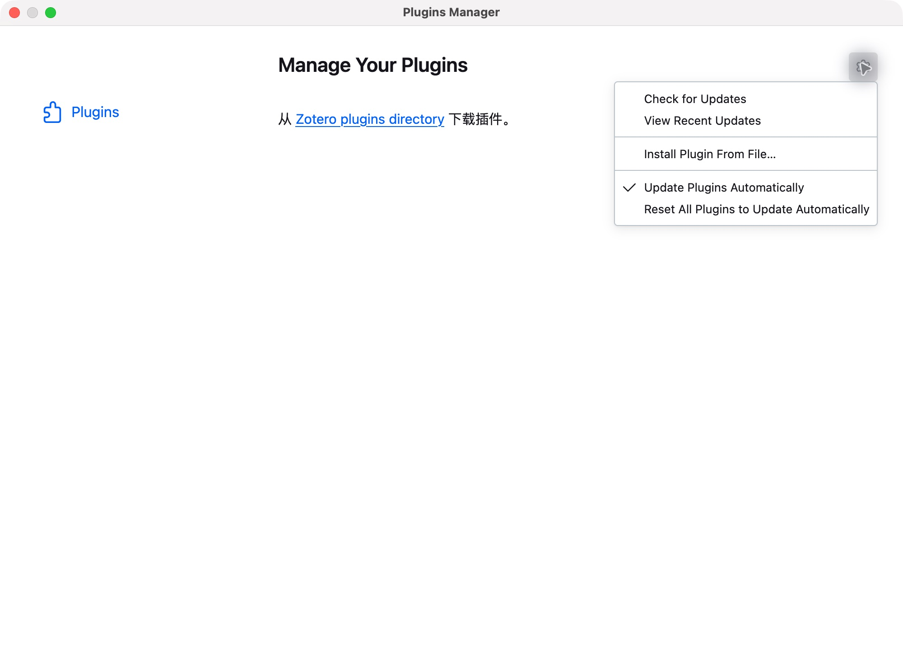

# 上手与安装

当前完整流程见 [Zotero 插件手册](manual/zotero-plugin.md#1-安装登录与第一篇论文)，浏览器使用见 [Web 手册](manual/web-workspace.md)。

1. 从 [Zotero 官方](https://www.zotero.org/download/)安装适合系统的正式 Zotero。
2. 从本仓库 [Releases](https://github.com/wdcpclover/ai4paper/releases/latest)下载 Assets 中的 `.xpi`，不要选 Source code ZIP。
3. Zotero→工具→插件→齿轮→Install Plugin From File…→选择 XPI，按提示安装/重启。
4. 再开插件详情核 Enabled 和版本，设置→AI4Paper→通用设置→账户与新手指引登录产品账号。
5. 用一篇公开 PDF 核题录/附件对应、正文可读，再开始 AI 功能。

本轮实装 Zotero 10.0.9/macOS + AI4Paper 10.0.31；官网适用范围、当前权益和其它系统差异见[核验说明](manual/verification.md)。

[中文手册](tutorials/README.md) · [排查安装问题](manual/troubleshooting.md)

<!-- 旧版章节锚点兼容 -->

