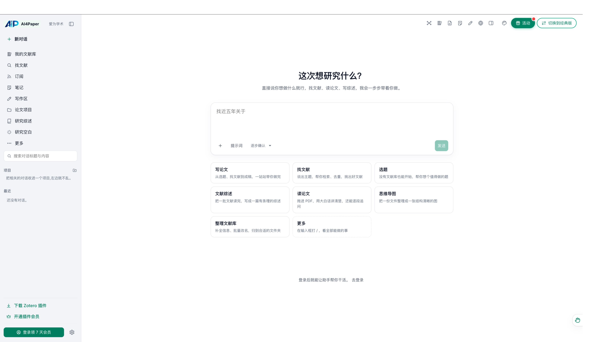
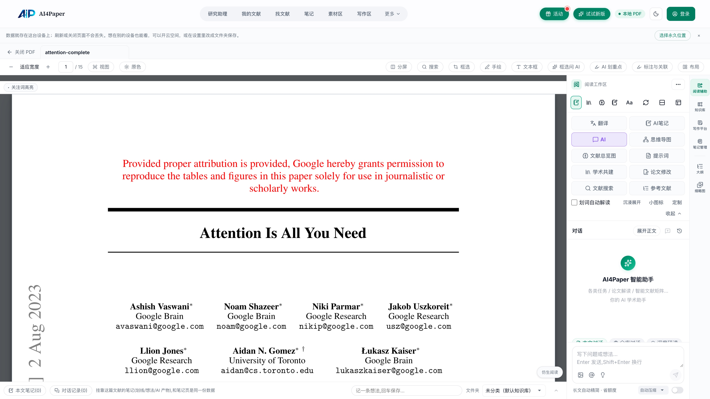

# 网页工作台使用手册

[手册首页](../tutorials/README.md) · [Zotero 插件手册](zotero-plugin.md) · [故障排查](troubleshooting.md) · [版本与核验范围](verification.md)

适用入口：[app.ai4paper.pro](https://app.ai4paper.pro/)。2026-11-26 核对的正式页面默认进入 `/agent` 研究助理首页，左侧是工具导航，右上角有「切换到经典版」。旧教程中的“顶部导航”指经典版；不要在新版左侧布局里反复找旧按钮。

## 先准备账号、资料和保存位置

用 Chrome 或 Edge 打开工作台。未登录可以查看界面和在本机试用部分文库功能；让研究助理执行任务、AI 生成和写作等需要产品账号，部分还受会员或余额限制。Google 或 Zotero 账号登录不等于 AI4Paper 登录。在左下角「登录」或页面「去登录」使用现有邮箱账号或微信扫码。权益、价格、可用设备数以本次账号页面为准。

同一个账号不等于所有端的本地文件自动互通。先在文献库位置/设置中确认资料放在哪里：

| 位置 | 保存与使用 | 换设备时检查 |
| --- | --- | --- |
| 这台设备的浏览器存储 | 适合公开样例短期练习；清除站点数据可能丢失 | 不会仅凭登录自动出现在另一浏览器 |
| 自己的文件夹 | 在支持文件夹访问的 Chrome/Edge 中选择并授权 | 仍需该目录与访问许可；普通本地路径不是云同步 |
| 云空间 | 登录后按当前方案保存和同步资料 | 核同一账号、空间和实际同步状态 |

在空库先导入一篇公开论文，例如 [Attention Is All You Need](https://arxiv.org/abs/1706.03762)。不要拿唯一一份重要论文或整个已有文库练习。

## 1. 从研究助理首页开始

**入口**：对话主页，或左侧「新对话」。

1. 在输入框说明问题、范围和希望得到的结果。例如：“找近五年关于课堂形成性评价的实证论文，先列候选和筛选理由，不直接入库。”
2. 用「添加」加入公开 PDF 或资料；用提示词挑选模板，修改后再发送。常用做法包括写论文、找文献、选题、文献综述、读论文、思维导图、整理文献库；输入 `/` 查看更多做法。
3. 保留「改动文献库前是否先确认」的逐步确认，先检查候选、任务范围和费用，再同意入库、下载或生成。
4. 通过上方「本任务的成果、我的文献、素材库、笔记、稿件、文献阅读」查看不同类型结果；左侧项目可归拢相关对话。

**结果**：对话、检索候选与后续成果各有对应位置。聊天中的建议不能代替已保存文献、已下载 PDF 或已生成稿件的回执。

**限制与修正**：未登录时会显示登录提示；只有题名不表示已取得全文。问题太大时先限定年代、领域和篇数，先审候选再扩展。

## 直接搜索文献

从左侧「找文献」打开检索。经典版在顶部导航也有「找文献」。

1. 输入论文题名、DOI 或主题关键词。第一次可用 *Attention Is All You Need* 检查能否找到已知论文。
2. 「AI 搜索文献」可按需开关或保留自动选择。在核对已知题名时，可以关掉扩展检索。查主题时可用「筛选」缩小候选范围。
3. 点击「找文献」。对照题名、作者、年份与来源，区分预印本和正式版。有用的结果可通过「保存到文件夹」入库，再检查条目是否附有正文。

本轮以公开论文题名查到同名记录。[核验记录](verification.md)

## 2. 建立文献库并导入

**入口**：左侧「我的文献库」→「导入文献」。

1. 选好保存位置。初次界面可提示「选择永久位置」。
2. 打开/拖入 PDF；有题录时导入 BibTeX、RIS、NBIB，或通过 DOI 列表等可用入口导入。需要 Zotero 数据时用「从 Zotero 导入」，按向导确认本机连接和范围，不把 Web 登录当作已连到 Zotero。
3. 在列表核标题、作者、年份、DOI 与附件。导入题录和取得 PDF 是两个步骤；只有题录的条目要补充原文。
4. 新建主题文件夹，把样例归入；用标签标阅读状态。顶部「全部、未读、在读、已读」切换范围；搜索支持标题、译名、作者或 DOI，可切换更广搜索字段。
5. 用排序、筛选、列配置调整视图。批量操作前核所选数量；回收站中的资料与正常列表分开。

**结果**：文献列表有题录，打开对应条目能找到正确 PDF；刷新后在原保存位置仍能看到样例，才算跑通保存。

**限制与修正**：换浏览器看不到资料时先核保存位置，不反复导入制造重复。目录权限失效时重新授权原目录；云空间则核账号和同步。不要通过清站点数据排查存储问题。

## 3. 打开阅读器，做一条可回查的笔记

**入口**：列表点标题→文献速览→「打开阅读器」。

1. 等正文解析，先用页码框跳页、搜索一个原文短语，确认文字层和题录对应。
2. 用缩放/适应宽度、阅读配色、布局选择专注阅读或阅读＋辅助；全屏用 Esc 退出。多篇通过标签切换。
3. 选一小段文字：点「译」看译文，点 AI 解读把段落送入对话；标注可选颜色、高亮、下划线或便笺。
4. 更多菜单可复制并带来源、摘录入笔记、存素材、加入提问、问研究助理或在本文中查找。单词/短语可加入生词本。
5. 「入笔记」后到本文笔记或笔记管理回看，检查原文、译文和页码。点击来源回到原页，人工核对术语、数字、否定词。

**结果**：一条能对应文献和原文位置的摘录，而非只有无出处的中文段落。

**限制与修正**：扫描图片可能选不中文字，框选可以把图表/公式区域送给支持图片的 AI；这不表示全文翻译自动支持所有扫描件。正文还没解析完先别生成，避免只读到标题。提示题录与正文疑似不一致时先换对 PDF。

## 4. 阅读辅助的功能怎么分工

右侧四区为「阅读辅助、知识库、写作平台、笔记管理」；功能格可通过「定制」显隐，窄窗口可沉浸展开。Web 的入口和保存位置以 Web 为准，不能直接照搬插件设置路径。

| 功能 | 怎么用与结果 | 前提、限制和排查 |
| --- | --- | --- |
| 翻译、连续翻译、同词追踪 | 选文字或粘贴→确认服务→翻译；连续翻译保留多段，单词加入生词本可复习 | 联网与可用服务；术语仍需核原文 |
| 本文 AI 对话 | 选当前论文→提问→按页码回查→存一轮/整段到笔记 | 单篇不要求先建知识库；先确认正文已解析 |
| 快捷提问、医学/临床模板 | 选模板→核问题与研究类型→发送 | 模板不提供医学决策；只辅助读研究设计和证据 |
| 多段加入提问、框选问 AI | 收集带页码段落或框选区域→补具体问题→发送 | 模型要支持图片；图表数值需人工核验 |
| 重新回答、编辑重发、换模型、继续回答 | 对某轮答案选对应动作，再核后续内容 | 重发可能替换后续对话；生成可能再次计量 |
| 简记、解读、精读/深度分析、大纲 | 选一篇→选深度→确认生成→AI 笔记查看 | AI/会员/额度，依据标题、摘要、全文的深度不同 |
| 思维导图、文献总览图 | 生成→缩放/查看源码或内容→核结构→导出 | 图中的关系是阅读线索，不是证明 |
| 全文翻译 | 确认文字层、输出模式和实时费用→提交→查任务状态与译文 | 仅支持当前服务方案；失败看原任务原因，不重复建任务 |
| AI 划重点 | 确认论文、维度、颜色→生成→回看高亮与批注 | 可能产生用量；不满意按本次批次撤销，区分手工标注 |
| AI 精细提取、图表公式 | 选相应面板→跳原页→核裁切内容→再存笔记 | 提取可能漏识别；公式和单位以原文为准 |
| 参考/施引文献、关联图谱 | 用已核 DOI 的论文作起点→看关系→审候选再入库 | 数据源可能不完整；引文关系不等于观点一致 |
| 目录书签、阅读统计、生词本 | 建定位点/查看统计/收词复习 | 阅读时长是行为记录，不代表理解程度 |
| 知识库 | 选资料范围→建立索引→提问→按来源回原文 | 多篇检索需要索引与相应服务；没命中不等于没有证据 |

已生成内容在 AI 笔记看，摘录与手写笔记在本文笔记/笔记管理看，对话在历史会话看；不要以“没有在当前标签看到”判断丢失。

## 5. 从素材到可编辑稿件

**入口**：左侧「更多」→素材区，以及「写作区」「论文项目」「研究综述」「研究空白」。经典版在顶部导航找同名入口。

1. 素材区从「找资料」或「已有资料」选择文献，也可从阅读器「存素材」带入原句和出处。先核来源，待核实材料保留待核实状态。
2. 对少量文献做逐篇简记、维度比较、研究空白、图谱与谱系，按主题编素材包；一键梳理后检查每个 `[n]` 对应材料。
3. 登录后在写作区新建稿件，写清题目。自由写作、写摘要、写方法、一键综述和整理文献各自有参数；确认标题/摘要/精读综述的取材深度，选引用样式、目标篇幅和维度。
4. AI 结果先审，再「插入正文」；不满意重新生成或丢弃。AI 帮写可续写、润色、扩写、精简或翻英文，对选中段落操作时先核范围。
5. 保存状态出现完成后切换稿件再回来确认。配引用先写清含明确论断的正文，检查候选是否真的支持句子；不能把检索结果当已核实证据。
6. 导出 Markdown 后打开文件；部分颜色、高亮、下划线不能完整映射到 Markdown。单篇引用导出在阅读器更多→工具箱→引用与导出，可选格式化引文、引用键、BibTeX/BibLaTeX、RIS、CSV，先预览字段。

**结果**：有来源材料、人工修订的稿件和可打开的导出文件。

**论文项目**：从研究主题、总纲、设计到章节写作逐步推进。只能用真实研究数据填写结果，模型生成的“示例数据”不能当实验结果。

**论文修改**：上传自己的 DOCX/PDF/TXT/Markdown 或粘贴正文→阅读→文献核验→综述修订→补缺口→整理导出；逐项接受修改，再与原稿核图表、公式和排版。仅查参考文献时用文献列表核验，未找到不代表一定不存在。

**汇报与图解**：工具箱中可用组会 PPT、海报式总结等入口；先审大纲/素材，再生成与导出。它们是配套输出，不改变论文真实性要求。

## 6. 订阅与其余工作区

「订阅」设置主题或期刊后先检查目标来源、频率和保存位置；新文题录入库不保证都有 PDF。「更多」中的综述筛选管理纳入/排除，阅读计划安排任务，白板组织关系，知识库做多篇提问，收件箱接收跨端资料，管理文献集中整理。云同步空间、成就、学术共建、产品动态和设置各按当前账号显示。

配置及第三方连接会影响哪些资料被发送或保存。先用公开样例检查；不要仅凭“同一账号”就开启所有导入或自动整理。

## 常见卡点

- 看到“去登录”：登录 AI4Paper 产品，不是重新注册 Google 或 Zotero。
- 有题录无正文：补充正确 PDF，等解析完成。
- AI 只概括了标题：核已解析的正文和取材深度，再重新生成。
- 换设备资料不见：核云空间/本机浏览器/文件夹三者，勿直接清数据或全量重导。
- 文档的顶部按钮找不到：你在新版侧栏布局；找同名左侧入口，或切换经典版。
- 输出中有来源号：逐个打开核对，编号本身不是真实性保证。

来源：[Web 快速上手](https://ai4paper.pro/docs/guide/web-start.html)、[文献库](https://ai4paper.pro/docs/guide/web-library.html)、[阅读与 AI](https://ai4paper.pro/docs/guide/web-reader-ai.html)、[写作与引用](https://ai4paper.pro/docs/guide/web-write.html)、[整篇论文流程](https://ai4paper.pro/docs/guide/web-paper-flow.html)。实际执行与未执行范围见[核验记录](verification.md)。
