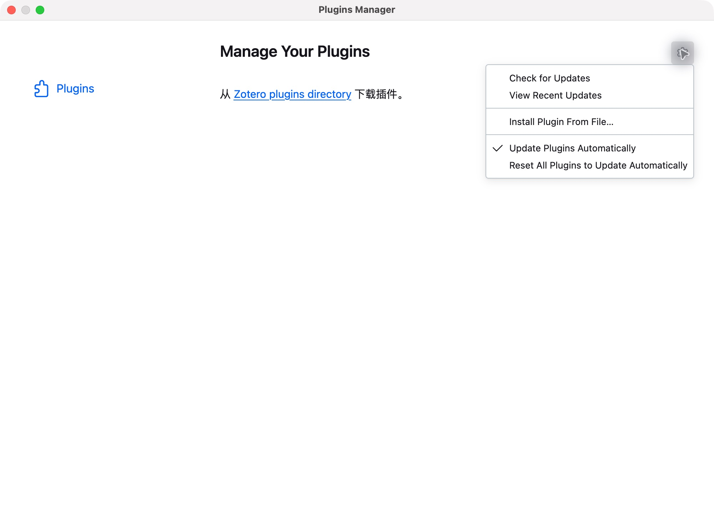
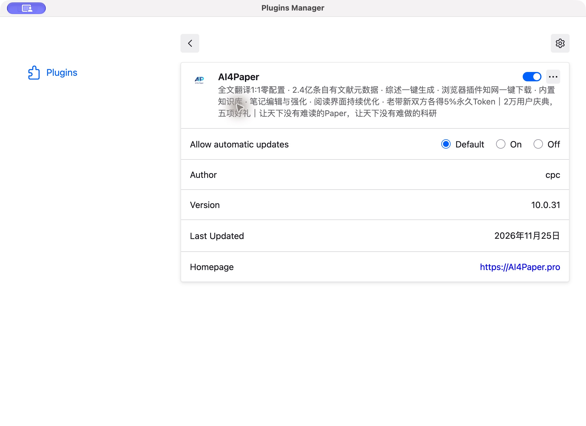
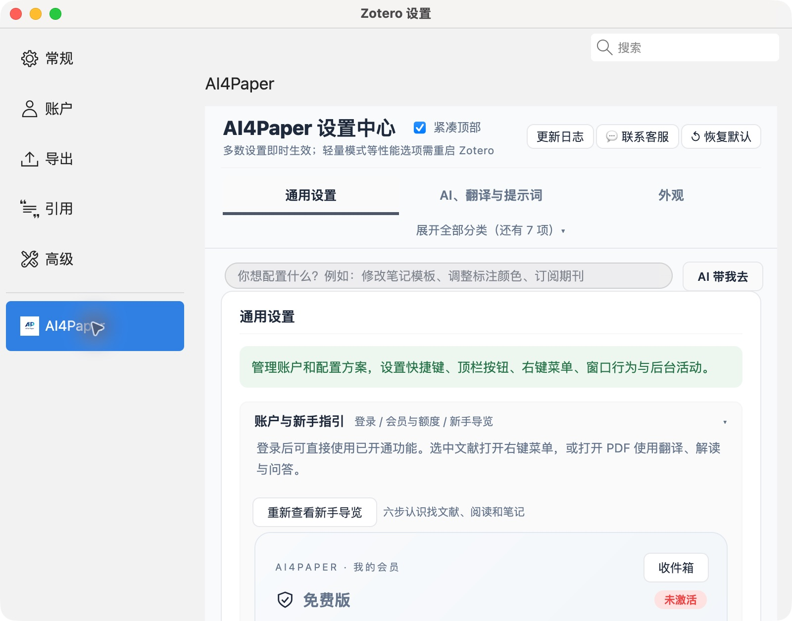
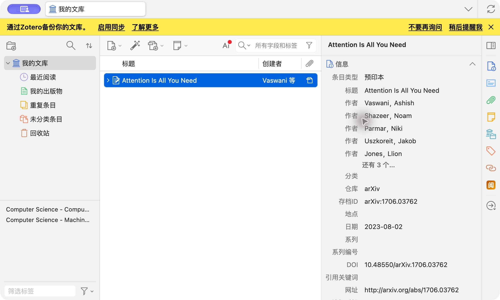
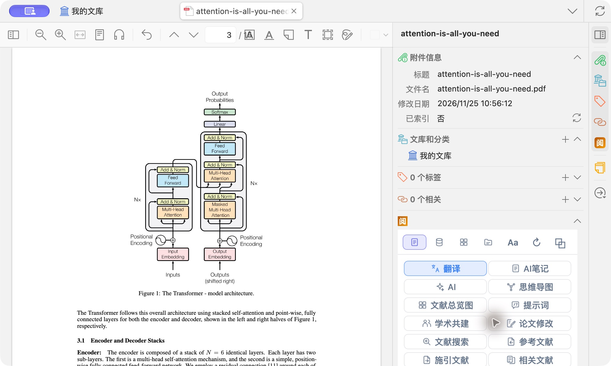
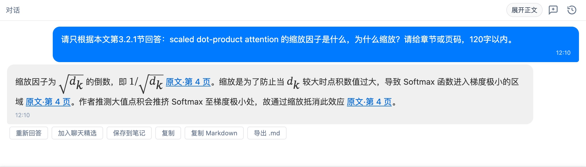
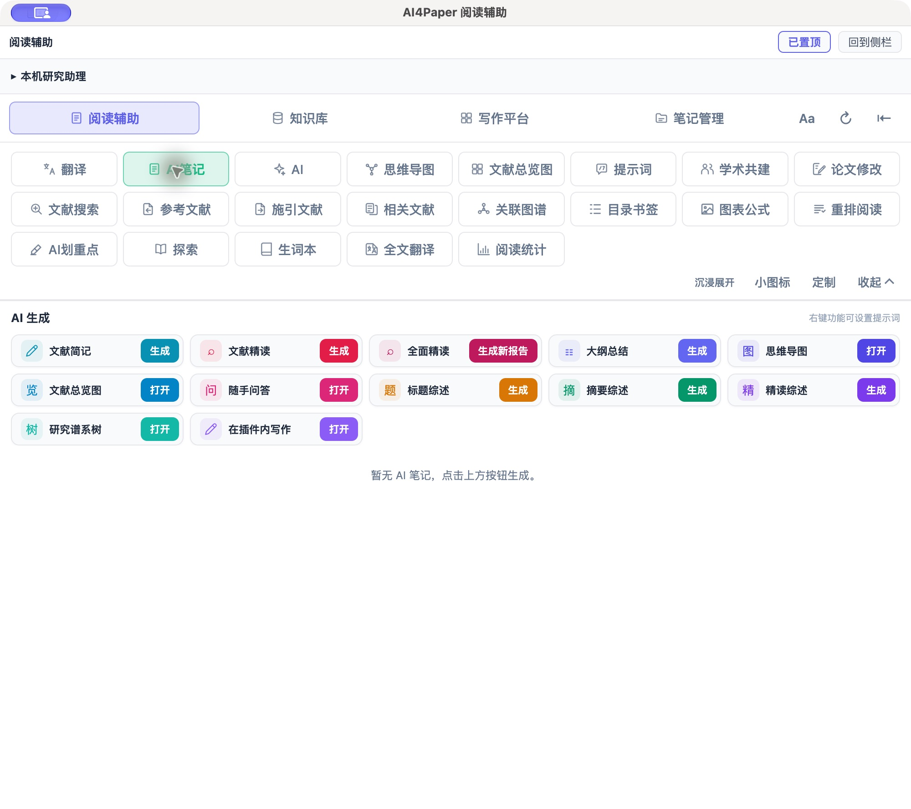
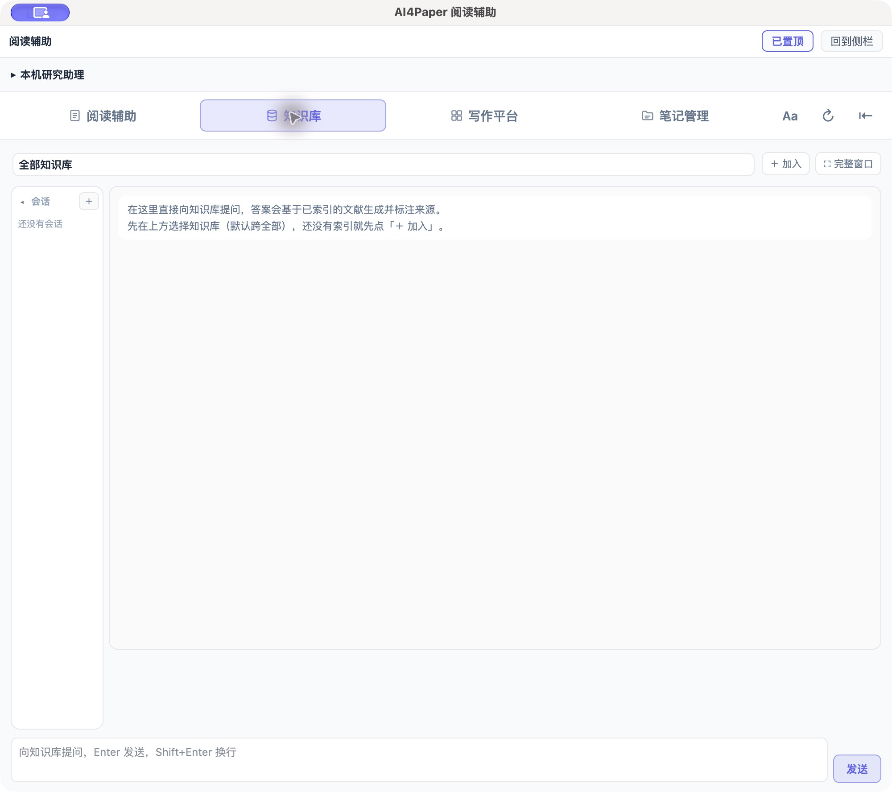
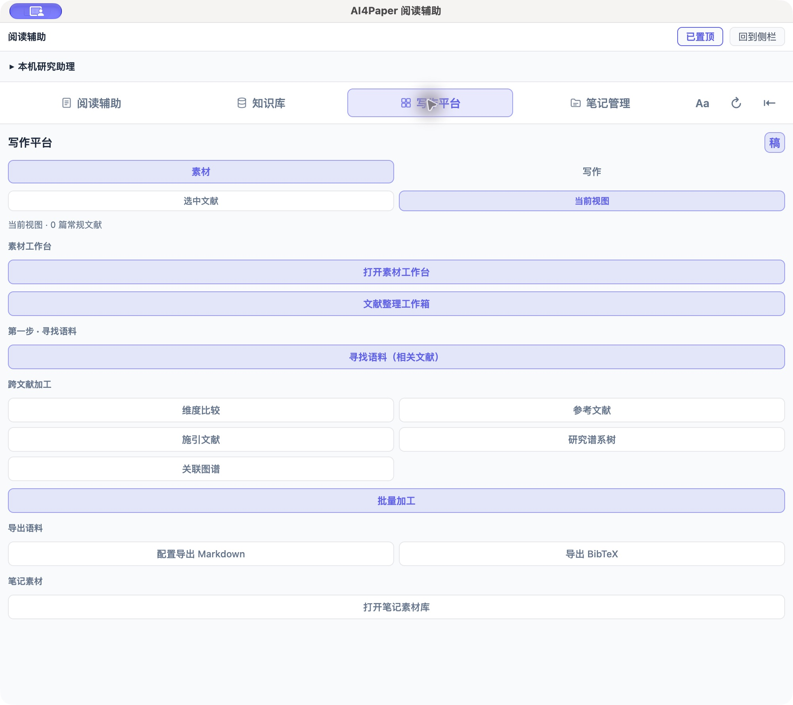
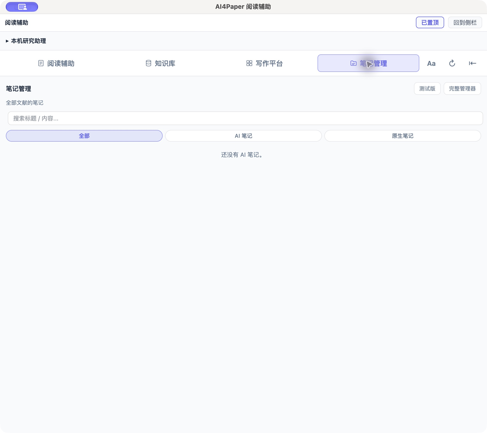

# Zotero 插件使用手册

[手册首页](../tutorials/README.md) · [Web 手册](web-workspace.md) · [全部功能与配置](plugin-feature-reference.md) · [故障排查](troubleshooting.md)

本次使用从 Zotero 官方下载的 **Zotero 10.0.9（macOS）** 和正式 **AI4Paper 10.0.31 XPI**。其他系统菜单可能不同；官网面向 Zotero 7 及更新版本，不能把一次 macOS 实测理解成所有系统和版本均已验收。具体测试与限制见[核验记录](verification.md)。

## 1. 安装、登录与第一篇论文

### 安装 XPI

1. 没有 Zotero，先到 [Zotero 官方下载页](https://www.zotero.org/download/)安装适合系统的正式版。Zotero Connector 是浏览器收文献扩展，不是 AI4Paper。
2. 到本仓库 [Releases](https://github.com/wdcpclover/ai4paper/releases/latest) 下载 AI4Paper `.xpi`。不要下载 Source code ZIP，也不要把任意 ZIP 改后缀当插件。
3. 在 Zotero 打开「工具→插件」。macOS 菜单在屏幕最上方，先让 Zotero 成为当前应用。
4. 点齿轮 **Tools for all plugins→Install Plugin From File…**，选择 XPI，按提示安装及重启。
5. 再开插件管理器，确认 AI4Paper 在 **Enabled**，点名称核版本。本次从空配置实际装到 10.0.31；无需复制别人的配置或令牌。

更新可在齿轮菜单 Check for Updates，也可安装正式新版 XPI。遇不兼容先核 Zotero 和 XPI 精确版本；不要关闭系统安全保护。

### 插件市场

在 Zotero 文库选择「工具 → 阅读宇宙应用」，也可以点击搜索框左边的「阅读宇宙应用」按钮，再在应用页左侧选「插件市场」。

1. **管理已装插件**。上半部分列出本机安装的插件。先看当前版本和是否有新版。支持管理的插件会显示更新、启用、停用或卸载按钮；卸载前读确认提示。缺少按钮时可回 Zotero 自带的「工具 → 插件」查看状态。
2. **挑选适合当前需要的插件**。下半部分是 Zotero 中文社区收录目录。输入名称、切换榜单或按用途筛选，点一项看作者、适配、发布信息和留言。看中某项，先确认它支持你正在用的 Zotero 版本。
3. **确认后安装或更新**。读清确认窗口里的插件名称和下载地址再继续，随后在已安装列表或 Zotero 插件管理器里复核版本和启用状态。市场由你逐次确认安装与更新。

安装阅读宇宙本身可按上方 XPI 步骤操作。了解通用的兼容与来源检查，可参考 [Zotero 中文社区的插件安装指南](https://zoterocn.org/guides/install-plugins)。

### 登录产品账号

macOS「Zotero→设置」、Windows/Linux「编辑→设置/首选项」→左侧 AI4Paper→通用设置→账户与新手指引→登录/注册。使用已有邮箱或微信扫码；登录后刷新账户状态，核会员和余额。**Zotero 同步账号与 AI4Paper 产品账号是两种账号**。

设置顶部分为通用设置、AI/翻译与提示词、外观，其余在「展开全部分类」中；搜索“你想配置什么”是辅助找入口。不要将账号邮箱、二维码、设备标识、密钥或 MCP 配置截图发到公开仓库。

### 导入一篇公开样例

1. 从 [arXiv](https://arxiv.org/abs/1706.03762)取得公开论文 PDF，先在本机打开确认下载完整。
2. 在新分类「公开演示」中添加文件或拖入 PDF；核能打开、页数正常、文字可选。
3. 只有独立 PDF 附件时，右键用 Zotero 自带「检索元数据」，完成后核标题、作者、年份、DOI 与附件对应。也可创建上级条目并手工校对。
4. 点题录行再进入 AI/写作功能。独立附件不等于常规题录；本次实测独立附件时写作范围显示 0 篇，元数据检索完成后得到带 PDF 的预印本题录。

**成功标准**：一条题录下挂正确 PDF，双击可读；不是只看见一个文件名。自动识别可能认错版本，尤其预印本与正式版须人工区分。

## 2. 认识四个工作区和处理范围

文库选中一条常规文献，右侧「阅」分为 **阅读辅助、知识库、写作平台、笔记管理**。PDF 阅读器里同样有四区，并额外出现目录书签、图表公式等正文工具。

- 功能格的「图文」可显示名称，「定制」控制显隐；看不到按钮先核这里。
- `⧉` 把当前侧栏打开成独立窗口；「回到侧栏」收回。`Aa` 调面板大小，`↻` 重绘没刷出的内容。
- 条目右键处理单篇或选中多篇；分类右键默认可能处理整个分类。运行前核“选中文献/当前视图”和篇数。
- 「AI4Paper 工具箱…」汇集文献信息、附件、标签、引用导出等，可按名称搜索；它与写作平台的「文献整理工作箱」是两个窗口。
- 默认最低负载可能关闭可选模块。通用设置→插件功能设置，查看所需模块→应用→按提示重启；不要为了找一个按钮全开自动化。

## 3. 找文献、查期刊、持续追踪

### AI 速搜文献

**入口**：条目/分类右键→AI速搜文献，或阅→阅读辅助→文献搜索。

先写主题、年代、文献类型和需要的篇数→核 AI 扩展检索词→搜索→按标题、摘要和来源筛选→勾选所需结果→导入目标分类。分区、年份、引用量等只用来缩小候选，不能代替内容判断。

**结果**：目标分类新增可核对题录；下载全文须另核 PDF。没搜到时先放宽关键词，核同义词和时间范围，不据此宣布没有研究。

### 分区、影响因子、被引次数与筛选

设置→外观→期刊分区设置选择指标/颜色；列表与标签→文献列表显示列选择列，点列头排序。可显示 JCR、中科院、收录及学科榜单等；具体可用项见[功能参考](plugin-feature-reference.md)。工具箱可刷新指标和不同来源的被引数据。

筛选按年份、期刊、分区、标签、是否有 PDF/笔记/标注、状态、评分组合，核当前分类和过滤条件。空白可能是期刊名/ISSN 不匹配、年份或来源未覆盖，不能当作未收录证明。不同年份/来源的被引次数分开读，不相加。期刊数据以相应官方机构发布为准，投稿时核学科与年份。

### 参考文献、施引文献和研究追踪

阅→参考文献向前找来源，施引文献向后找后续，相关文献找相近主题，关联图谱查看关系。先核起点 DOI→加载列表→搜索/筛选→人工校对候选→选择入库。网络缺边不代表没有引用。

持续追踪先建独立分类→分类右键工具箱搜索“期刊/领域追踪”→手动指定期刊或描述领域让 AI 推荐→核名单、时间范围和导入分类→确认创建→后续更新当前或全部追踪。可以编辑、停止/删除追踪；删除追踪前核是否仅停止任务。订阅入库可拉取新文或找回已入库文献。收到题录不保证附件到位；不要把每次全量重新导入当更新。

配套浏览器扩展可在学术网页看期刊徽章、“本页”批量挑文献、搜索和看保存进度，也可协助全文获取。需另装扩展、按提示连接/登录同一产品账号，不能用 Zotero Connector 代替；只使用有权访问的全文。[官方扩展教程](https://ai4paper.pro/docs/features/browser-extension.html)。

## 4. 阅读：先定位原文，再调用 AI

### 划词翻译、解读、生词和同词追踪

打开能选文字的 PDF→选一小段→在浮窗翻译/解读，或阅→翻译查看原文译文。可直接粘贴文字；按需开连续翻译、划词弹窗、同词追踪，选单词后加入生词本。将译文加入笔记后核原文与页码。

翻译服务在 AI、翻译与提示词→翻译方式/翻译服务设置选；AI 翻译与默认翻译通道不是同一种计量。默认通道也可能要求有效试用/会员；不要把“不扣 AI 余额”写成所有账号免费无限用。第三方服务需自己的可用配置，全文翻译另有服务限制。

若不出现浮窗，先核文字层、划词弹窗开关、模块与阅读器，扫描图片不能当可选文字。翻译失败保留服务名称、错误和短样例，不发密钥。词义仍以论文语境为准。

### 本文对话、全库对话、深度研读、整本书阅读

阅→AI：本文对话围绕当前正文；全库对话可用 `@` 引用知识库/文献/笔记；深度研读在回答前查更多材料；整本书阅读用于长文，耗时和费用可能增加。输入明确问题，必要时附全文或图片；看过程与来源后保存到笔记或导出 Markdown。

**单篇本文对话不需要先建知识库。** 长文自动独立建库等策略会改变读取范围，先读当前提示。要跨多篇检索才考虑知识库。来源号或流畅答案不保证准确，核原页、表格和结论边界。未登录、余额/会员不足、正文未提取或服务错误应分别处理。

### 本轮公开论文问答：回答后回原文，再存笔记

2026-11-26，在独立演示配置登录后，实际对 *Attention Is All You Need* 发问：“请只根据本文第 3.2.1 节回答：scaled dot-product attention 的缩放因子是什么，为什么缩放？请给章节或页码，120 字以内。”界面确认附加了本文全文，回答给出 `1/√dₖ` 及避免点积过大使 softmax 进入梯度极小区域的解释。

点击回答中的“原文·第 4 页”，实际打开原 PDF 第 4 页；第 3.2.1 节的公式（1）和正文与上述解释相符。随后点本轮回答下的“保存到笔记”，界面显示“已保存／已保存到笔记”。只核这个具体问题，不据此承诺其它回答都正确。

这是单篇本文对话，不要求先建知识库；不等于已经执行全部精读报告、导图或跨库问答。截图只裁切真实结果区域，未公开账号、余额、任务标识或私有路径。

### 简记、精读、大纲、总览图、导图

阅→AI笔记选择文献简记、文献精读、全面精读/新报告、大纲总结、思维导图或总览图。先确认选中论文和服务，再生成；结果在 AI 笔记或相应面板回看，可按当前按钮存为原生笔记、复制或导出。导图核节点后导出 PNG/OPML，结构仍需人工修订。右键功能可调整提示词，修改前保留原方案。

标题综述只适合主题粗览；摘要综述依赖摘要；精读综述需要更多正文。不要把标题级结果称作已阅读全文。

### 重排、探索、预览、图表公式

重排阅读把正文转为单栏，可用逐段对照；探索集中看题名摘要、标注、笔记及引文；文库预览先看 PDF，阅读器图表公式面板集中列图、表、公式→点条目跳页→核原文→再存笔记/提问。解析可能漏段或把公式识错，原 PDF 始终是核对依据。

目录书签区分 PDF 目录与个人定位点；先核页码，再添加/导入目录或书签。阅读统计看本篇进度与记录，仪表盘看全库；时长不代表阅读质量。护眼配色在阅读器 **Aa/外观主题面板**，不必到插件设置寻找旧“护眼模式”。

### AI 划重点与人工标注

阅→AI划重点；多选两篇及以上可见批量卡→批量处理→AI 划重点；重排阅读也可点“划进 PDF…”。先确认范围、维度和颜色，再运行；逐条核关键句与批注。不满意从本次批次撤销，区分手工标注。额度不足或取消应看队列状态，不能反复点击生成。页边批注、注释筛选、关注词、划词颜色标签与附件版本切换属于阅读定制，见功能参考。

## 5. 全文 PDF 翻译

**前提**：正确 PDF 已完整下载，有可提取文字；可用 AI4Paper 账号服务及当前所需权益/余额；网络稳定。如已为其他功能另设翻译或 AI 服务，仍以全文翻译确认窗口显示的服务和费用为准。

1. 右键文献→全文翻译 PDF，或阅→全文翻译。
2. 核选中论文、页数、输出模式：双语对照通常为原文页和译文页交错，仅译文只输出译页。先读本次实时预估与计费提示，再确认。
3. 工作台中查看待处理队列；根据当前界面的开始/确认按钮启动。**进入队列与已开始运行是两种状态**。
4. 在排队、运行中、已完成、失败、已中止中查回原任务；关闭窗口不等于取消。需要停止，用原任务的中止按钮。
5. 完成后展开原题录，找 AI4Paper 生成的译文 PDF 附件；打开核页数、表格、公式和关键术语，保留原文。

**结果**：能打开的译文附件和已完成状态，而不是仅有“已提交”。换电脑还需要实际附件同步成功，不能只凭同一账号保证。

**排查**：无文字层先取得文本版或做合适的 OCR；余额/服务限制按实时提示；网络失败留错误与任务标识，在原任务按支持的继续/重试处理，先核已有产物和计费状态，避免重复任务。教程不固定承诺每页价格、耗时、免费篇数或版式完全一致。

## 6. 知识库：对一批材料提问

阅→知识库：选库→＋加入选中文献→核范围→建立索引→确认完成数量→提问→点来源定位条目/PDF/笔记。完整窗口管理库、索引、会话和来源；全部知识库是跨库范围，选中文献是临时小范围。先用两篇公开材料，问“各自的方法和局限是什么”，核每个来源。

完整 PDF、网页快照、题录摘要提供的证据深度不同；没有页码的快照不要编页码。建索引需要可用嵌入服务，与主 AI 对话服务分别核；修改/新增资料后检查增量更新。没有检索到不代表文献不存在；索引未完成先别反复建库。所用模型服务可能接收问题和材料片段，按资料权限选择服务。

## 7. 从文献材料到综述和稿件

阅→写作平台，先在“选中文献/当前视图”中核处理范围，再按以下顺序：

1. **素材**：打开素材工作台或文献整理工作箱，将文献、笔记和已有 AI 结果选入任务；通过寻找语料补候选，先审再收。
2. **加工**：维度比较按问题/理论/数据/方法/结果/局限建立对照；AI 表格先设字段与提取要求，再逐格核原文。研究 Gap、研究谱系树、关联图谱帮助梳理分歧与演进，不能自动证明“无人研究”。
3. **综述**：标题、摘要、精读综述按真实材料深度选择；专业综述/批量工作台先配置主题、范围、模型与输出，审候选与费用再运行。不要拿系统目标篇数当实际读到篇数。
4. **写作**：切“写作”或点“稿”，新建/继续稿件，选择已核素材，编辑后查保存状态；预览、复制 Markdown、插入引注、生成 PDF 等按界面执行。
5. **导出**：配置 Markdown 素材字段，或导出 BibTeX；打开文件核引文与附件链接。Word/WPS 中引用仍用 Zotero 的文字处理插件或当前支持的转换流程，不把纯文本标记当可更新的正式引文。

参考文献真假核验：粘贴列表→检查解析→逐条查题名/作者/年份/DOI→人工核对匹配→再入库。查不到是待核实，不是“假文献”的定论。论文修改先保留原稿，再逐项接受修订并对照版式。

## 8. 整理题录、附件、标签和分类

### 题录与中文资料

右键→AI4Paper 工具箱…，搜索刷新/识别元数据、元数据手工校错、翻译标题、中文资料、CSL 字段等。先选小范围→预览识别结果→人工核题名作者→锁定不应被刷新覆盖的字段→保存。元数据补全需当前有效权益；不扣 AI 额度不等于免费账号可用。

预印本转正式版先核真正对应关系，确认后更新题录，必要时用撤销入口恢复；附件版本仍要自己核。中文姓名拆分/合并、语言字段、CAJ、文件名解析及中文网页转换器只在对应资料上使用，不整库盲跑。引用需要的 CSL 扩展字段不要随意清空。

### 附件获取、匹配和归档

先区分存储副本与链接附件。工具箱可下载全文、挂载最近 PDF/CAJ、批量匹配本地目录、在下载目录查找、重新关联失联附件、在文件管理器显示、重命名或转存储副本。

每次先核目标题录和本地文件→预览匹配→打开确认是同一篇→再批量。自动归档并链接会移动文件到外部目录，链接附件不会自动享有与存储附件相同的跨设备文件同步；先备份和测试小样例。文件名规则在附件管理设置，元数据变化后自动改名、扫描导入和自动归档均是独立选项，按需开启。不要把“识别元数据”与“移动附件”混为一谈。

### 标签、列表和阅读顺序

少量主题分类＋阅读状态标签起步。工具箱本地规则打标签与 AI 自动标签是不同路径；AI 生成后检查标签再写入。可批量添加/改名/合并、复制/粘贴标签，清空标签只对确认范围操作。嵌套标签树/补全/标签列需启用对应可选模块。

分类可显示数量、彩色文件夹、收藏；列表可选评分、备注、作者、期刊指标、进度分布等列并存为视图组。分类内置顶/取消置顶、阅读顺序/上移下移只针对相应分类，核当前顺序再调整。筛选后批量操作仍先核所选篇数。

### 智能整理与文库体检

先备份，再在演示小分类扫描重复、空条目、孤立/失效附件和分类问题。分类体检可列缺 DOI、缺摘要、缺 PDF、未标注，扫描结果是候选而非删除指令。逐条比较题录、不同版本、批注和笔记后才合并/处理。缺 PDF、零引用或低影响因子本身不是应删除的理由。

未分类归类、合并同名文件夹先核目标与推荐范围；AI 推荐默认候选时自己勾选。删除、清空回收站、覆盖恢复可能无法撤销，不把“Zotero 有回收站”当所有操作均可恢复的保证。

## 9. 笔记、同步、备份和外部工具

**笔记**：阅→笔记管理，按标题/内容搜索并切全部/AI/原生；完整管理器用于编辑、转换、导出、批量处理。AI 笔记转原生笔记后检查来源和公式；模板与自动笔记在阅读与笔记设置。测试版笔记入口是可选项，未开启不等于旧笔记丢失。

**导出/同步**：Markdown、Obsidian 和第三方笔记平台按对应入口配置。Notion 等连接在笔记管理同步面板；需要自己授权目标空间，先一条公开笔记核方向、目标和重复行为，再批量。导出文件不等于已完成双向同步。

**三类数据分开核**：Zotero 题录与附件同步；AI4Paper 插件研究数据/设置备份与自建同步；AI4Paper 云空间的文献与文件。设置→同步与备份查看当前路径、状态、设备和任务，不凭一个云图标推断全部成功。

本机配置备份/导入、研究数据备份、云空间存取设置、Chartero 阅读记录或其他插件配置导入，都先预览范围并保留恢复点。换机前在原机确认数据完整、完成备份，在目标机先核空环境与保存位置，再导入。遇冲突保留副本和版本信息，勿反复选择版本、重置同步或清空云端试错。

**MCP/外部助手**：设置→文献联动→外部 AI 工具连接→MCP 设置，核运行状态、认证、只读/写入范围；复制适合客户端的配置到自己授权的工具，先测试只读列出公开演示文献。MCP 需当前有效权益；默认不扣 AI4Paper 额度不等于所有调用无成本，外部 AI 仍按自己的方案处理材料。保留认证，不在教程或截图展示令牌；不要为了接入开放到公网。写入和启动付费 AI 任务另有许可/确认，应按当前界面逐项同意。本手册未替读者启用连接或写入。

**账号、订阅与共建**：顶栏阅读宇宙应用中的概览、模型与用量、我的期刊订阅、期刊/投稿经验、学术共建、荣誉墙、消息更新、帮助；设置内建议池、徽章、收件箱和配置方案分享，均使用产品账号。投稿经验是用户信息，需核时间与来源；反馈只提供匿名错误和版本，不上传客户文库。

## 10. 定制、快捷键与减负

通用设置管理插件功能、配置方案、右键菜单、快捷键、顶栏和窗口；外观管理主题/大小/配色/样式；列表与标签管理列、视图组、标签树和进度；阅读与笔记管理浮窗、笔记模板和阅读行为。先改一项→应用→按提示重启→核期望入口，避免同时开大量后台自动化。

快捷键在设置里查或自定义，系统/插件冲突时回到该窗口检查，不从旧教程照抄固定键位。恢复默认只按当前界面说明选择范围，先备份配置。242 条随包功能与配置逐项入口、前提和使用检查见[全部功能参考](plugin-feature-reference.md)。

来源：[正式发布](https://github.com/wdcpclover/ai4paper/releases/tag/plugin-v10.0.31)、[官网安装](https://ai4paper.pro/docs/guide/install.html)、[功能索引](https://ai4paper.pro/docs/features/plugin-function-index.html)、[阅读侧栏](https://ai4paper.pro/docs/features/reader-toolbar.html)、[设置](https://ai4paper.pro/docs/guide/ai-setup.html)。详细链接见各专题与功能参考；不以文档列出替代实际账号运行结果。
