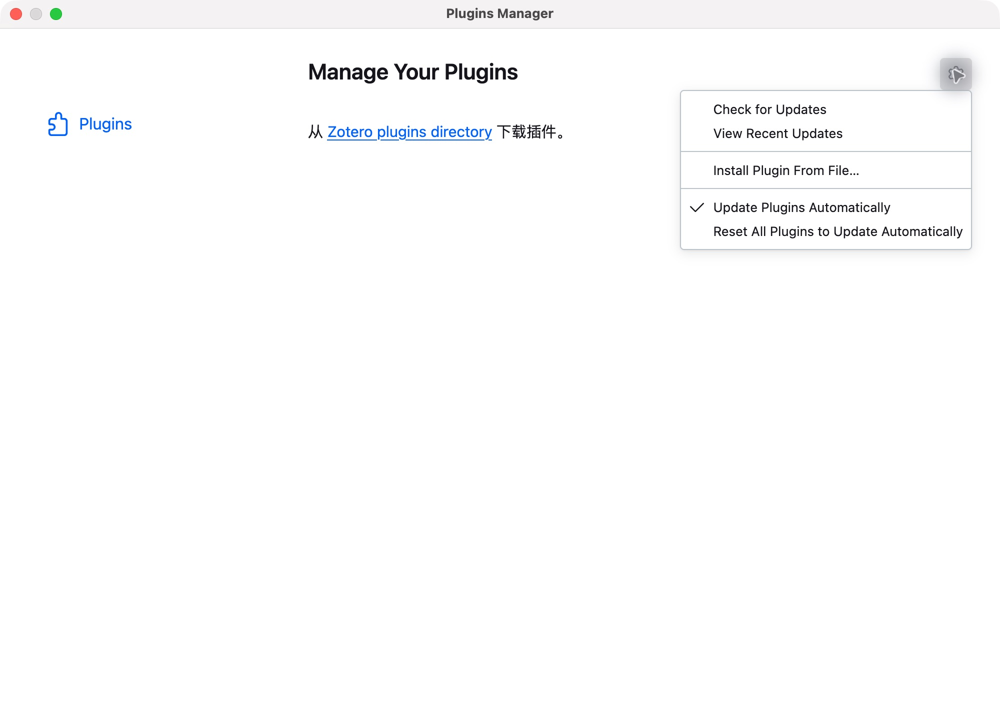

# 安装并登录，先跑通一篇文献

[中文手册首页](../README.md) · [Zotero 完整手册](../../manual/zotero-plugin.md) · [Web 完整手册](../../manual/web-workspace.md)

2026-11-26 修订。当前步骤按正式 Web、AI4Paper 10.0.31 与官网核对；本轮实际执行范围见[版本与核验](../../manual/verification.md)，未执行项目不写成成功案例。

## 你要解决什么

安装与登录。先完成一个小范围练习，再扩大到真实资料。

## 前提

已安装 Zotero；正式 XPI；现有产品账号。

## 操作步骤

1. 到 [Zotero 官方下载页](https://www.zotero.org/download/)安装正式 Zotero，再从[插件正式发布页](https://github.com/wdcpclover/ai4paper/releases/latest)的 Assets 下载 `.xpi`。
2. Zotero→工具→插件→齿轮→Install Plugin From File…，选 XPI；按提示安装/重启。
3. 再开插件详情，核 Enabled 和精确版本。设置→AI4Paper→账户与新手指引→登录/注册，核账户状态。
4. 添加公开 PDF，检索/创建上级题录，确认元数据与附件对应并能打开。

## Web 与插件入口分别看

Web 无需 XPI：打开 app.ai4paper.pro，用 AI4Paper 产品账号登录，先核文献保存位置。

安装后，可在 Zotero「工具 → 阅读宇宙应用」的左侧打开[插件市场](../../manual/zotero-plugin.md#插件市场)，查看已装插件和社区插件目录。一般 Zotero 插件的来源与兼容检查见[社区安装指南](https://zoterocn.org/guides/install-plugins)。

## 结果与检查

插件已启用、产品登录状态明确、样例能读。

## 常见问题

不要双击 XPI、下载源码 ZIP 或把 Google/Zotero 登录当产品登录。

## 相关教程

- [两端主手册](../README.md)
- [插件全部功能与配置](../../manual/plugin-feature-reference.md)
- [故障排查](../../manual/troubleshooting.md)

<!-- 兼容旧版章节链接；最新操作见本页正文。 -->

