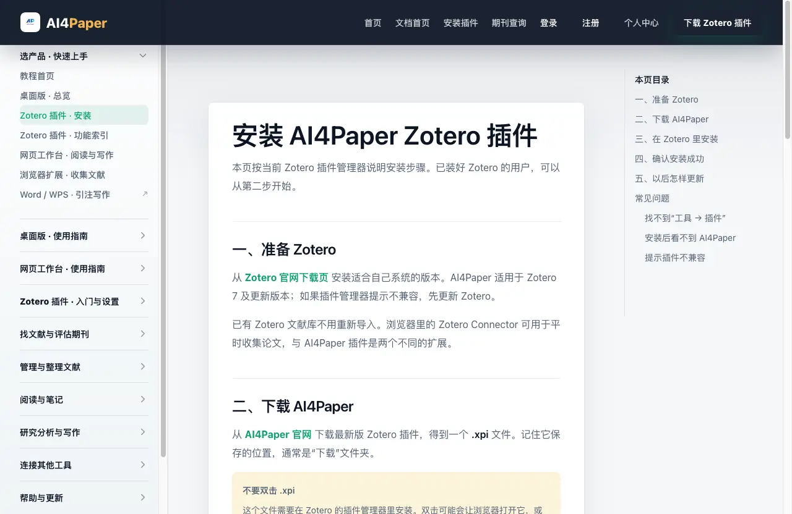
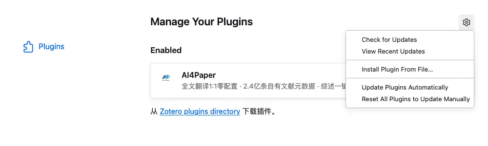
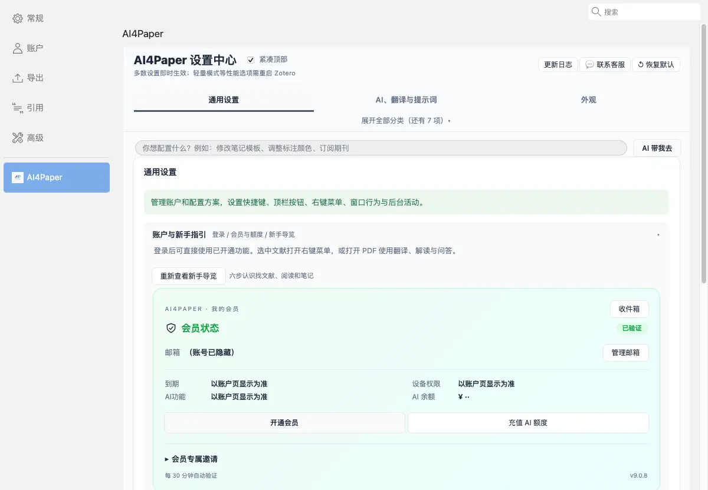
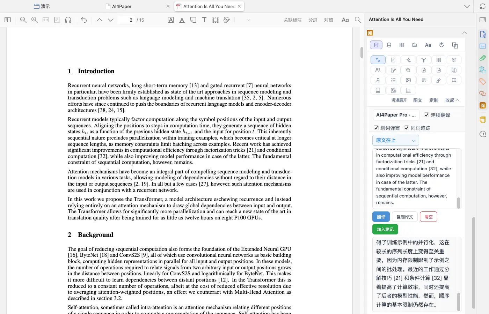
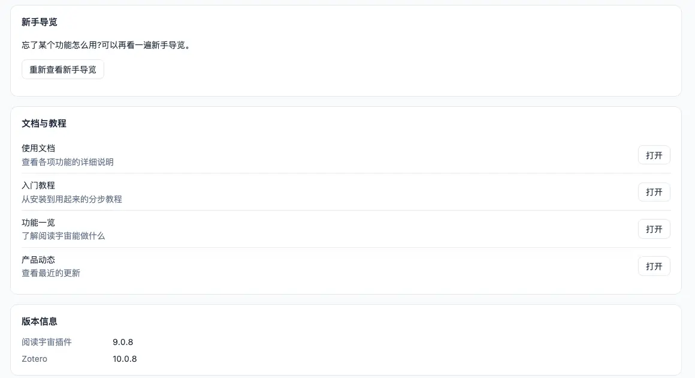

# 安装并登录，先跑通一篇文献

> 适用:Zotero 7 及以上；具体以应用内提示为准 · 部分步骤已在真机核对,其余已标注「未实测」

> 资料核对日期：2026-11-11。第 1、4、5 步已在真机上走通；第 2、3 步核对了入口位置，但「从文件安装」和「输入账号登录」这两个动作本身未实测。具体入口、可用功能与使用条件以当前应用内提示为准。

## 你要解决什么

第一次使用时，先完成安装、登录和一篇文献的阅读检查，再决定要不要开启更多功能。这样遇到问题时，能分清是安装没有完成、账号没有登录，还是当前文献本身无法阅读。先用一篇可公开获取的论文练习，不必一开始就处理整个文库。网页版也能作为起点，想继续使用 Zotero 原有文库时再安装插件。

## 操作步骤

### 1. 确认 Zotero 版本并下载插件

官网安装教程写明适用于 Zotero 7 及更新版本；插件管理器提示不兼容时，先更新 Zotero。请从 AI4Paper 官网下载插件，得到一个 .xpi 文件，记住它保存在哪里（通常是“下载”文件夹）。不要双击 .xpi，也不要用来历不明的转存文件。

### 2. 在 Zotero 的插件管理器里从文件安装

打开 Zotero 菜单「工具 → 插件」，会弹出插件管理器（界面为英文 Plugins Manager）。点右上角齿轮，选「Install Plugin From File…」，再选中刚下载的 .xpi 文件。实测核对了这条菜单路径；安装动作本身未实测，请按屏幕提示完成并重启 Zotero，之后在 Enabled 列表里看到 AI4Paper 即表示已启用。

### 3. 在账户与新手指引里登录并确认状态

打开 Zotero「设置」，左侧选「AI4Paper」，在「通用设置」下找到「账户与新手指引」，点「登录 / 注册」按提示完成。登录后同一区域会显示会员状态、到期时间、可同时在线的设备数和 AI 余额。登录动作未实测（本次使用已登录的账号）；请自己输入账号信息，不把密码或登录凭据发给别人，练习时也不必立即购买服务。

### 4. 打开一篇可正常阅读的 PDF

在文库里双击一篇有 PDF 附件的论文，确认原文能在 Zotero 阅读器中打开。打开后，右侧栏的「阅」就是 AI4Paper 的阅读辅助入口，翻译、AI 对话、笔记等都从这里进入。若原文打不开，先处理附件问题；若某项功能提示需要会员或额度，按账号页面核对，不要把两类问题混在一起反复安装。

### 5. 在帮助中核对下一步

点 Zotero「工具」菜单里的「阅读宇宙应用」（或文库工具栏搜索框左侧的按钮）打开应用页，左侧选「帮助」。这里有联系客服、「重新查看新手导览」，以及使用文档、入门教程、功能一览和产品动态（点「打开」会在浏览器中打开官网对应页面），页面底部还显示插件和 Zotero 的版本号。求助时附上这两个版本号，比只说“不能用”更容易说明情况。

## 常见问题

### 装好后没有看到阅读功能怎么办？

先完全退出并重新打开 Zotero，再到「工具 → 插件」确认 AI4Paper 在 Enabled 列表中、开关是打开的。仍找不到某个入口时，打开应用页的「功能地图」搜一下功能名，它会告诉你入口在哪里。

### 试用、会员和额度怎么算？

以官网和账号页面当前显示为准。下载插件与使用具体功能是两件事，部分功能需要会员或按用量消耗额度，使用前先看屏幕说明，不依据本篇推断价格或承诺。

### 需要把原来的文库重新导入吗？

不需要。官网说明已有的 Zotero 文库不用重新导入，先在原有文库中用一篇论文检查即可。

## 相关教程

- [按任务认识界面，找到第一个入口](ui-tour.md)
- [选网页版还是 Zotero 插件](web-and-plugin.md)
- [先读懂关键段，再选择全文翻译](../03-read/translate-pdf.md)
