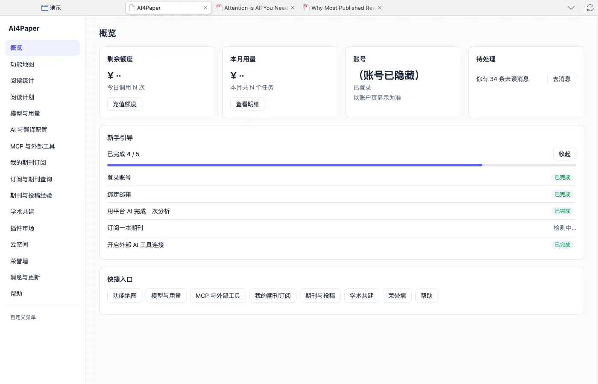
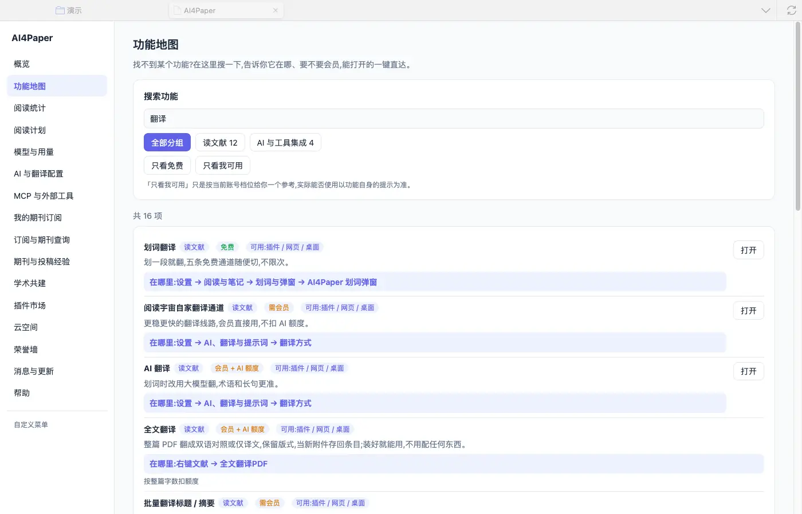
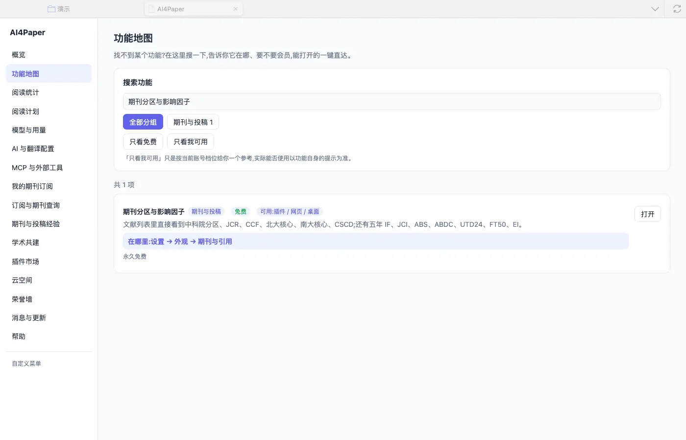
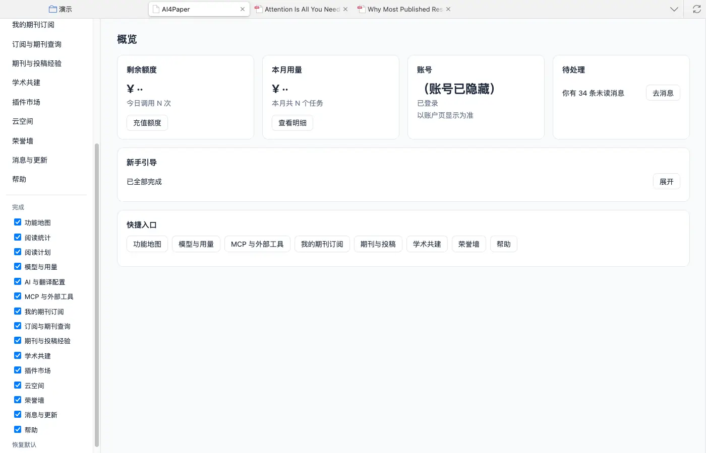
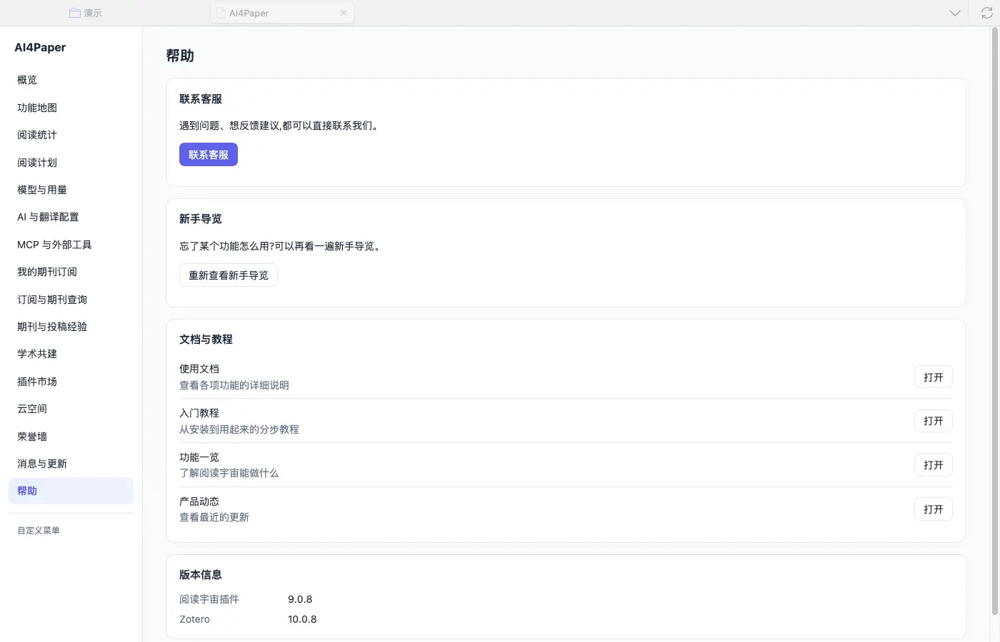

# 按任务认识界面，找到第一个入口

> 适用:Zotero 7 及以上；具体以应用内提示为准

> 资料核对日期：2026-11-11。本文操作已在真机上走通并配图；具体入口、可用功能与使用条件以当前应用内提示为准。

## 你要解决什么

认识界面不需要记住所有按钮。先说清自己现在想找论文、读论文，还是整理笔记，再去找对应入口。AI4Paper 的「应用页」集中了概览、功能地图和帮助：概览用于查看当前状态，功能地图用于找功能，帮助用于查说明。打开方式是 Zotero「工具」菜单里的「阅读宇宙应用」，或文库工具栏搜索框左侧的按钮。先把这三处看懂，比一次打开所有功能更容易形成自己的使用顺序。

## 操作步骤

### 1. 在概览确认当前账号状态

应用页默认打开「概览」，顶部四张卡片分别是剩余额度、本月用量、账号（是否已登录、有效期）和待处理（未读消息）；下方有新手引导进度和快捷入口。先看是否已登录，再看有没有需要自己处理的消息。金额或次数不清楚时点「查看明细」核对，不凭页面某个数字判断一项功能能否使用。

### 2. 用功能地图搜索一个具体目标

左侧选「功能地图」，在搜索框输入一个具体目标，例如只搜“翻译”或“笔记”。每条结果会标出所属分组、是否免费或需要会员与额度、可用在哪些端，以及「在哪里」。还可以按分组浏览，或勾选「只看免费」「只看我可用」缩小范围；页面也提醒，「只看我可用」只是参考，实际能否使用以功能自身的提示为准。

### 3. 按显示的位置打开所需功能

能直接打开的功能，卡片右侧有「打开」按钮；没有按钮时，就按「在哪里」写的路径去找，例如“右键文献 → 全文翻译PDF”。实测在「期刊分区与影响因子」一项点「打开」，直接弹出了期刊分区设置窗口。没有直达按钮不代表功能不存在，按路径操作即可。

### 4. 用自定义菜单收起暂时不用的入口

应用页左侧栏底部有「自定义菜单」。点开后，侧栏下方会列出全部入口的勾选框：取消勾选，对应入口就从侧栏收起；重新勾选即可恢复，也可以点「恢复默认」。调整完点「完成」。实测取消勾选一项后它从侧栏消失，重新勾选后恢复。练习时一次只调整一项，确认变化后再继续。

### 5. 从帮助回到教程与客服

左侧选「帮助」：最上面是「联系客服」，其次是「重新查看新手导览」，再往下是使用文档、入门教程、功能一览和产品动态（点「打开」会在浏览器中打开官网对应页面），最底部是插件与 Zotero 的版本信息。遇到不清楚的提示时，先保留原文，再查相应说明；需要求助时附上已脱敏的页面现象与版本号，不提交自己的完整文库。

## 常见问题

### 功能地图显示可用，打开却提示限制？

可用提示只用于帮助选择，实际使用条件以功能自身显示为准。检查账号状态和页面说明；不要把一个筛选选项当作使用权益已经确认。

### 能否把所有入口都显示出来？

可以，默认就是全部显示。初次使用建议只保留当前要做的任务，入口多少不是效率指标，找得到并能完成目标更重要。

### 我的界面和教程截图不一样？

先看帮助页底部的版本号，以及当前使用的是网页还是插件。界面不同时，以当前页面文字与帮助为准。

## 相关教程

- [安装并登录，先跑通一篇文献](install-and-login.md)
- [选网页版还是 Zotero 插件](web-and-plugin.md)
- [用清楚的问题找到第一批文献](../02-find/ai-quick-search.md)
