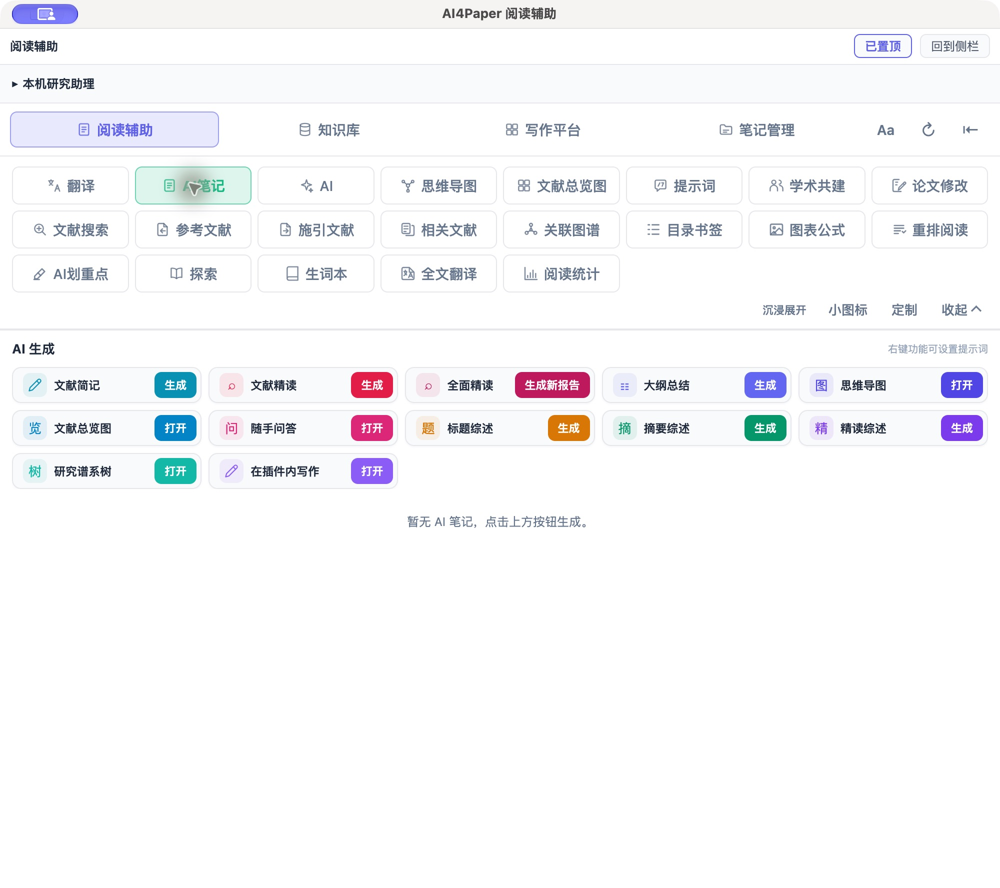

# 按任务认识界面，找到第一个入口

[中文手册首页](../README.md) · [Zotero 完整手册](../../manual/zotero-plugin.md) · [Web 完整手册](../../manual/web-workspace.md)

2026-11-26 修订。当前步骤按正式 Web、AI4Paper 10.0.31 与官网核对；本轮实际执行范围见[版本与核验](../../manual/verification.md)，未执行项目不写成成功案例。

## 你要解决什么

按任务认识界面。先完成一个小范围练习，再扩大到真实资料。

## 前提

已启用插件；选中一篇常规题录。

## 操作步骤

1. 在文库右侧找「阅」；打开 PDF 后同样有阅读工作区。
2. 切换阅读辅助、知识库、写作平台、笔记管理；图文显示可看按钮名称。
3. 阅读辅助→定制核功能显隐，⧉ 可打开独立窗口，↻ 重绘，Aa 调大小。
4. 右键条目/分类→AI4Paper 工具箱…搜索管理功能；批量前核范围和篇数。

## Web 与插件入口分别看

Web 默认是 /agent 研究助理侧栏布局；我的文献库、找文献、笔记、写作区在左侧，经典版有顶部导航。

## 结果与检查

能根据当前任务找到入口与输出位置。

## 常见问题

文库与 PDF、单篇与分类菜单不同；可选模块需在插件功能设置按需启用。

## 相关教程

- [两端主手册](../README.md)
- [插件全部功能与配置](../../manual/plugin-feature-reference.md)
- [故障排查](../../manual/troubleshooting.md)

<!-- 兼容旧版章节链接；最新操作见本页正文。 -->

