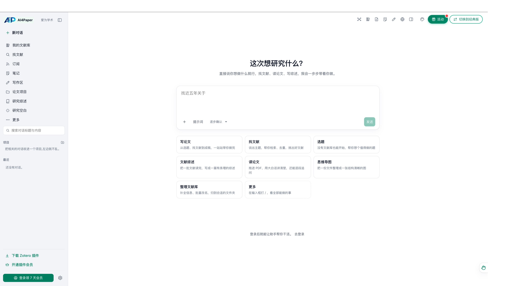

# 选网页版还是 Zotero 插件

[中文手册首页](../README.md) · [Zotero 完整手册](../../manual/zotero-plugin.md) · [Web 完整手册](../../manual/web-workspace.md)

2026-11-26 修订。当前步骤按正式 Web、AI4Paper 10.0.31 与官网核对；本轮实际执行范围见[版本与核验](../../manual/verification.md)，未执行项目不写成成功案例。

## 你要解决什么

选择 Web 或插件。先完成一个小范围练习，再扩大到真实资料。

## 前提

先确认论文放在浏览器、云空间还是 Zotero。

## 操作步骤

1. 本机 Zotero 文库优先用插件，保持题录与附件对应。
2. 临时浏览器使用 Web，先选资料保存位置，再导入公开样例。
3. 需要跨端先核账号、同步方向和实际完成状态，别反复导入同一批资料。

## Web 与插件入口分别看

Web 的文件夹/浏览器存储不是 Zotero 数据目录；同一账号不能代替附件同步。

## 结果与检查

选定适合当前资料位置的一端，能在原位置回看样例。

## 常见问题

各端功能与按钮不完全相同；浏览器扩展、桌面版和 Connector 分开安装。

## 相关教程

- [两端主手册](../README.md)
- [插件全部功能与配置](../../manual/plugin-feature-reference.md)
- [故障排查](../../manual/troubleshooting.md)

<!-- 兼容旧版章节链接；最新操作见本页正文。 -->

