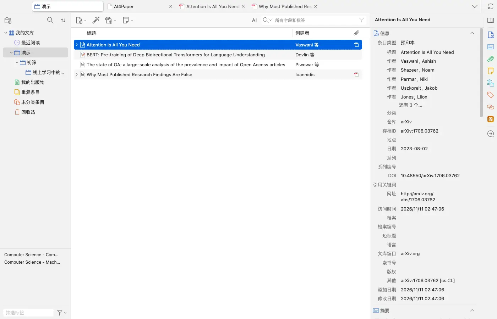
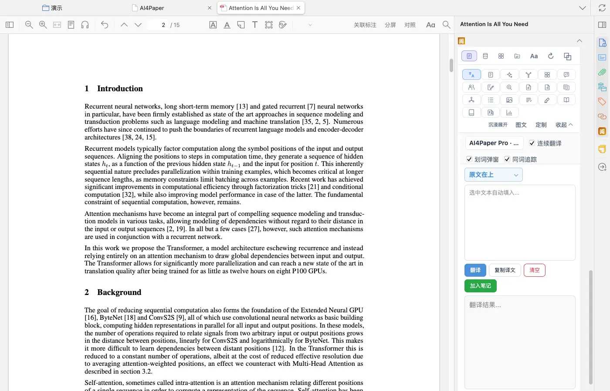
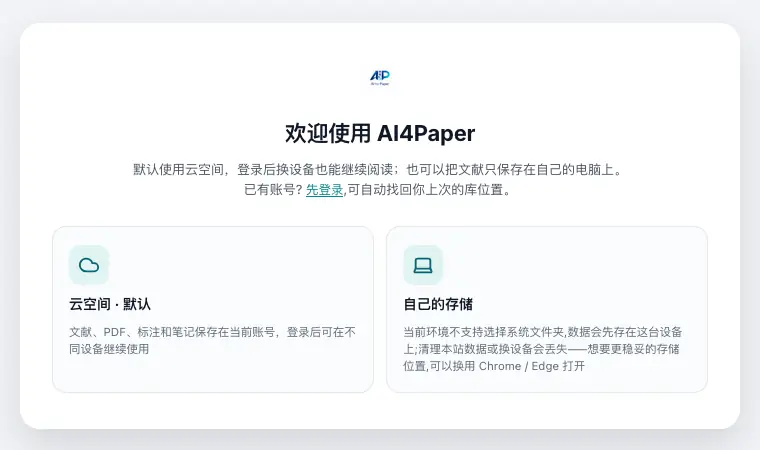
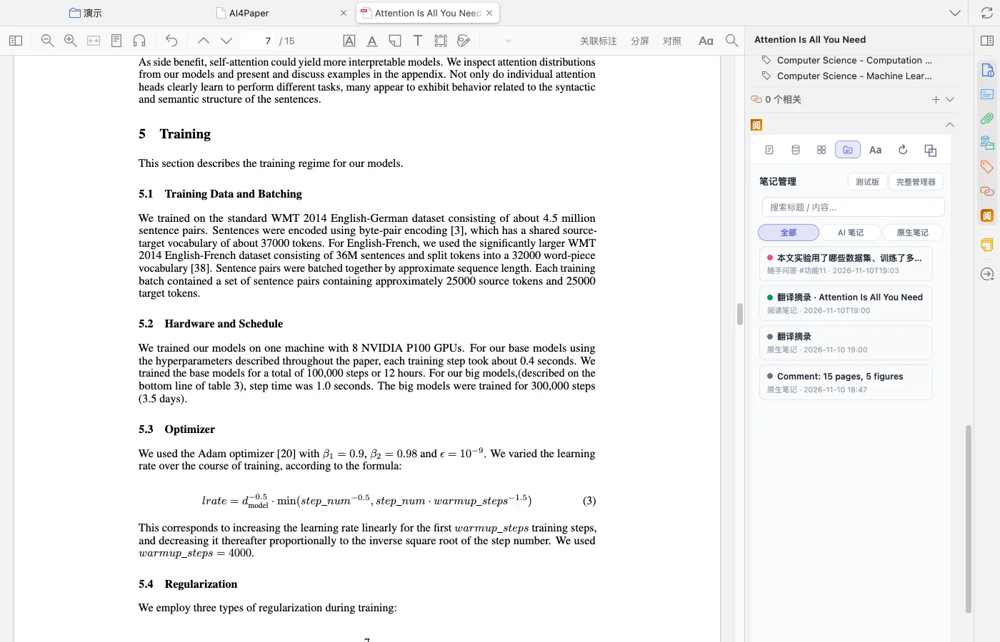
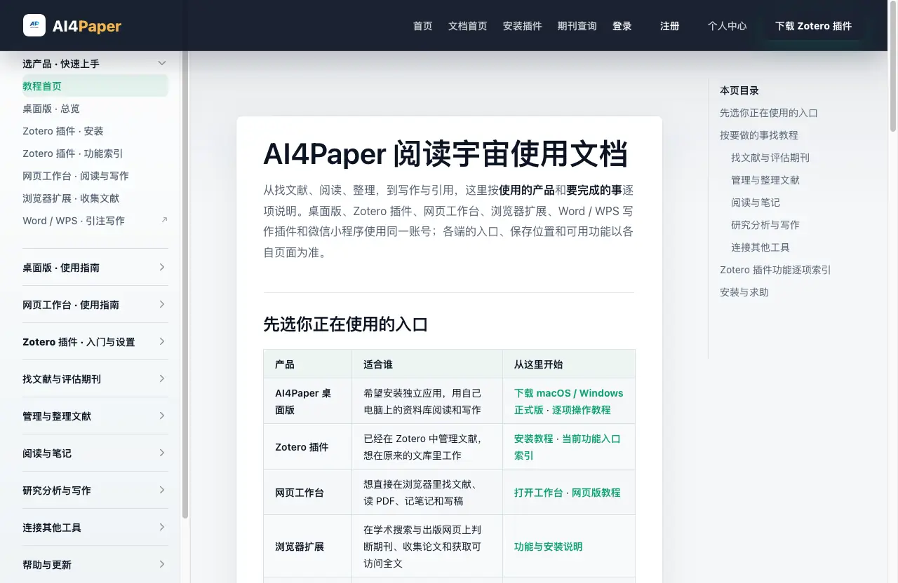

# 选网页版还是 Zotero 插件

> 适用:Zotero 7 及以上；具体以应用内提示为准 · 部分步骤已在真机核对,其余已标注「未实测」

> 资料核对日期：2026-11-11。第 1、2、4、5 步已在真机上走通；第 3 步只核对了网页工作台的首屏，登录后的操作未实测。具体入口、可用功能与使用条件以当前应用内提示为准。

## 你要解决什么

已经在 Zotero 里管理和阅读论文，可以先用插件；希望从浏览器开始研究任务，可以先用网页工作台。同一个账号能用于多种产品，但不代表每一端的按钮、功能和资料保存位置完全相同。选择时先看自己正在处理哪一份文献，以及结果要留在哪里，不必为了开始一次检索同时安装所有端。

## 操作步骤

### 1. 确定这次任务和文献所在位置

写下一个具体目标，例如读懂已有 PDF 的方法部分，或围绕一个主题寻找新文献。再确认材料现在位于 Zotero、网页工作台还是另一份文件中。只知道账号相同，并不能说明当前打开的就是同一份材料，尤其要核对题名、年份与附件。

### 2. 已有 Zotero 文库时先试插件

插件直接在原来的 Zotero 文库里工作：双击打开 PDF 后，右侧栏的「阅」提供翻译、AI 对话、思维导图、笔记等阅读辅助；右键文献还有随手问答、AI速搜文献、全文翻译 PDF、文献分析等入口。选一篇公开论文，从自己最需要的阅读环节开始，不把其他端的操作照搬成插件操作。

### 3. 希望直接开始时先试网页工作台

不安装 Zotero 也可以使用网页工作台：在官网使用文档里点「打开工作台」进入。首次打开会先请你选资料存放位置——「云空间」（默认，登录后换设备也能继续）或「自己的存储」（只存在这台电脑上），已有账号可以先登录找回上次的库位置。页面提示，想把资料存到自己选定的文件夹，建议用 Chrome 或 Edge 打开。本篇只核对了这一屏，登录后的文件加入方式与可用功能请当场阅读页面说明。

### 4. 用一份小材料核对结果保存位置

完成一次简短问答或翻译摘录后，确认它保存在哪里，并尝试重新打开。在插件里，打开 PDF 后进入右侧「阅」的笔记页，「笔记管理」会列出这篇文献的 AI 笔记（例如随手问答的记录）和原生笔记，点开即可查看。需要换端接着做时，再用同一篇文献检查能否看到预期结果；看不到先查说明，保留原始材料，避免把反复导入当作同步检查。

### 5. 确定长期习惯后再加其他工具

官网使用文档首页的「先选你正在使用的入口」列出了桌面版、Zotero 插件、网页工作台、浏览器扩展、Word / WPS 写作插件和微信小程序，并写明各自适合谁、从哪里开始。只有在遇到明确需求时再选择，安装与使用条件以对应页面为准。

## 常见问题

### 同一账号是否代表所有资料都会同步？

不能据此推断。官网文档写明，会员和 AI 额度随账号显示，但文献能否在另一台设备看到，取决于资料保存的位置和你选择的同步方式；本机文件不会只因登录相同账号就自动上传。请用小材料实际检查。

### 网页版能直接操作我电脑里的所有 Zotero 文献吗？

本篇没有核实这种行为，也不作此承诺。先查看当前页面提供的材料选择方式，不要为了照着教程操作而开放整个文库。

### 先选错了会影响后续研究吗？

先做一次小范围练习，确认能完成目标且找得到结果，再继续累积材料。换用另一端前保留重要原文与笔记，避免只剩一个不清楚去向的副本。

## 相关教程

- [安装并登录，先跑通一篇文献](install-and-login.md)
- [按任务认识界面，找到第一个入口](ui-tour.md)
- [整理已有文献，先用一小批检查导入](../02-find/import-existing.md)
