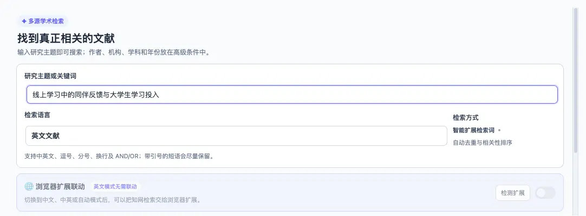
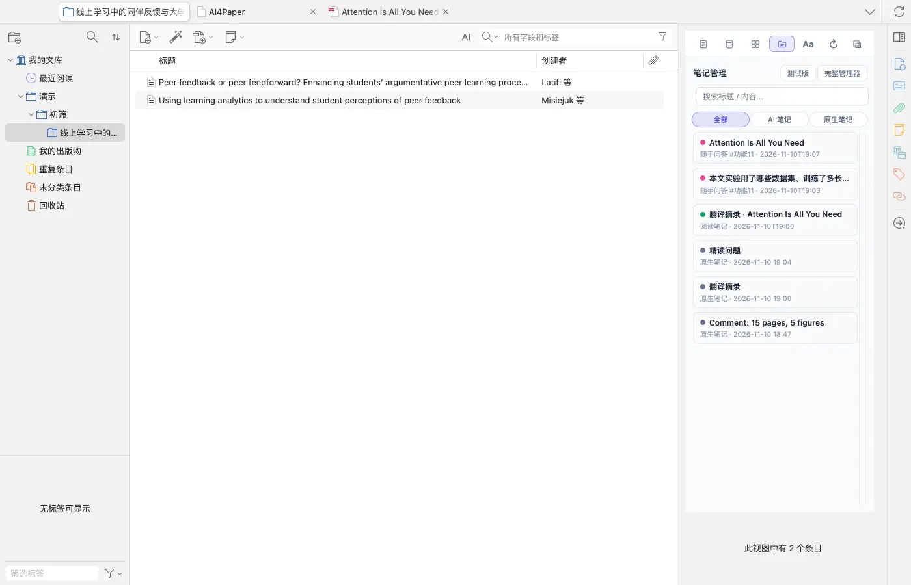
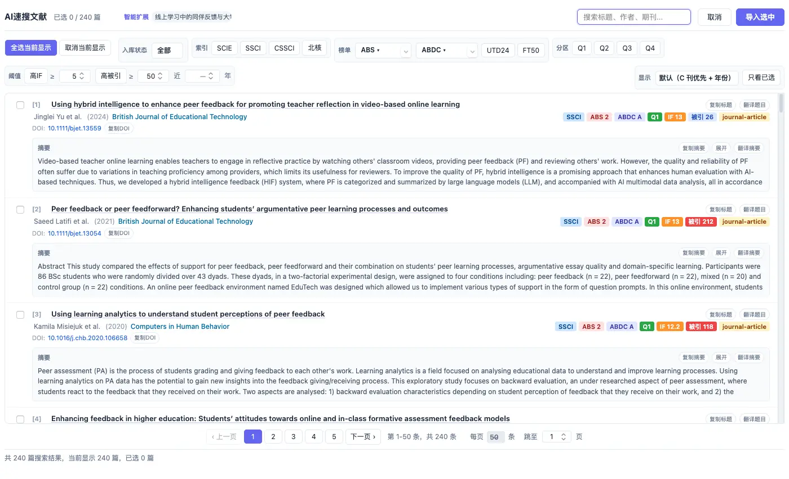
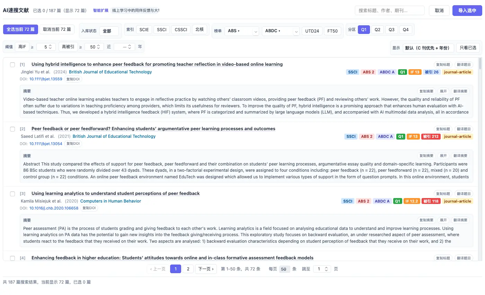
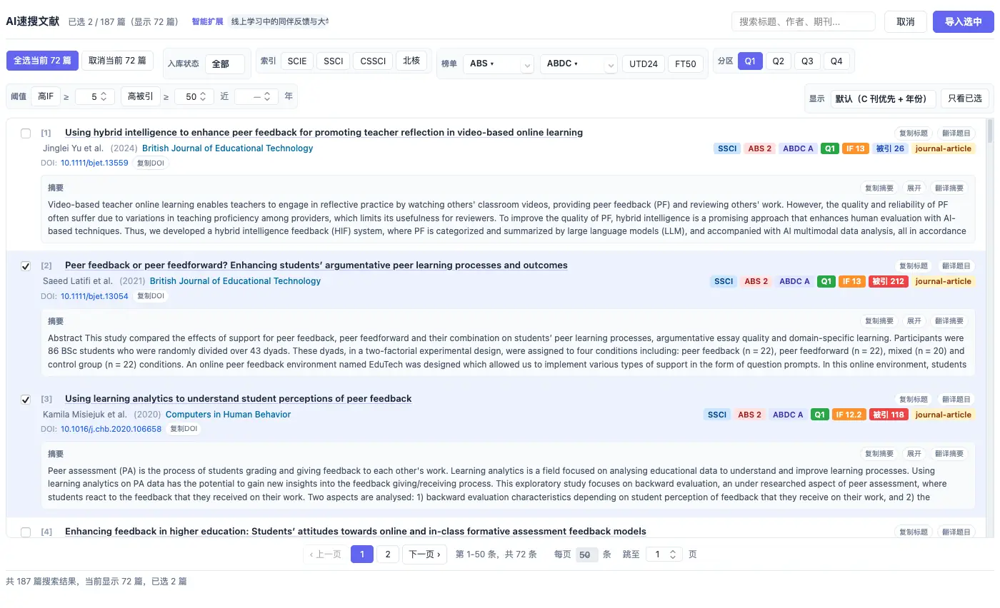

# 用清楚的问题找到第一批文献

> 适用:Zotero 7 及以上；具体以应用内提示为准

> 资料核对日期：2026-11-11。本文操作已在真机上走通并配图；具体入口、可用功能与使用条件以当前应用内提示为准。

## 你要解决什么

找文献先追求相关，再追求数量。把研究对象、要解释的关系和范围写清楚，通常比输入一个宽泛学科名更有帮助。AI4Paper 的「AI速搜文献」支持用中文或英文描述研究方向，结果可按收录、榜单、分区、影响因子、被引和年份筛选。这项功能需要会员并消耗 AI 额度，以应用内提示为准。得到结果之后仍要读摘要，不能把排在前面的论文直接当成核心文献。

## 操作步骤

### 1. 把研究方向写成一句清楚的话

在 Zotero 左侧右键一个分类，选「AI速搜文献」，在「研究主题或关键词」里写一句话，例如“线上学习中的同伴反馈与大学生学习投入”。「检索语言」可选英文文献、中文文献、中英文献或自动判断；作者、学科、年份等放在下方的高级条件里。这只是检索练习，不代表两者已有确定关系；另列两三个英文近义词，之后便于补搜。

### 2. 先选好接收结果的分类

从哪个分类右键发起检索，勾选的文献就导入到它下面：实测会在该分类下自动新建一个以检索主题命名的子分类，导入的论文都放在里面。建议先建一个专门用于初筛的分类（例如「初筛」），从它发起检索，不要直接把第一批结果混入最终写作资料。

### 3. 输入主题并检查第一批结果

点「搜索」后等待片刻，结果窗口会列出检索到的论文（实测一次得到近两百篇），每条有题名、作者、年份、期刊、DOI、摘要，以及收录、分区、影响因子和被引次数标签。先读题名与摘要，看研究对象、核心概念和时间范围是否相符；找到贴题论文时，记下它使用的术语，必要时改写描述再搜一遍。同一描述两次检索的结果数量也可能不同，结果多少不等于覆盖完整。

### 4. 按研究需要逐项筛选

结果窗口顶部有筛选条：入库状态、收录（SCIE、SSCI、CSSCI、北核）、榜单（ABS、ABDC、UTD24、FT50）、分区（Q1–Q4），以及「高IF ≥」「高被引 ≥」「近几年」等阈值。每次只加一个条件，看看删掉了哪些论文；实测只点「Q1」，显示数量就从全部缩小到约四成。新论文可能尚未获得较多引用，相关研究也可能出现在不同层次期刊，最后仍以内容相关性决定保留。

### 5. 核对后再把候选文献加入分类

勾选前核对题名、作者、年份和摘要；勾选的数量会显示在窗口顶部，「只看已选」可以集中复查。确认后点「导入选中」，论文会进入第 2 步所说的子分类。先保留一批足够开始阅读的候选，并记下这次描述和日期；重要主题还应补充不同关键词和引用线索，不把一次检索视为研究材料已经收齐。

## 常见问题

### 能用中文找英文论文吗？

可以。实测用中文描述、检索语言选「英文文献」，返回的是英文论文。重要概念仍建议准备英文近义词补搜。

### 结果排第一是否最值得读？

不一定。默认排序会把部分期刊和较新的论文排在前面，只是开始筛选的线索。先看研究问题和材料是否相关，再看年份与期刊信息。

### 使用是否需要会员或额度？

需要会员，并按用量消耗 AI 额度，以应用内提示和账号页面为准。不依据本篇判断试用期限、价格或可以使用多少次。

## 相关教程

- [按期刊信息缩小范围，再按内容选论文](filter-by-ranking.md)
- [整理已有文献，先用一小批检查导入](import-existing.md)
- [怎么找综述：从主题词找到研究地图](../04-write/find-reviews.md)
