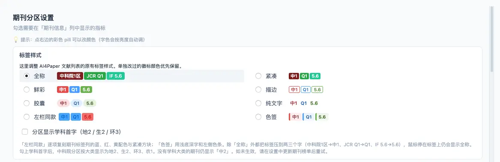
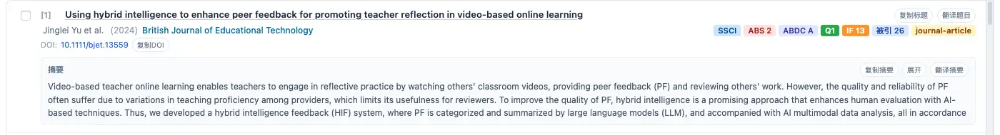
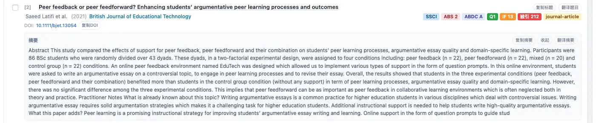
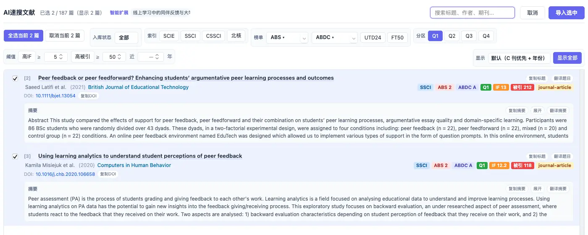

# 按期刊信息缩小范围，再按内容选论文

> 适用:Zotero 7 及以上；具体以应用内提示为准

> 资料核对日期：2026-11-11。本文操作已在真机上走通并配图；具体入口、可用功能与使用条件以当前应用内提示为准。

## 你要解决什么

分区和影响因子适合帮助缩小阅读范围，不能代替读摘要和判断证据。AI4Paper 的 AI速搜文献结果会标出期刊、年份、收录类型、分区、影响因子与被引次数，并提供相应筛选；文库里也可以显示「期刊信息」列。先确认任务需要哪一种口径，再使用筛选条件，能够减少把不同年份、不同学科的数字直接放在一起比较造成的误判。

## 操作步骤

### 1. 先写下筛选目的

明确自己是先了解高关注度研究，还是按课程、毕业或投稿的具体要求选材料。若有单位要求，把认可的分区体系和年份写下来；要求不清楚时先查正式说明。想在文库列表里直接看这些信息，可在应用页「功能地图」搜「期刊分区」点「打开」，进入「期刊分区设置」，勾选要在「期刊信息」列中显示的指标和标签样式（这项为永久免费）。没有硬性要求时，应把研究问题相关性放在数字之前。

### 2. 检查结果中期刊信息是否齐全

在速搜结果里，每条论文的右侧有一排标签：收录（如 SSCI）、榜单（如 ABS、ABDC）、分区（如 Q1）、影响因子、被引次数和文献类型。先看期刊名称、发表年份和这些标签是否对应同一篇论文。缺少分区不等于文章没有价值，可能只是当前没有提供相应信息；遇到不确定的刊名或数值，保留待查标记，不自行补成一个看起来合理的答案。

### 3. 一次只增加一个筛选条件

结果窗口顶部的筛选条可按入库状态、收录、榜单、分区和「高IF / 高被引 / 近几年」阈值缩小范围。先点一个分区，再看窗口顶部和底部的显示数量（例如“显示 72 篇”）是否过少。记下筛选前后少了哪些重要研究；若熟悉的关键论文被排除，检查是不是条件过严，而不是立即认定那篇不合格。

### 4. 回到摘要判断实质相关性

在摘要区点「展开」读完整摘要，逐篇看研究对象、材料和主要结论，保留能够回答问题的论文。引用多可能与发表时间有关，不宜据此排斥刚发表的新研究；影响因子是期刊层面的信息，也不能直接证明这篇论文的方法可靠。对有争议的证据，仍要阅读全文比较。

### 5. 保留一组用于补查的文献

勾选决定保留的论文后，点「只看已选」集中复查，再点「显示全部」回到完整列表。把分区缺失但高度相关的论文另作标记，继续核查其出版信息；把最终使用的筛选条件和日期记在阅读记录里。这样以后扩充材料时，能解释哪些研究暂时没有纳入，避免将方便阅读的条件误写成全面检索的结论。

## 常见问题

### 没有分区的结果是否都应该删掉？

不应该。先核对出版信息和研究内容，再决定是否纳入。你的研究可能需要书籍、工作论文或其他材料，而不只是某一分区的期刊文章。

### 不同体系的一区能直接互换吗？

不能。名称相似并不代表评价方法相同，用于正式评审时必须按单位认可的体系和年份核对，不只抄一个“一区”。

### 筛完没有结果怎么办？

先放宽一个数字条件，保留研究问题本身，再检查关键词是否过窄。筛选是管理阅读量的方法，不是证明某类研究不存在的方法。

## 相关教程

- [用清楚的问题找到第一批文献](ai-quick-search.md)
- [看懂期刊信息，再判断是否适合投稿](../05-journals/ranking-and-if.md)
- [用五个问题读论文，并逐项回查](../03-read/read-and-verify.md)
