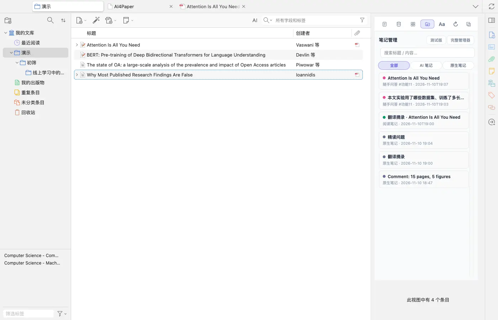
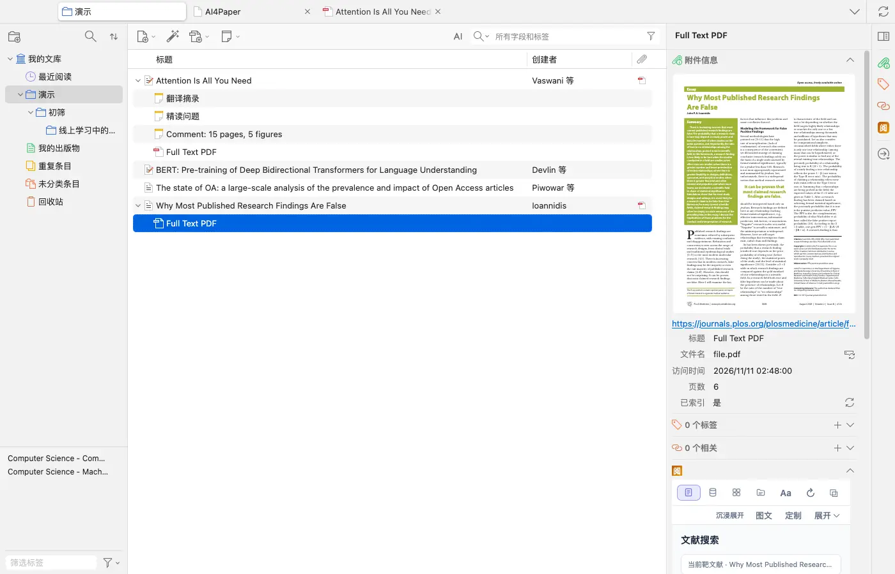
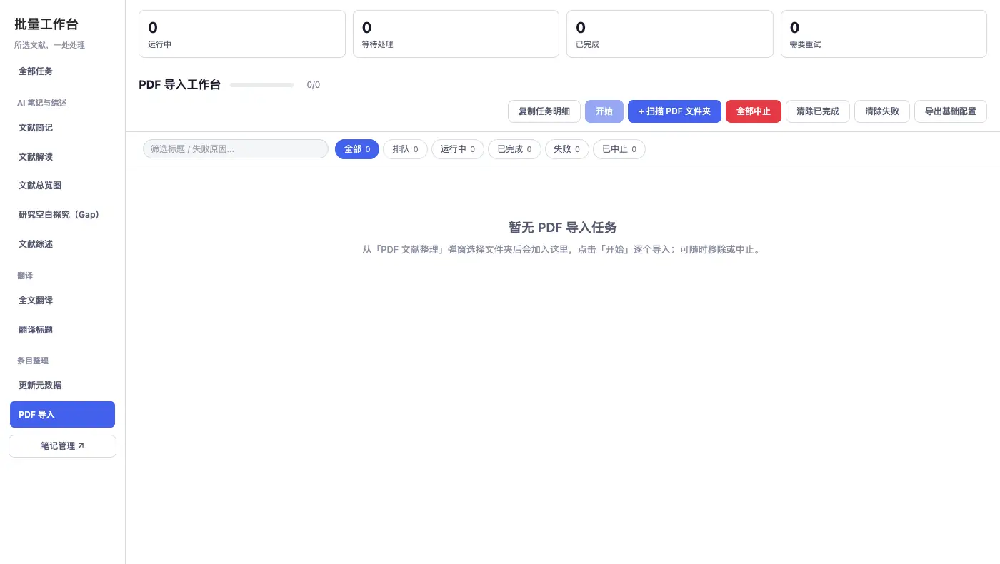
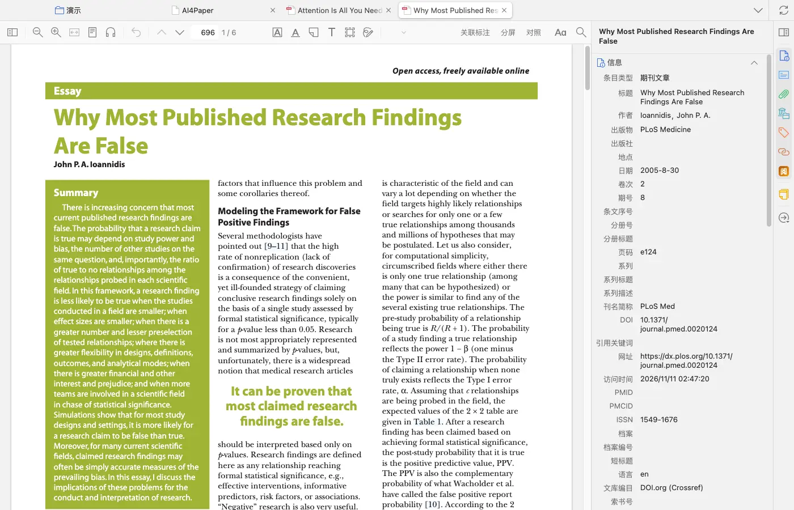
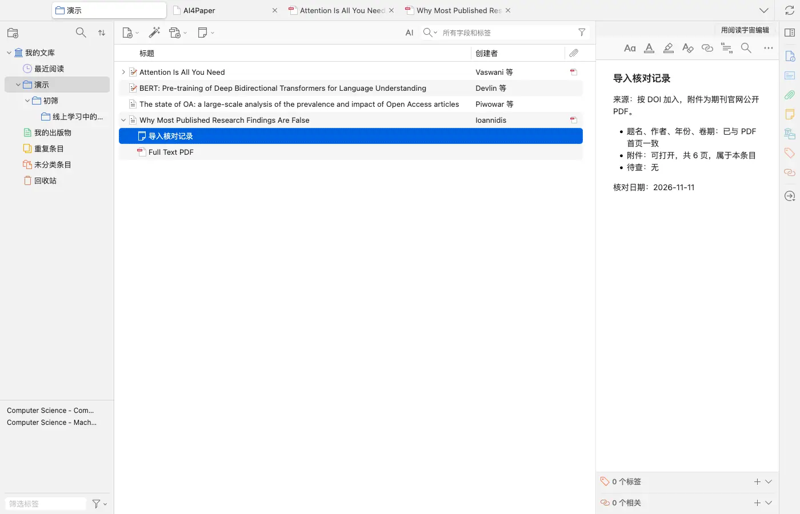

# 整理已有文献，先用一小批检查导入

> 适用:Zotero 7 及以上；具体以应用内提示为准 · 部分步骤已在真机核对,其余已标注「未实测」

> 资料核对日期：2026-11-11。第 1、2、4、5 步已在真机上走通；第 3 步只核对了入口和页面说明，实际加入动作未实测。具体入口、可用功能与使用条件以当前应用内提示为准。

## 你要解决什么

手头已经有 PDF、题录或原有 Zotero 文库时，先盘点材料，再决定是否需要导入。AI4Paper 插件直接在已有的 Zotero 文库中工作，不必为了阅读一篇已有论文先把整库重新加入。网页工作台与插件的资料选择方式不同，涉及格式和保存位置时以当前提示为准。

## 操作步骤

### 1. 先列出现有材料与目标位置

区分只有 PDF 的文件、已有作者年份等信息的条目，以及已经在目标分类中的论文。明确这次要让哪几篇文献可用于阅读或写作，而不是先处理全部历史材料。保留原始文件和重要笔记，记录题名与年份，便于之后判断是否加入了正确的一份。

### 2. 已在 Zotero 中的文献先直接检查

在文库里展开一篇现有条目，点它的 PDF 附件，右侧会显示附件的首页预览、文件名和页数；确认题名、作者和附件对应后，双击即可在阅读器打开并使用右侧「阅」的阅读辅助。若只是想用插件读已有文献，不要先复制整个文库。

### 3. 需要加入时先选少量示例

已知 DOI 或 arXiv 编号时，可用 Zotero 自带的「文件 → 根据标识符新增...」逐篇加入；整批 PDF 可以用 AI4Paper 的批量工作台：右键文献选「文献分析」打开工作台，左侧选「PDF 导入」，点「扫描 PDF 文件夹」，选好的文件会排队，点「开始」逐个导入，可随时移除或中止。这两种加入动作本身未实测，支持的格式与保存位置以页面说明为准。先用少量可公开获取的论文练习，避免一次加入大量材料后才发现题录不完整或放错分类。

### 4. 逐条核对题录和原文

打开加入后的条目，把右侧「信息」里的题名、作者、日期、卷期和 DOI 与正文首页逐项对照；同名论文、预印本与正式发表版尤其要辨清。检查附件是否可读、是否属于该条目。信息不全先记待核查，查到可靠出处后再改，不能只凭文件名给论文补上作者或期刊。

### 5. 确认无误后再扩大处理范围

重新打开目标分类，确认结果仍可找到，再继续加入下一批。看到疑似重复先比较内容和附件，不立即批量删除。可以在条目下新建一条笔记，简要记下来源、核对结果和日期；若要换端继续工作，再做一次小范围检查，不以登录了同一个账号作为资料已齐全的证明。

## 常见问题

### 整库已经在 Zotero 里，还要再导入一遍吗？

不必。插件直接在原有文库中工作，先从已有文库选一篇检查可用阅读功能即可。

### 只有文件名，没有题录怎么办？

先查看正文首页或可靠出版信息再核对。不能确认的内容保持待查，不要根据文件名猜年份、作者或期刊。

### 加入后出现两个相似条目怎么办？

先比较题名、作者、年份、版本和附件，再按去重教程处理。不要用一次批量删除来解决尚未查清的版本差别。

## 相关教程

- [选网页版还是 Zotero 插件](../01-getting-started/web-and-plugin.md)
- [先比较版本与附件，再处理重复文献](../06-library/dedup.md)
- [让分类管主题，让标签管阅读状态](../06-library/categories-tags.md)
