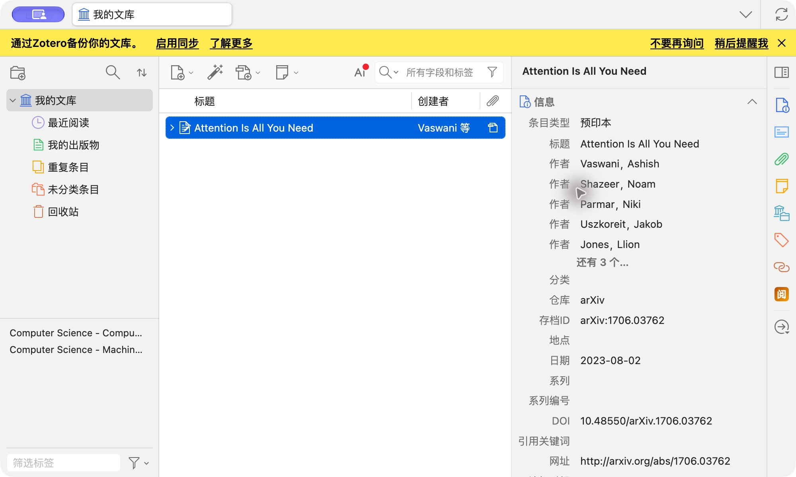

# 整理已有文献，先用一小批检查导入

[中文手册首页](../README.md) · [Zotero 完整手册](../../manual/zotero-plugin.md) · [Web 完整手册](../../manual/web-workspace.md)

2026-11-26 修订。当前步骤按正式 Web、AI4Paper 10.0.31 与官网核对；本轮实际执行范围见[版本与核验](../../manual/verification.md)，未执行项目不写成成功案例。

## 你要解决什么

整理已有文献。先完成一个小范围练习，再扩大到真实资料。

## 前提

原资料备份；先一篇公开样例。

## 操作步骤

1. 先区分题录、独立 PDF、存储附件和链接附件。
2. 导入 PDF 或题录；单独附件先检索/创建上级题录并校对。
3. 补全文与匹配本地文件时核同一篇、同一版本，先预览再挂载。
4. 打开附件检查页数和文字层，再整理分类/标签。

## Web 与插件入口分别看

Web→我的文献库→导入文献，可用 PDF/题录/DOI/Zotero 向导等当前入口，先选保存位置。

## 结果与检查

题录与可打开的正确原文对应。

## 常见问题

自动归档可能移动文件；不要将导入题录当已下载全文。

## 相关教程

- [两端主手册](../README.md)
- [插件全部功能与配置](../../manual/plugin-feature-reference.md)
- [故障排查](../../manual/troubleshooting.md)

<!-- 兼容旧版章节链接；最新操作见本页正文。 -->

