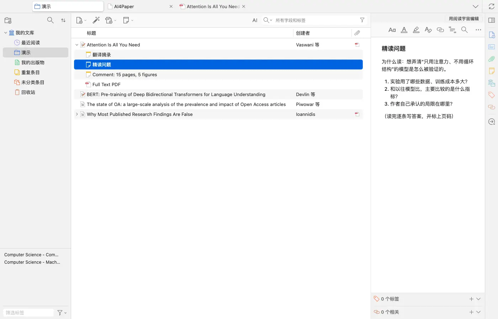
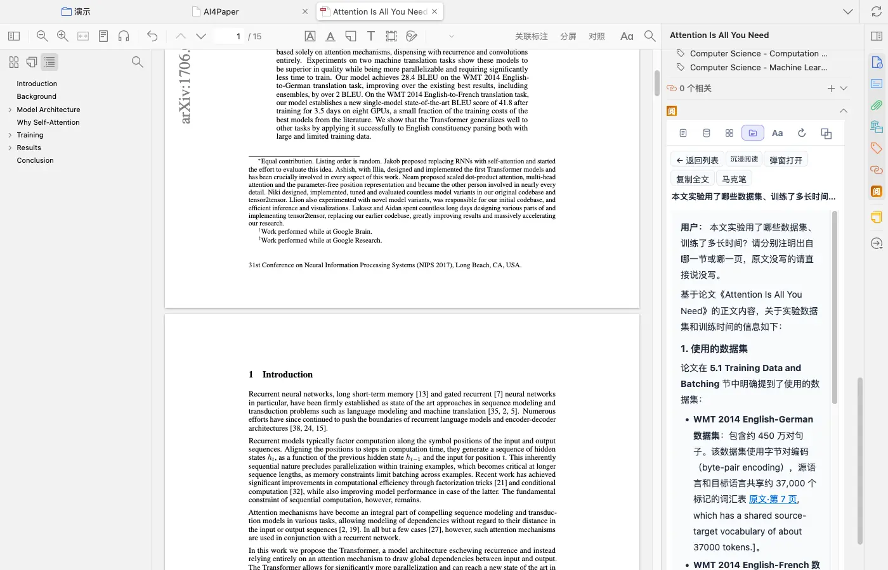
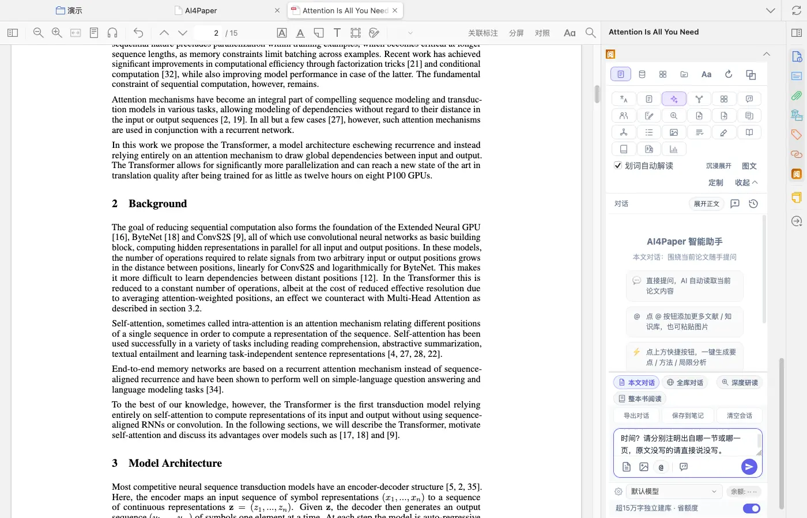
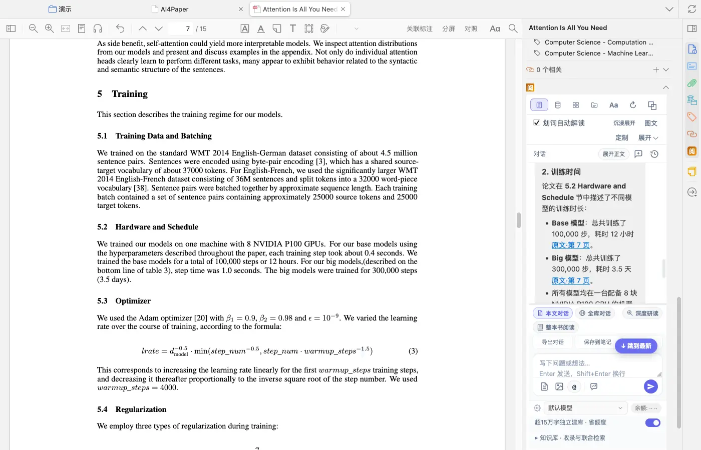
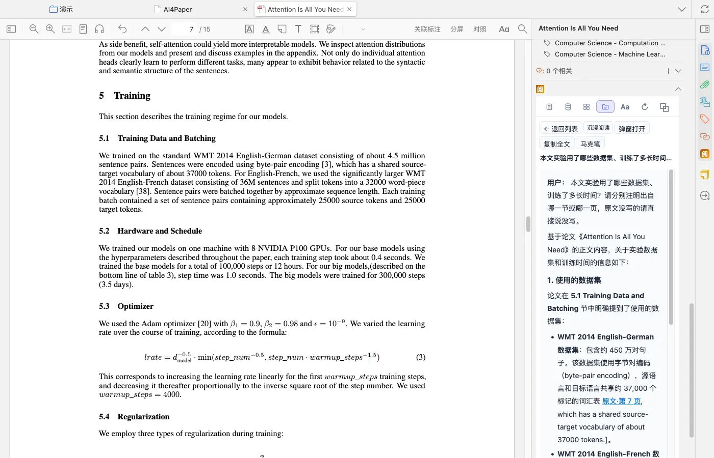

# 让精读围绕问题，而不是堆积摘要

> 适用:Zotero 7 及以上；具体以应用内提示为准

> 资料核对日期：2026-11-11。本文操作已在真机上走通并配图；具体入口、可用功能与使用条件以当前应用内提示为准。

## 你要解决什么

精读的目标是能说清一篇论文做了什么、凭什么得出结论，以及哪些地方不能推广。先自己快速看一遍摘要和结构，再让 AI4Paper 帮助解释具体难点，会比直接要求“全面分析”更容易核对。AI 问答和文献解读需要会员并消耗 AI 额度，以应用内提示为准。

## 操作步骤

### 1. 先写下这篇论文为什么值得读

记录它与你当前研究问题的关系，预设两三个需要解答的疑问。例如材料来自哪里、核心比较是什么、作者如何解释反例。可以在这篇文献下新建一条笔记（Zotero 文库工具栏的「新建笔记」），写成“精读问题”。先有问题再阅读，能减少把整篇内容全部复制成笔记的负担；如果论文与主题无关，也允许在快速阅读后暂时放下。

### 2. 先自己概览摘要与正文结构

打开 PDF 后，点阅读器左上角的侧栏按钮，切到大纲，就能看到 Introduction、Model Architecture、Training、Results 等章节，点一下即可跳转。找到研究问题、方法、主要结果和讨论所在位置，标记暂时看不懂的术语。此时不急着认同作者的解释，只确认论证是如何展开、哪些部分需要自己仔细检查。

### 3. 在本文对话里提出具体问题

在文库里右键这篇文献选「随手问答」，阅读器右侧「阅」会打开对话，默认是「本文对话：围绕当前论文随手提问」，会自动读取当前论文全文。先问一个能够回到正文核对的问题，例如“本文实验用了哪些数据集、训练了多长时间？请分别注明出自哪一节或哪一页，原文没写的请直接说没写。”想要整篇的解读、简记或总览，可以右键文献选「文献分析」，在打开的批量工作台里选择对应任务。

### 4. 逐条回查回答中的事实与解释

实测回答在每条事实后附了“原文·第 7 页”这样的链接，点一下，左侧 PDF 就跳到对应页，可以直接对照。先核对样本、时间范围、变量定义和结果方向，再看解释是否超出作者论证；页码对得上也要读原句，确认回答没有改变原意。原文没有说明的内容，不替作者补成确定原因；查不到出处的，标为未核实。

### 5. 保存一份自己能复述的阅读笔记

对话区的「保存到笔记」会把这轮问答存为 AI 笔记；在「阅」的笔记页（笔记管理）里可以按“全部 / AI 笔记 / 原生笔记”查看，点开后问题、回答和页码链接都在。在此基础上用自己的话写研究问题、材料、做法、发现和局限，每一项加原文位置，并把原文摘录、自己的理解与工具建议分开。最后合上论文讲三分钟；讲不清楚的环节就是下一轮精读的目标。

## 常见问题

### 是不是解读越长越好？

不是。能回答阅读问题、能回查出处、能指出不确定之处更重要。过长内容如果无法逐项核对，反而增加误记和误引的机会。

### 回答没有给出可靠出处怎么办？

自己回到原文定位。无法定位的事实不写进正式证据笔记，可以保留为疑问；不要用猜测的页码给回答补出处。

### 每篇都需要同样深读吗？

先按相关性分层。核心证据与关键分歧值得深读，背景材料可先做简要记录；是否深入取决于它将支持什么论点。

## 相关教程

- [用五个问题读论文，并逐项回查](read-and-verify.md)
- [围绕一组文献提问，带着来源核对](ask-your-library.md)
- [做一张能比较研究的文献证据表](../04-write/evidence-table.md)
