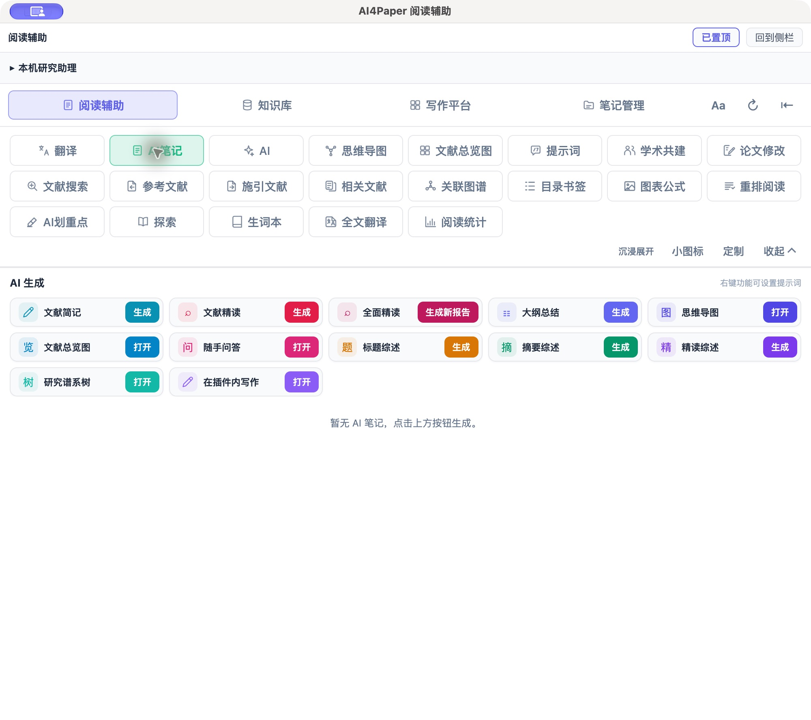

# 让精读围绕问题，而不是堆积摘要

[中文手册首页](../README.md) · [Zotero 完整手册](../../manual/zotero-plugin.md) · [Web 完整手册](../../manual/web-workspace.md)

2026-11-26 修订。当前步骤按正式 Web、AI4Paper 10.0.31 与官网核对；本轮实际执行范围见[版本与核验](../../manual/verification.md)，未执行项目不写成成功案例。

## 你要解决什么

围绕问题做 AI 精读。先完成一个小范围练习，再扩大到真实资料。

## 前提

正确正文已解析，AI 服务及当前权益可用。

## 操作步骤

1. 阅→AI笔记选简记/精读/全面精读或大纲，先核选中论文与材料深度。
2. 确认生成后等待任务完成，到 AI 笔记查看。
3. 用研究问题、数据、方法、发现、局限五项逐条对原文。
4. 修订后存原生笔记或导出；再用本文对话追问具体页/表。

## Web 与插件入口分别看

Web 阅读器→AI笔记/AI分析，或本文对话；单篇不要求先建知识库。

## 结果与检查

有出处、经人工修正的精读笔记。

## 常见问题

标题/摘要级结果不能称已读全文；本轮只核入口，未登录执行生成。

## 相关教程

- [两端主手册](../README.md)
- [插件全部功能与配置](../../manual/plugin-feature-reference.md)
- [故障排查](../../manual/troubleshooting.md)

<!-- 兼容旧版章节链接；最新操作见本页正文。 -->

