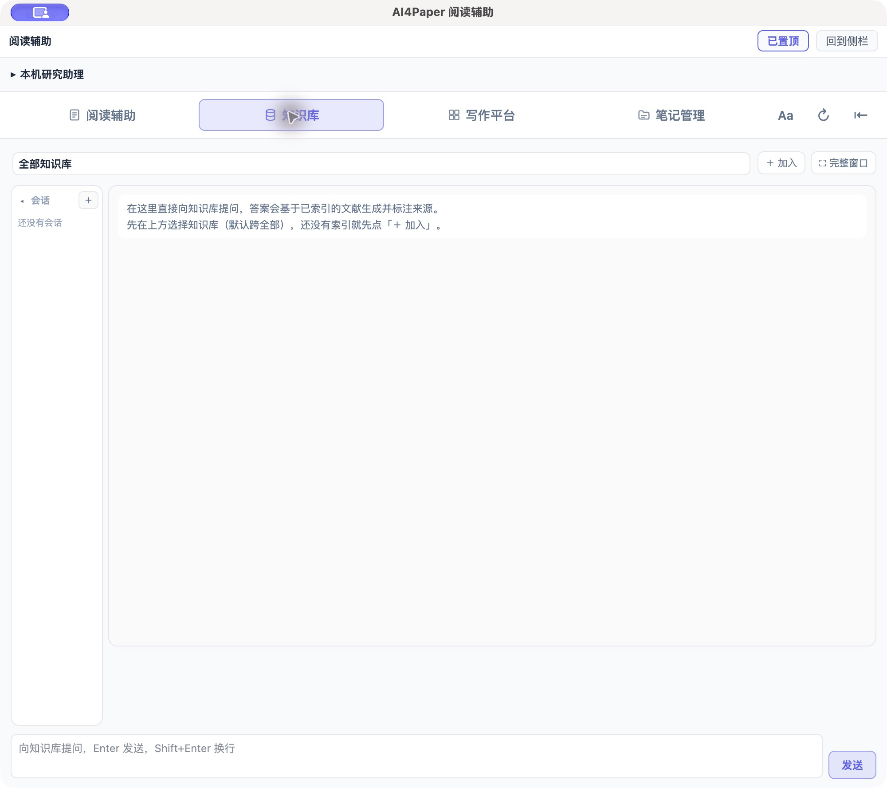

# 围绕一组文献提问，带着来源核对

[中文手册首页](../README.md) · [Zotero 完整手册](../../manual/zotero-plugin.md) · [Web 完整手册](../../manual/web-workspace.md)

2026-11-26 修订。当前步骤按正式 Web、AI4Paper 10.0.31 与官网核对；本轮实际执行范围见[版本与核验](../../manual/verification.md)，未执行项目不写成成功案例。

## 你要解决什么

围绕一组材料提问。先完成一个小范围练习，再扩大到真实资料。

## 前提

少量相关题录/全文或快照，嵌入和对话服务可用。

## 操作步骤

1. 选目标分类/文献→阅→知识库→＋加入。
2. 核范围，建立索引并等完成，确认成功数量和失败项。
3. 选这个库提问，跨库才选全部知识库。
4. 点来源回条目/PDF/笔记核证据；保存经修订回答。

## Web 与插件入口分别看

Web 用阅读工作区的知识库，核 Web 资料范围和保存位置；单篇对话不必建库。

## 结果与检查

答案与可定位来源，不只是生成一段文字。

## 常见问题

无全文只能得到相应深度材料；索引无命中不等于没有证据。本轮未执行索引/问答。

## 相关教程

- [两端主手册](../README.md)
- [插件全部功能与配置](../../manual/plugin-feature-reference.md)
- [故障排查](../../manual/troubleshooting.md)

<!-- 兼容旧版章节链接；最新操作见本页正文。 -->

