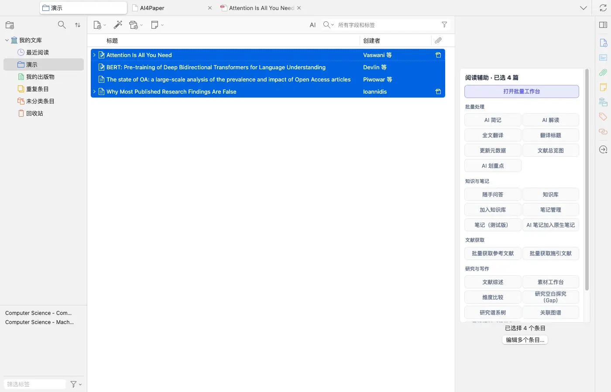
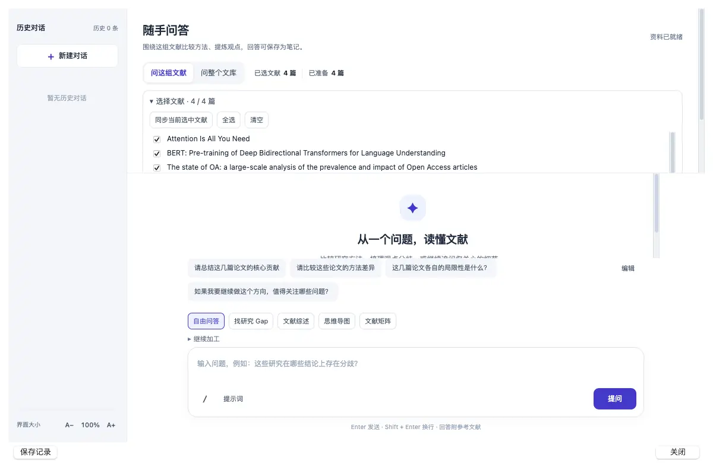
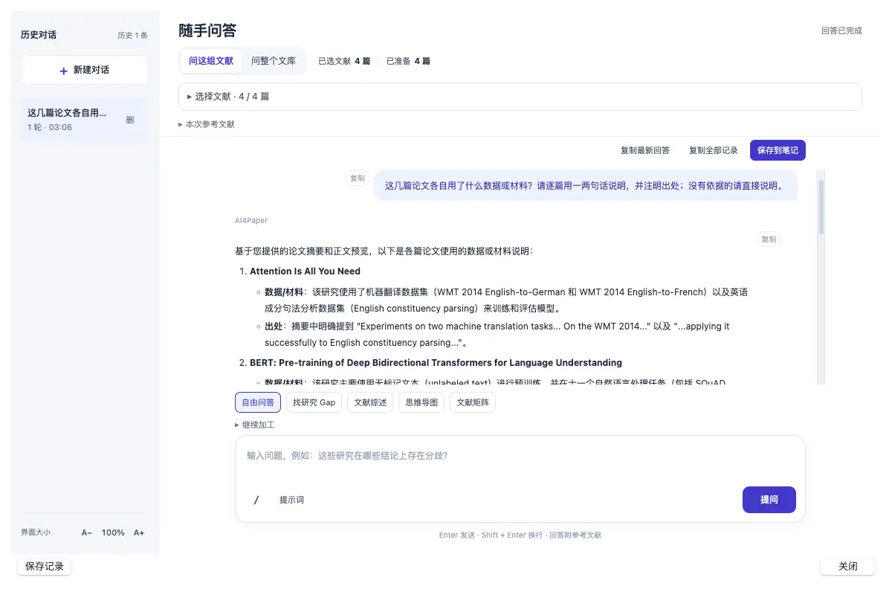
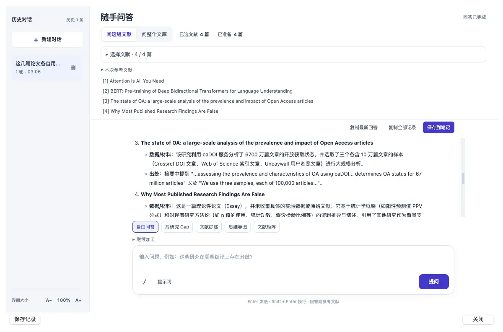
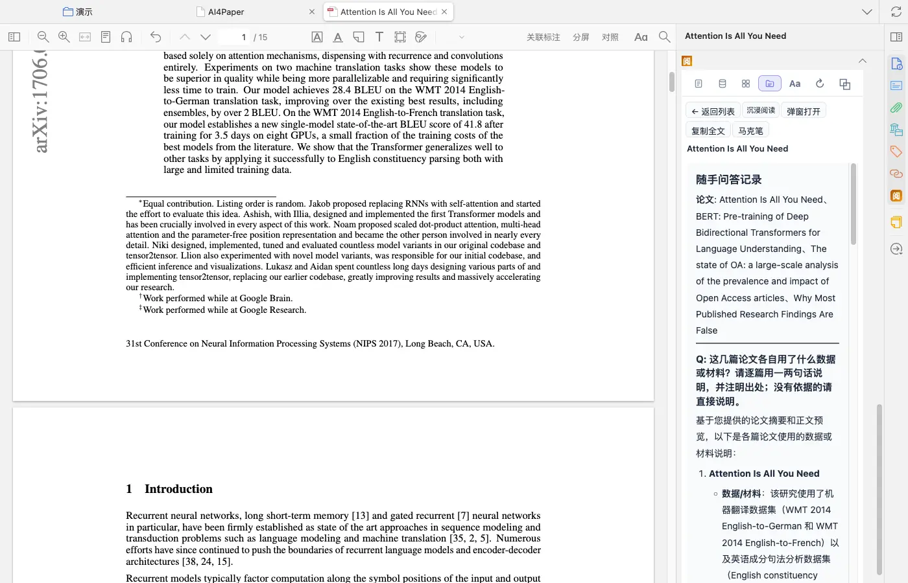

# 围绕一组文献提问，带着来源核对

> 适用:Zotero 7 及以上；具体以应用内提示为准

> 资料核对日期：2026-11-11。本文操作已在真机上走通并配图；具体入口、可用功能与使用条件以当前应用内提示为准。

## 你要解决什么

向一组文献提问适合寻找材料之间的联系，例如不同研究如何定义一个概念，或有哪些相反结论。它与围绕单篇 PDF 提问不同，开始前要先划定资料范围。AI4Paper 的「随手问答」可以针对一个分类或选中的几篇文献提问，回答附参考文献；需要会员并消耗 AI 额度，以应用内提示为准。有来源只是核查的起点，重要判断仍要回到论文自己确认。

## 操作步骤

### 1. 先确定这次比较的文献范围

围绕一个清楚主题准备一组文献，放进同一个分类，核对题名与原文，排除明显不相关材料。记录是否包含综述、原始研究以及不同发表版本，避免把同一项研究的多份材料当成多条独立证据。范围过宽时，先缩小到一个概念或一个具体争议。

### 2. 打开随手问答并确认纳入了哪些文献

在左侧右键这个分类，选「随手问答」（也可以在列表里多选几篇，右侧「阅读辅助」面板点「随手问答」）。弹出的窗口顶部可在「问这组文献」和「问整个文库」之间切换，旁边显示“已选文献 N 篇 · 已准备 N 篇”；展开「选择文献」能看到每一篇并逐个勾选。页面提示缺少全文时会使用可用资料并注明依据。若想把文献长期收进知识库，另有「加入知识库」入口，本篇未使用。

### 3. 提出可以比较且范围明确的问题

例如“这几篇论文各自用了什么数据或材料？请逐篇用一两句话说明，并注明出处；没有依据的请直接说明”，比“帮我总结一切”更容易检查。输入框上方有几条示例问题和「自由问答」「找研究 Gap」「文献综述」「思维导图」「文献矩阵」等模式，练习时用「自由问答」即可。一次只解决一个问题，先核对之后再继续追问。

### 4. 打开来源并核对是否支持回答

展开「本次参考文献」能看到这次回答用到了哪几篇。实测回答逐篇给出“数据/材料”和“出处”，出处引用的是摘要或正文开头的原句，没有标页码；它还注明了“基于论文摘要和正文预览”，说明不一定读了全文。逐条看引用的是原始发现、作者的讨论还是转述，几篇文章使用同一个词不等于测量或含义相同。查不到依据的句子记为未核实，暂时不放入正式论证。

### 5. 保存问题、范围和自己的判断

点「保存到笔记」后，这轮问答会存成一条「随手问答记录」，开头列出本次提问涉及的论文，再是问题和回答；实测它保存在所选的第一篇论文名下，可在阅读器右侧「阅」的笔记页找到。窗口底部的「保存记录」与左侧历史对话也能回看。另外记下提问时间、关键原文位置和自己的核对结论；后续增加文献时，重新检查原先结论是否仍成立。

## 常见问题

### 它能代替全面的文献检索吗？

不能。回答建立在你选定的材料范围上，范围以外的研究不会因此自动被考虑；补搜仍要单独完成并记录范围。

### 回答附了来源就可以直接写进论文吗？

仍需检查来源是否真正支持那句话，必要时读全文。要用自己的分析连接证据，并按写作规范标明引用。

### 不同论文意见相反怎么办？

先比较对象、时期、概念定义和方法，再保留真实分歧。不要为了得到整齐结论而删掉不一致的证据。

## 相关教程

- [让精读围绕问题，而不是堆积摘要](ai-close-reading.md)
- [用五个问题读论文，并逐项回查](read-and-verify.md)
- [做一张能比较研究的文献证据表](../04-write/evidence-table.md)
