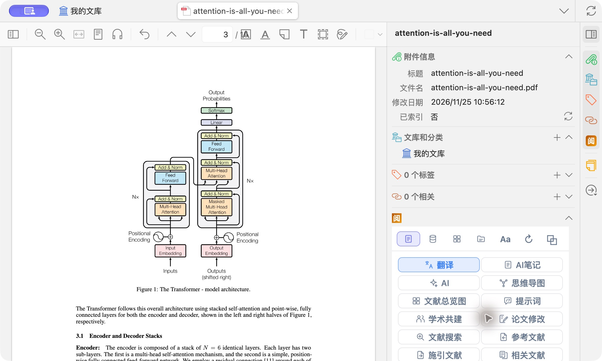

# 用五个问题读论文，并逐项回查

[中文手册首页](../README.md) · [Zotero 完整手册](../../manual/zotero-plugin.md) · [Web 完整手册](../../manual/web-workspace.md)

2026-11-26 修订。当前步骤按正式 Web、AI4Paper 10.0.31 与官网核对；本轮实际执行范围见[版本与核验](../../manual/verification.md)，未执行项目不写成成功案例。

## 你要解决什么

用五个问题读论文。先完成一个小范围练习，再扩大到真实资料。

## 前提

可打开的原文；自己的记录位置。

## 操作步骤

1. 先写论文回答什么问题、为什么重要。
2. 记研究对象/数据/设计和关键假设。
3. 找主要结果、表号、页码与证据。
4. 记录局限和作者没有证明的内容，区分自己的推断。
5. 将每条 AI 回答与原文对应，保留不支持或不确定项。

## Web 与插件入口分别看

两端均可用本文对话、笔记、目录书签和图表面板辅助定位；不用 AI 也可完成。

## 结果与检查

一份问题—证据—出处—局限记录。

## 常见问题

流畅回答、来源号或高亮不是核对本身，别把相关性写成因果。

## 相关教程

- [两端主手册](../README.md)
- [插件全部功能与配置](../../manual/plugin-feature-reference.md)
- [故障排查](../../manual/troubleshooting.md)

<!-- 兼容旧版章节链接；最新操作见本页正文。 -->

