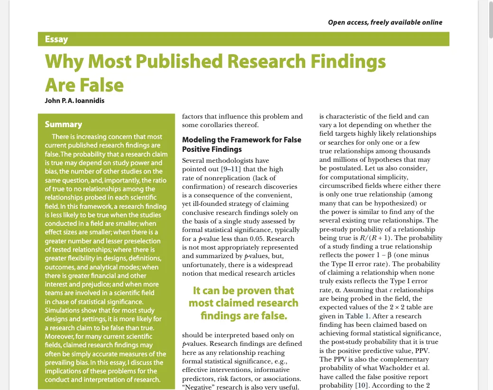
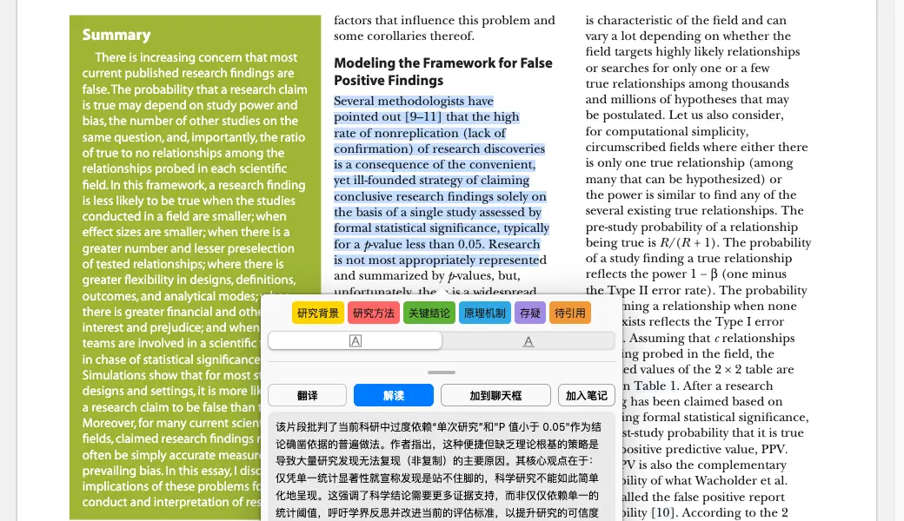
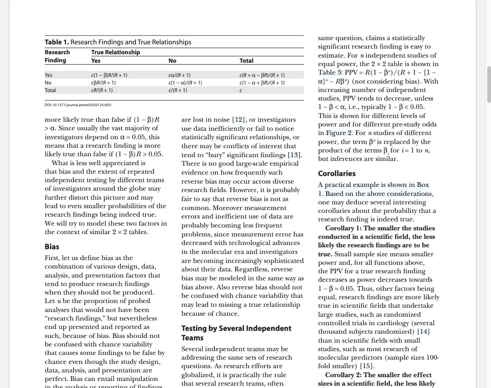
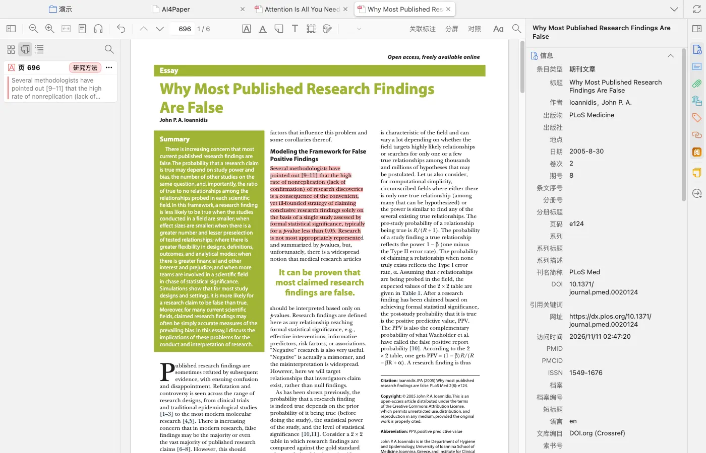
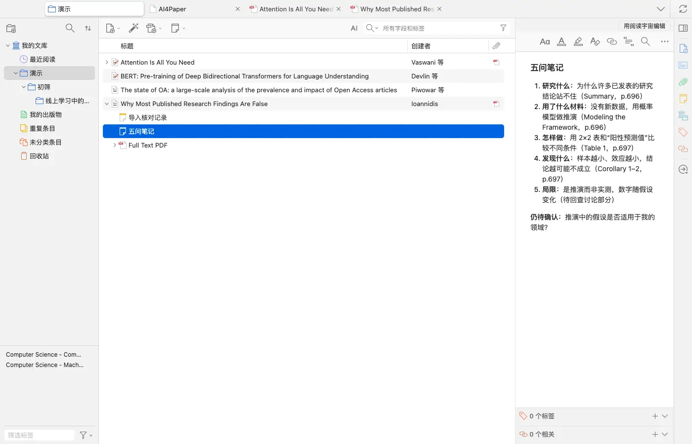

# 用五个问题读论文，并逐项回查

> 适用:Zotero 7 及以上；具体以应用内提示为准

> 资料核对日期：2026-11-11。本文操作已在真机上走通并配图；具体入口、可用功能与使用条件以当前应用内提示为准。

## 你要解决什么

读完论文能复述，不等于其中的每个结论都有证据。先用五个问题整理：研究什么、用了什么材料、怎样做、发现什么、有哪些局限。每项回答都附上原文位置，再判断哪些结论能够用于自己的研究。这套方法不需要任何产品也能完成；使用 AI4Paper 时，只把解释与笔记作为辅助，核对标准保持一样。

## 操作步骤

### 1. 把研究问题与材料分别写清

先找作者明确要回答的问题，再记录样本或材料来自哪里、覆盖什么时间和对象。不要把背景介绍当成论文已经研究的内容。材料不明就写待核查，并记录所在段落；不同文章对同一个词可能有不同定义，比较之前必须先分清。

### 2. 把做法写成能够理解的过程

说明作者怎样从材料得到结果，区分观察、比较、实验或其他论证方式。在 PDF 里选中方法段，划词窗口顶部有「研究背景」「研究方法」「关键结论」「原理机制」「存疑」「待引用」六个颜色标签，点一个就把这段高亮并归类；窗口里的「解读」会用中文解释这段在说什么（需要会员并消耗 AI 额度；右侧对话页勾着「划词自动解读」时，选中文字就会自动解读）。方法名不熟悉时先查清其作用，解读只帮你读懂，不替你判断方法是否可靠。

### 3. 分别记录发现与作者的解释

先抄明结果的方向、范围和必要条件，再用自己的话写作者如何解释。核对否定词、单位、样本数量和图表注释，区分相关关系与因果判断。作者转述的前人结论还需查原始出处，不能把它记成当前论文自己得到的发现。

### 4. 核对局限，并检查自己的使用范围

阅读作者列出的局限，再问这些证据能否支持你准备写的那句话。针对特定人群或时期的发现，不能不加说明地推广。把关键答案标上章节、页码或图表号：在阅读器左侧侧栏切到注释列表，每条高亮都带页码和你选的标签（例如“页 696 · 研究方法”），点一下就能跳回原文。如果使用了翻译或解读，仍须逐条回到这些原文位置核对。

### 5. 合上论文，用自己的话复述一遍

尝试向同学讲清问题、材料、方法、发现和局限，讲不清的地方重新打开原文。可以在这篇文献下新建一条笔记，按五个问题逐条写，每条后面注明页码或表号，最后把仍未确定的问题单独列出，确认自己的笔记没有把“可能”改成“必然”。

## 常见问题

### 通用方法是否只能用在实证论文？

不只能。理论或综述文章也能问它要解决什么问题、使用哪些论证材料、如何推理和边界在哪里。本篇示例就是一篇用概率模型推演的论述文章，按文章类型调整记录方式即可。

### 作者讨论里写了一个结论，就能直接引用吗？

先看这个结论来自本文结果、作者推测还是前人研究，再查相应证据。仅有讨论文字，不代表本文已经直接验证。

### 如何判断这轮阅读完成了？

你能用自己的话说明五项答案，关键事实可回查，无法确认的地方清楚标出。完成阅读不意味着所有疑问都已解决。

## 相关教程

- [让精读围绕问题，而不是堆积摘要](ai-close-reading.md)
- [做一张能比较研究的文献证据表](../04-write/evidence-table.md)
- [把笔记写成能回原文、能继续写作的材料](../06-library/note-management.md)
