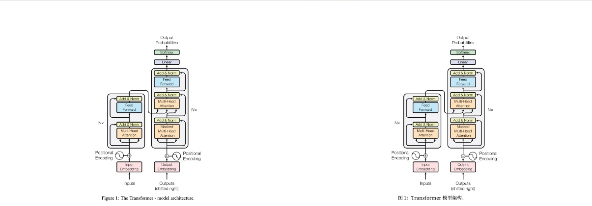

# 先读懂关键段，再选择全文翻译

[中文手册首页](../README.md) · [Zotero 完整手册](../../manual/zotero-plugin.md) · [Web 完整手册](../../manual/web-workspace.md)

2026-11-26 修订。当前步骤按正式 Web、AI4Paper 10.0.31 与官网核对；本轮实际执行范围见[版本与核验](../../manual/verification.md)，未执行项目不写成成功案例。

## 你要解决什么

全文翻译与划词翻译。先完成一个小范围练习，再扩大到真实资料。

## 前提

完整、可读、带文字层的 PDF；当前服务与账号权益。

## 操作步骤

1. 只读难段落：打开 PDF 选一段→浮窗翻译或阅→翻译→核术语→加入笔记。
2. 整篇：右键全文翻译 PDF 或阅→全文翻译，核论文、页数、输出模式和实时费用。
3. 在工作台确认启动，分清排队与运行；失败查看原任务原因，不重复建任务。
4. 完成后展开原题录找到译文附件，打开核页数、公式、表格和关键句。

## Web 与插件入口分别看

Web 阅读器同样有翻译/全文翻译；结果在 Web 当前保存位置，不假定自动挂到本机 Zotero。

## 结果与检查

划词得到可核译文/笔记；全文任务完成且译文 PDF 可打开。

## 本轮实际产物

本轮正式版选择“双语”生成的是同页左右并排，15页输入输出仍为15页，不是必然交错成30页。页码留空、保留默认跳过参考文献。打开新增附件检查首页、末页和第3页模型图；图与箭头可对应原文，译文仍需人工核对。

[完整产物与队列状态说明](../../manual/zotero-plugin.md#本轮完整-pdf-产物核验)

## 常见问题

本轮已登录并启动一次15页公开样例的双语整篇任务，页码留空，默认跳过参考文献；原题录已生成并可打开15页同页左右对照PDF，首末页和Figure1已核；但队列仍在90%/下载阶段，状态未显示完成。分别记录产物与队列，不重复提交。扫描纯图片、服务限制、余额和网络分开查，不承诺固定价格/耗时。

## 相关教程

- [两端主手册](../README.md)
- [插件全部功能与配置](../../manual/plugin-feature-reference.md)
- [故障排查](../../manual/troubleshooting.md)

<!-- 兼容旧版章节链接；最新操作见本页正文。 -->

