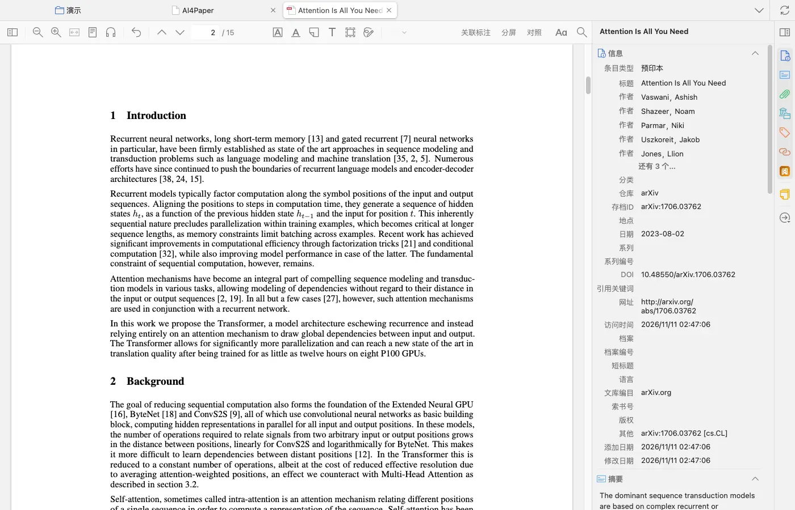
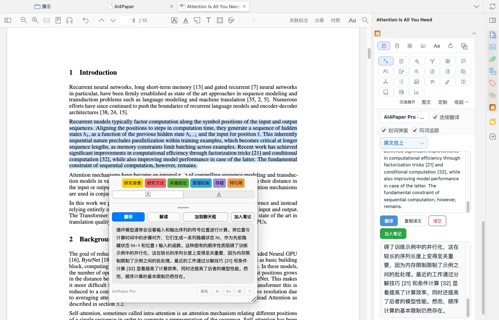
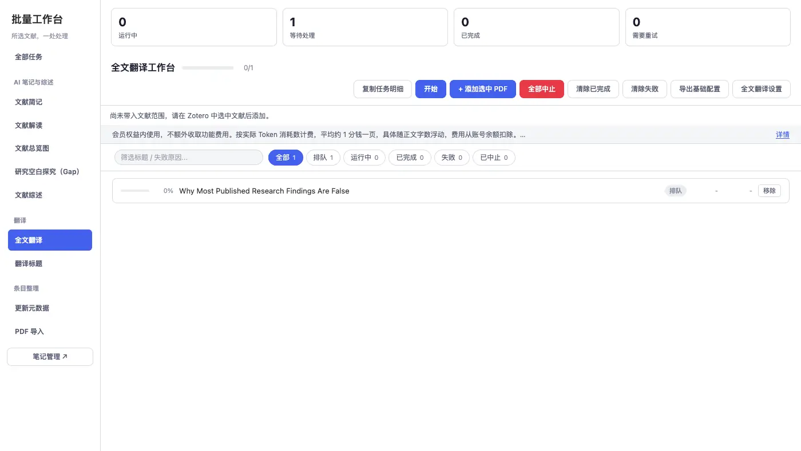
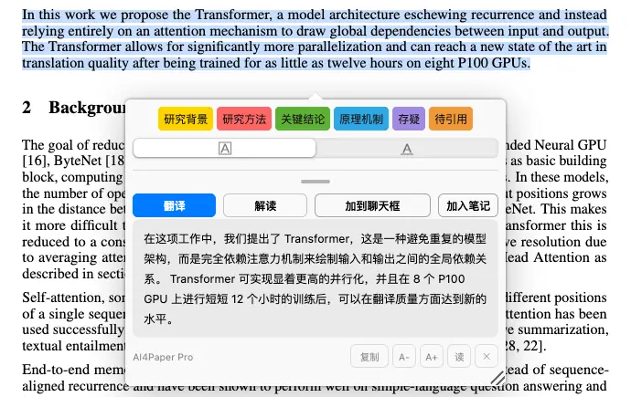
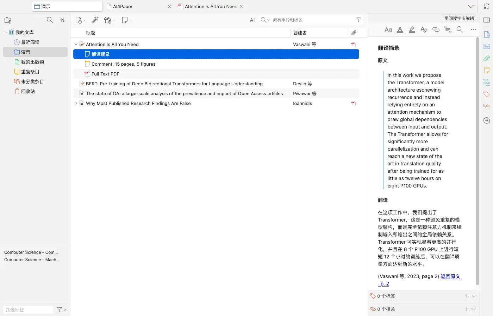

# 先读懂关键段，再选择全文翻译

> 适用:Zotero 7 及以上；具体以应用内提示为准 · 部分步骤已在真机核对,其余已标注「未实测」

> 资料核对日期：2026-11-11。第 1、2、4、5 步已在真机上走通；第 3 步核对了入口与工作台，但没有实际运行全文翻译，译文附件的去向未实测。具体入口、可用功能与使用条件以当前应用内提示为准。

## 你要解决什么

只被一句长句卡住时，先翻译这一段；需要了解整篇结构时，再考虑全文翻译。AI4Paper 提供划词翻译与全文翻译，两者可以配合使用。译文是阅读辅助，不能代替原文证据，尤其是方法、数据、否定表达和研究限制。先用一篇能正常打开的 PDF 做小范围检查，再决定是否处理更多材料。

## 操作步骤

### 1. 确认原文可读并明确阅读目标

在 Zotero 里双击论文打开 PDF，确认页码、图表与正文完整。如果文件本身缺页或文字难以辨认，先换一份可靠原文。写下这次需要理解的是一个术语、一个段落还是整篇结构；目标越具体，越容易判断译文有没有解决问题，而不只是看起来流畅。

### 2. 遇到局部长句时先用划词翻译

在 PDF 里拖选一段文字，旁边会弹出划词窗口，默认显示译文，窗口里还有「解读」「加到聊天框」「加入笔记」等按钮；右侧栏「阅」的翻译面板会同时显示原文和译文。选择时保留完整句子和必要上下文，不只截取一句中的结论词；读完译文后再回看前后句，确认代词、条件和比较对象没有理解错。划词翻译可用免费的翻译方式，会员可用更稳的自家翻译，均以应用内提示为准。

### 3. 需要通读时查看全文翻译说明

在文库里右键这篇文献，选「全文翻译 PDF」，会打开批量工作台的「全文翻译工作台」，所选文献先进入排队，点「开始」才会运行；不想翻译时点「移除」即可。页面上方写有计费方式（需要会员，按实际用量从账号余额扣除），「全文翻译设置」里可以调整输出形式。官网说明支持双语对照和仅译文两种形式，会尽量保持版式。本篇没有实际运行全文翻译，开始前请先读页面说明，再自行决定是否继续，不在不清楚范围时处理整批。

### 4. 对照核对关键数据和研究结论

无论用划词还是全文翻译，都要回查摘要结论、方法定义、图表数值与限制部分。实测示例里，原文 “twelve hours on eight P100 GPUs” 对应译文是“在 8 个 P100 GPU 上进行 12 个小时的训练”，数字和单位要逐个对上。特别留意“相关”与“导致”、“没有发现”与“证明不存在”的差别；遇到不一致，以原文为准，并在笔记中保留原文页码和待确认的问题。

### 5. 确认译文去向并保存阅读记录

在划词窗口点「加入笔记」，会在这篇文献下生成一条「翻译摘录」笔记，内含原文、译文、作者年份与页码，并带「返回原文」链接，点击可跳回对应页。官网说明全文翻译的译文 PDF 会作为新附件存回条目，这一行为本篇未实测；完成后请检查题名和附件，确认没有把译文认作原版。笔记里分别记录原文证据、自己的理解和仍有疑问之处。

## 常见问题

### 译文顺畅是否表示已经读懂？

不表示。试着用自己的话解释研究问题、材料、方法和局限，讲不清的部分仍需回查；关键数据与公式继续看原文。

### 全文翻译后版式一定完全一样吗？

官网使用的是尽量保持版式的表述。复杂图表与公式仍需检查，本篇没有完成真机全文翻译，不能作完全一致的保证。

### 翻译后的文件能代替原文保存吗？

不建议只留译文。保留原文，清楚区分两份附件；正式引用的结论和页码都应以自己核对过的原始材料为准。

## 相关教程

- [让精读围绕问题，而不是堆积摘要](ai-close-reading.md)
- [用五个问题读论文，并逐项回查](read-and-verify.md)
- [把笔记写成能回原文、能继续写作的材料](../06-library/note-management.md)
