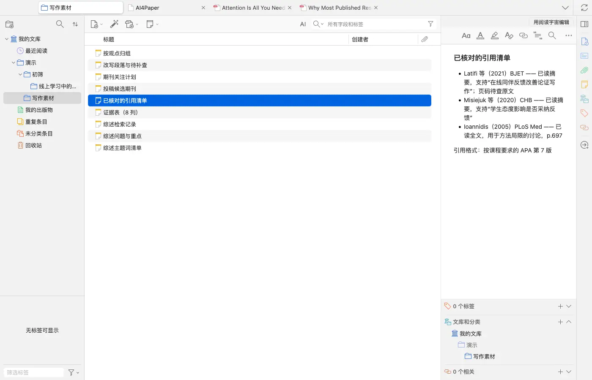
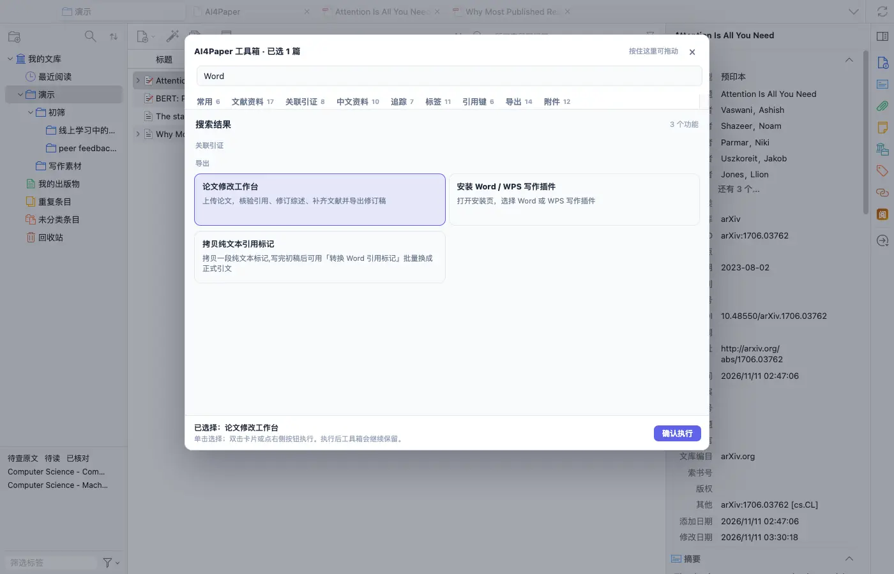
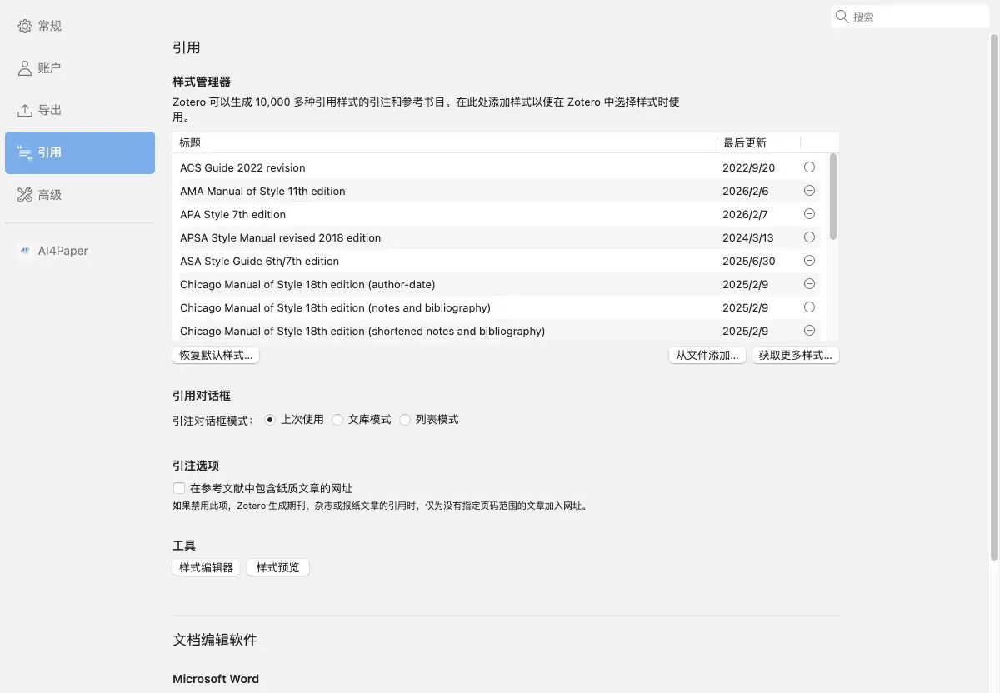
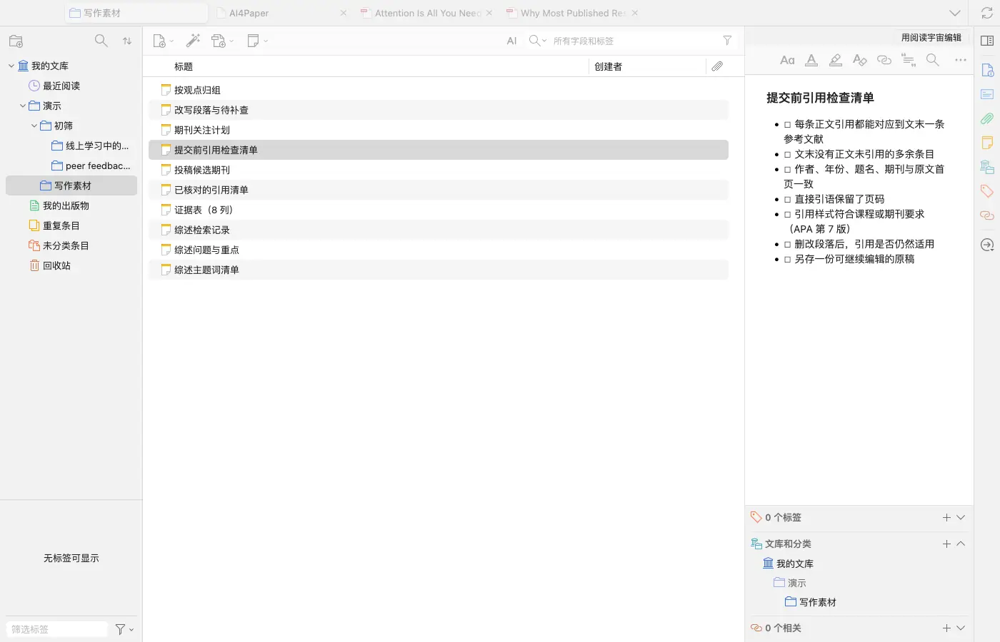

# 在 Word 或 WPS 中把引用与原文对上

> 适用:Zotero 7 及以上；具体以应用内提示为准 · 部分步骤已在真机核对,其余已标注「未实测」

> 资料核对日期：2026-11-11。本篇只核对了 Zotero 里的入口、引用样式设置和官网安装页；没有在 Word 或 WPS 中安装写作插件，文档里插入引用、生成参考文献表等操作均未实测。具体入口、可用功能与使用条件以当前应用内提示为准。

## 你要解决什么

正确引用的第一步是知道某句话出自哪篇材料，而不是先选择一种漂亮的格式。AI4Paper 提供 Word / WPS 写作插件，官网写明可以从自己的文献库插入引注和参考文献表；本篇没有在编辑器里实测这些操作。以下先给通用核对流程，再说明使用产品前需要确认的事项。

## 操作步骤

### 1. 先准备一份练习文档与可靠题录

用文档副本练习，挑两三篇已读过原文的公开论文，核对题名、作者、年份与版本。为每个准备引用的判断记录原文位置，区分直接引语和自己的转述。可以在 Zotero 里建一条笔记列出“已核对的引用清单”。不要把仅在某篇综述里看到、尚未读过原文的文献写成自己已核实的证据。

### 2. 确认当前写作工具支持的操作方式

官网 Word / WPS 写作插件页写明了当前版本与状态（核对时为公开测试版、暂未签名、在线功能自动更新），Word 需下载安装清单后在加载项管理中上传，WPS 在安装页一键安装或更新；页面还列出已上线和开发中的功能。安装前先核对自己的编辑器版本与这些要求；本篇未在 Word 或 WPS 中安装，不提供编辑器内的按钮顺序。

### 3. 只为一个具体论点插入引用

在 Zotero 里右键文献选「AI4Paper 工具箱…」，搜索“Word”，可以看到「安装 Word / WPS 写作插件」「拷贝纯文本引用标记」（先粘贴一段文本标记，写完初稿后再批量换成正式引文）和「论文修改工作台」（核验引用、补齐文献）。在练习文档里为一条有出处的判断加入引用，再检查是否对应正确论文；编辑器内的操作未实测。直接引语要保留引号和页码，转述须忠实于原意。

### 4. 按投稿或课程要求检查样式

先确认要求的引用格式，再检查正文标注与文末条目是否一致。引用样式在 Zotero「设置 → 引用」的样式管理器里选择和添加。不同单位对同名样式可能有细节要求，不能只看样式名称就认定完全符合。核对作者顺序、年份、题名与出版信息；无法确认的内容先查原始出处，不凭排版结果反推资料准确。

### 5. 在提交前检查副本的整体表现

保存并重新打开练习文档，确认引用与参考文献仍能正常显示，再决定是否在正式稿中沿用。对照一份检查清单：正文引用与文末条目一一对应、没有多余条目、直接引语有页码、删改段落后引用仍适用。需要交给他人协作时，先确认对方使用的工具和格式要求，保留可继续编辑的原稿。

## 常见问题

### AI4Paper 的引用按钮具体在哪里？

Zotero 一侧可以从「AI4Paper 工具箱…」找到写作插件的安装入口和纯文本引用标记；Word / WPS 里的引用按钮在写作插件的侧栏中，本篇未在编辑器内实测，请以官网写作插件页和插件内说明为准。

### 格式看着正确，就不用核对内容了吗？

仍需核对。格式只说明呈现方式，不能证明这篇论文支持当前论点，也不能证明题录和页码没有错误。

### 能否直接粘贴别人论文的参考文献？

不应将其当作已核实资料。先找到并阅读你实际需要引用的原文，再核对题录和证据；未读原文时要按适用规范处理转引。

## 相关教程

- [做一张能比较研究的文献证据表](evidence-table.md)
- [用五个问题读论文，并逐项回查](../03-read/read-and-verify.md)
- [把笔记写成能回原文、能继续写作的材料](../06-library/note-management.md)
