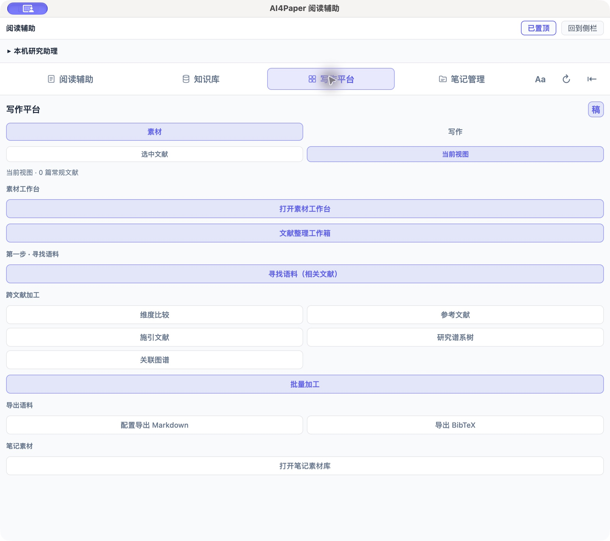

# 做一张能比较研究的文献证据表

[中文手册首页](../README.md) · [Zotero 完整手册](../../manual/zotero-plugin.md) · [Web 完整手册](../../manual/web-workspace.md)

2026-11-26 修订。当前步骤按正式 Web、AI4Paper 10.0.31 与官网核对；本轮实际执行范围见[版本与核验](../../manual/verification.md)，未执行项目不写成成功案例。

## 你要解决什么

做文献证据表。先完成一个小范围练习，再扩大到真实资料。

## 前提

几篇已核相关论文和一致比较维度。

## 操作步骤

1. 阅→写作平台→素材→维度比较，或工具箱 AI 表格。
2. 选择问题、理论、对象、数据、方法、发现、局限等字段。
3. 先核两篇输出，每格保留原文位置，不清楚写待核实。
4. 按主题归纳一致与冲突，导出后再核引文。

## Web 与插件入口分别看

Web 素材区→比较与加工；也可手工用表格完成，生成不代替阅读。

## 结果与检查

同口径、可回查的证据表。

## 常见问题

不同设计/样本/指标不能直接横比；本轮未执行 AI 表格生成。

## 相关教程

- [两端主手册](../README.md)
- [插件全部功能与配置](../../manual/plugin-feature-reference.md)
- [故障排查](../../manual/troubleshooting.md)

<!-- 兼容旧版章节链接；最新操作见本页正文。 -->

