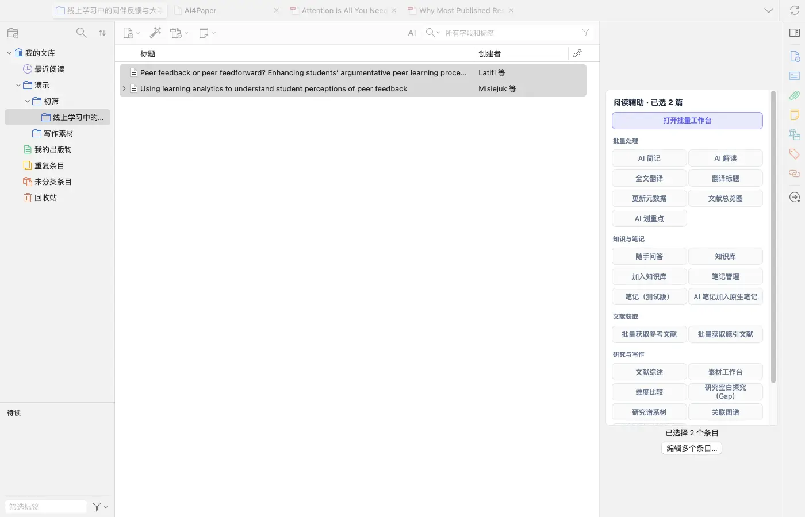
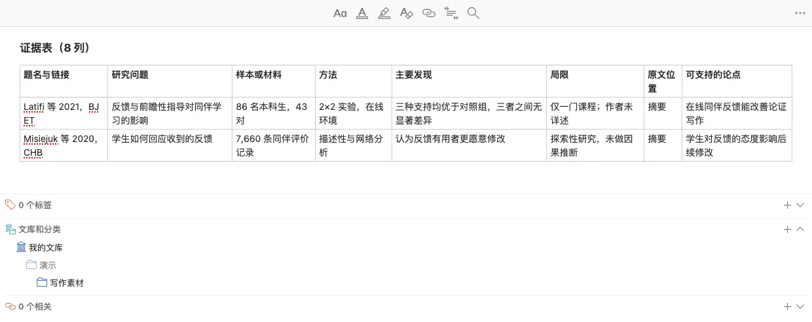
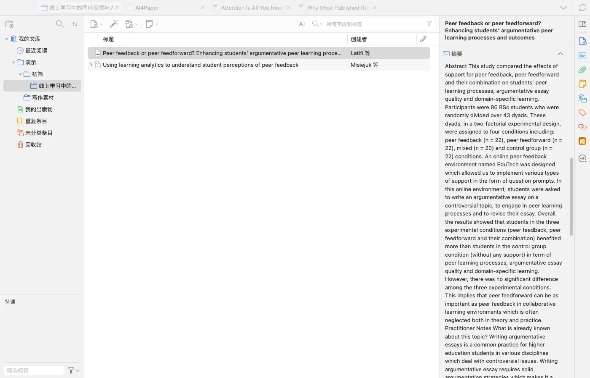
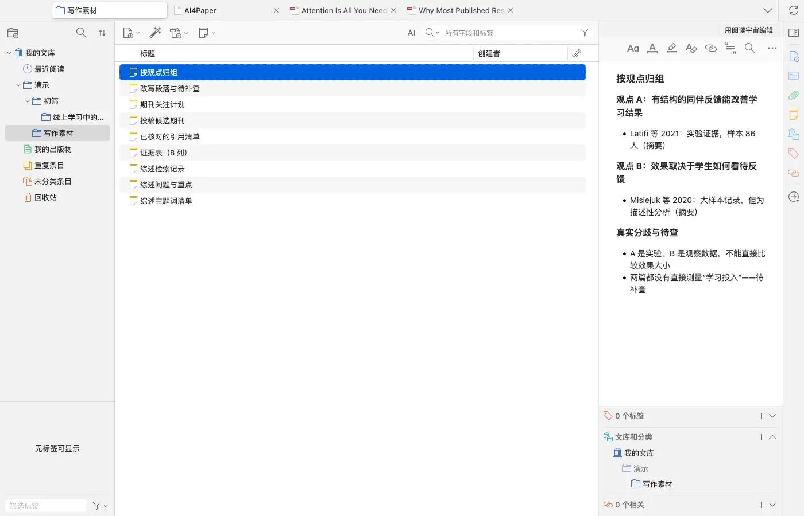
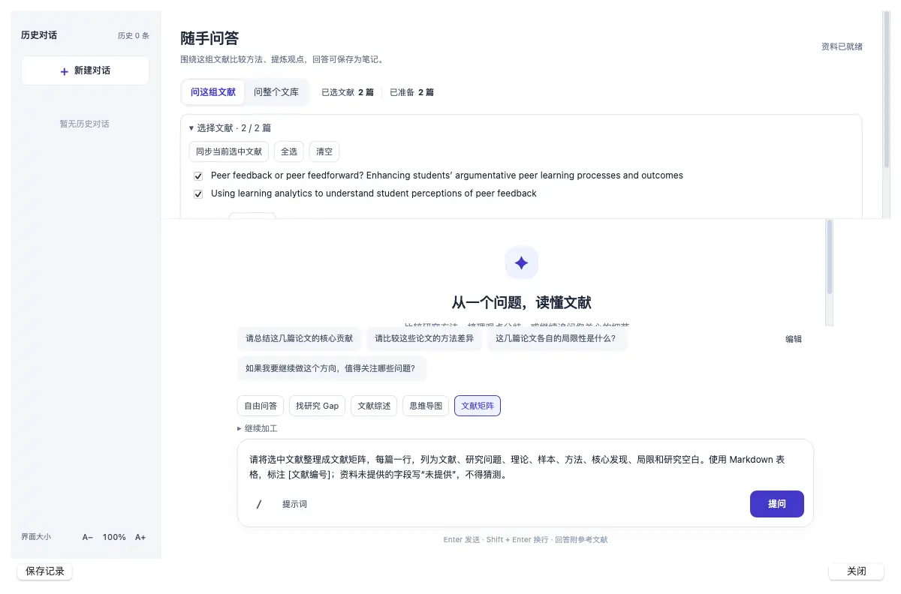

# 做一张能比较研究的文献证据表

> 适用:Zotero 7 及以上；具体以应用内提示为准

> 资料核对日期：2026-11-11。本文操作已在真机上走通并配图；具体入口、可用功能与使用条件以当前应用内提示为准。

## 你要解决什么

证据表的作用不是把摘要排成一列，而是让不同研究能够放在同一组维度下比较。先挑最相关的几篇填出结构，再逐步补充。官网指南采用八列记录：题名与链接、研究问题、样本或材料、方法、主要发现、局限、原文位置、可支持的论点。这个做法用普通文档或一条 Zotero 笔记里的表格就能完成，不必先使用任何产品功能。

## 操作步骤

### 1. 先选一小批最相关的论文

优先放入将直接支持综述核心问题的研究，也保留有代表性的不同意见，并把它们放在同一个分类里。先核对题录和原文可用性，避免只有二手摘要就开始比较。若同一研究存在多篇报告，先记清关系，不把它们当然视为互相独立的证据。

### 2. 用八列建立统一记录方式

按题名与链接、问题、材料、方法、发现、局限、原文位置和可支持论点写出表头。Zotero 笔记支持表格，可以在笔记里直接建一张表，用单独窗口打开会更宽、更好填。每列先约定记什么，例如材料列同时保留对象与规模。表头是为比较服务的，不是越多越好。

### 3. 逐篇读原文，事实与理解分开写

先记录作者报告的材料和结果，再写自己的理解；摘录要加引号并记位置，不凭记忆补数字。例如示例论文摘要写明“86 名本科生、分为 43 对、2×2 实验设计”，表里就照此填写，并在“原文位置”注明来自摘要，读完全文后再补页码。没有找到的信息写“待核查”或“文中未说明”，不要为了填满每一格编造内容。

### 4. 横向寻找共同点、分歧与适用条件

比较相似发现是否来自相似对象和方法，分歧是否可能与时期或定义不同有关。先写“哪里相同、哪里不同”，再讨论可能原因；没有直接证据的解释只作待检验想法。此时可以按观点分组，并单列“真实分歧与待查”，不再逐篇按发表年份排成摘要清单。

### 5. 在 AI4Paper 中辅助整理，再逐格核对

右键这个分类选「随手问答」，在输入框上方点「文献矩阵」，输入框会预填一段整理要求（每篇一行，列为研究问题、理论、样本、方法、核心发现、局限和研究空白，资料没提供的写“未提供”），点「提问」即可生成。实测它基于两篇论文的摘要生成，并自动存进了笔记管理；结果以表格文字形式给出，可以复制后对照你的八列表逐格核对、补原文位置。这项功能需要会员并消耗 AI 额度，以应用内提示为准。最后把可支持的论点改写成自己的话，再据此拟定综述提纲。

## 常见问题

### 论文太多，是否必须全部填完才写？

先选最相关的一小批建立结构，明确范围后继续补充。写作时只对已经核对的材料作判断，不把暂时没填的论文说成不存在。

### 一篇论文支持多个论点怎么办？

保留同一文献与不同论点的关系，每个论点对应自己的原文位置。不要复制成几篇看似不同的研究，也别因为方便分类而丢掉复杂发现。

### 能直接把表里的短句连起来作为综述吗？

还需要解释研究之间的关系与边界。证据表提供材料，综述应围绕问题组织论证；填完并不自动得到有说服力的段落。

## 相关教程

- [用五个问题读论文，并逐项回查](../03-read/read-and-verify.md)
- [怎么找综述：从主题词找到研究地图](find-reviews.md)
- [先整理证据，再核对综述草稿](one-click-review.md)
