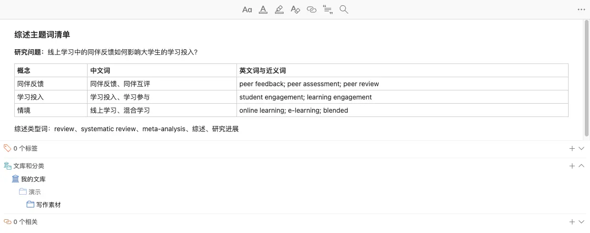
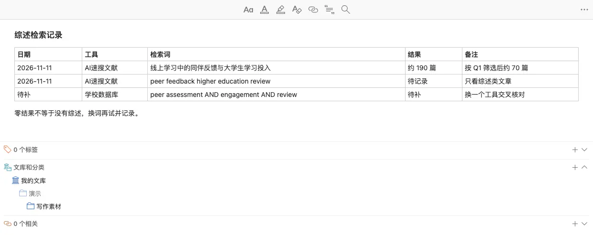
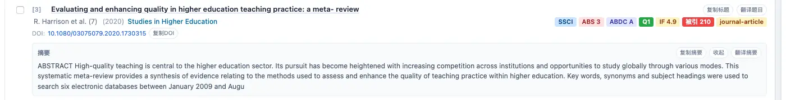
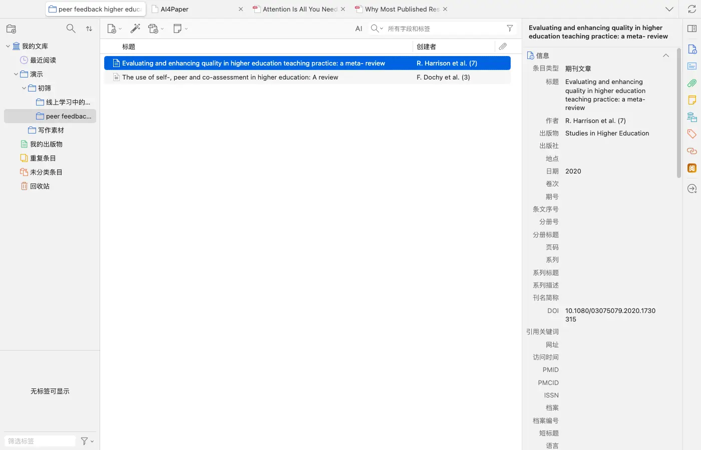
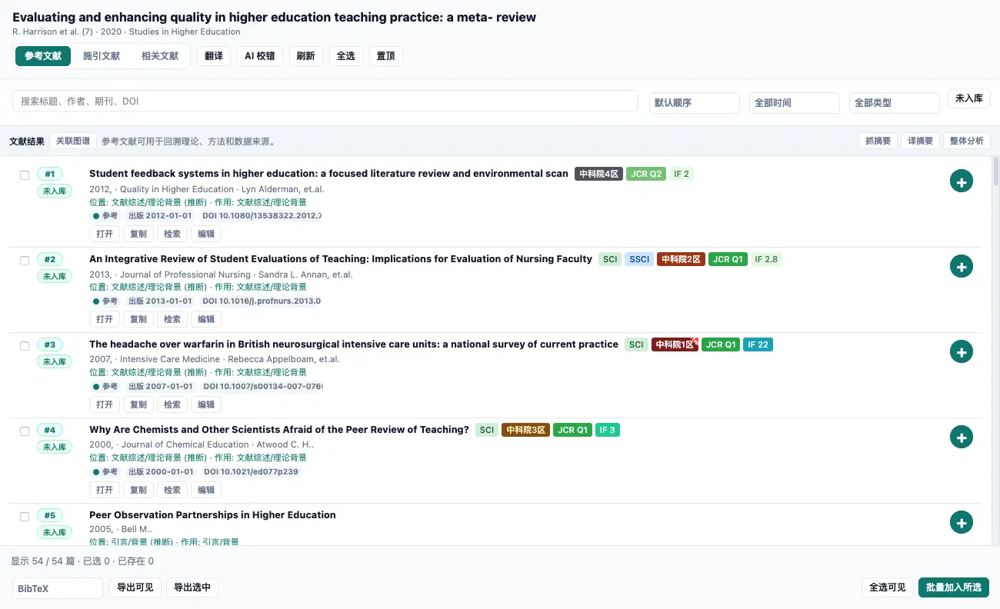
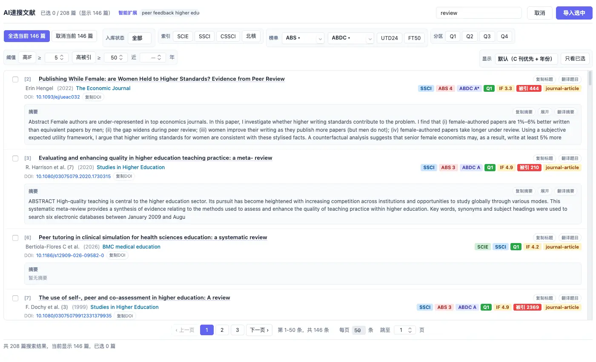

# 怎么找综述：从主题词找到研究地图

> 适用:Zotero 7 及以上；具体以应用内提示为准

> 资料核对日期：2026-11-11。本文操作已在真机上走通并配图；具体入口、可用功能与使用条件以当前应用内提示为准。

## 你要解决什么

找综述不是找到一篇标题里带“综述”的文章就结束。先写清主题，再用多组词找候选，阅读摘要和方法辨认文章类型，最后检查覆盖范围与时间。综述适合帮助建立研究地图，不能替代关键原始研究。下面先给不依赖 AI4Paper 的通用做法，最后再说明怎样把产品用于检索和整理。

## 操作步骤

### 1. 把主题拆成核心概念与近义词

写出你研究的对象、现象和范围，分别列中文词与常见英文表达。例如围绕“同伴反馈与学习投入”，先分别准备两个概念的近义词，再决定是否限定大学生或线上学习。可以在 Zotero 里新建一条笔记专门放这张词表，后面看到贴题文章的新术语，随时补进去。

### 2. 分别尝试主题词与综述类型词

在平时使用的学术检索工具中，将主题词与“综述”“研究进展”“述评”或 review、systematic review、meta-analysis 等词组合尝试。不同工具的写法和筛选能力不同，按当前帮助使用，不照搬一套语法。每次检索都记下日期、工具、检索词和结果数量，避免把一次零结果当作没有综述。

### 3. 阅读摘要与方法，确认文章是什么

看文章是否综合了已有研究，以及是否说明材料如何选择、如何整理。实测示例中，一篇 meta-review 的摘要写明了检索了几个数据库、覆盖哪段时间，这类说明就是判断范围的依据。标题出现 review 也可能只是别的用法；有些综述标题并不包含这个词。系统综述、叙述性综述与元分析侧重点不同，不应混作同一种证据。

### 4. 检查主题匹配、覆盖年份与局限

记下综述关注的人群、概念、学科与文献截至时间，判断是否真正贴合你的问题。新发表的综述也可能较早停止搜集材料，较早的经典综述则可能有助于理解概念起源。导入 Zotero 后，在右侧信息栏核对年份、期刊和 DOI；题录不完整（例如作者只显示“某某 et al.”）时，按原文补齐后再引用。

### 5. 沿参考文献与后续引用补充原始研究

选中一篇综述，在右侧「阅」里点「参考文献」，再点「获取参考文献」，会列出它引用的文献及期刊信息；点右上角的弹出按钮可在「文献工作台」大窗口里查看，旁边的「施引文献」页签用于查看后来谁引用了它（本篇未展开该页签）。实测一篇综述列出了 54 条参考文献，可逐条打开或加入文库。挑出与你的问题最相关的原始研究自己阅读，引用具体发现时优先核对原始出处。

### 6. 在 AI4Paper 中重做一轮有记录的检索

右键一个分类选「AI速搜文献」，用英文写上主题加 review、systematic review 等词。结果窗口里没有专门的“只看综述”按钮，可以在右上角搜索框输入 review 缩小范围——它会同时匹配题名和摘要，因此仍会混入非综述文章（实测里就有一篇只在摘要里提到 peer review 的研究），要逐条看摘要辨认。速搜需要会员并消耗 AI 额度，以应用内提示为准。把入选的综述、理由和待补查之处记到笔记或证据表里。

## 常见问题

### 综述与原始研究应该先读哪一种？

入门时可以先读贴题综述建立概念地图，再读它引用的关键原始研究；若已经有明确争议，也可以从相关原始证据出发补读综述。

### 找不到很贴题的综述怎么办？

先放宽一个对象或范围限制，找上位主题的综述了解术语，再回到更具体问题补查原始研究。不要把稍有关联的综述硬说成完全覆盖。

### 找到几篇后能否说检索全面？

不能仅凭数量判断。需说明使用的工具、检索词、时间与选择规则，并检查遗漏。若要开展正式系统综述，应另行制定符合该研究要求的完整方案。

## 相关教程

- [用清楚的问题找到第一批文献](../02-find/ai-quick-search.md)
- [做一张能比较研究的文献证据表](evidence-table.md)
- [先整理证据，再核对综述草稿](one-click-review.md)
