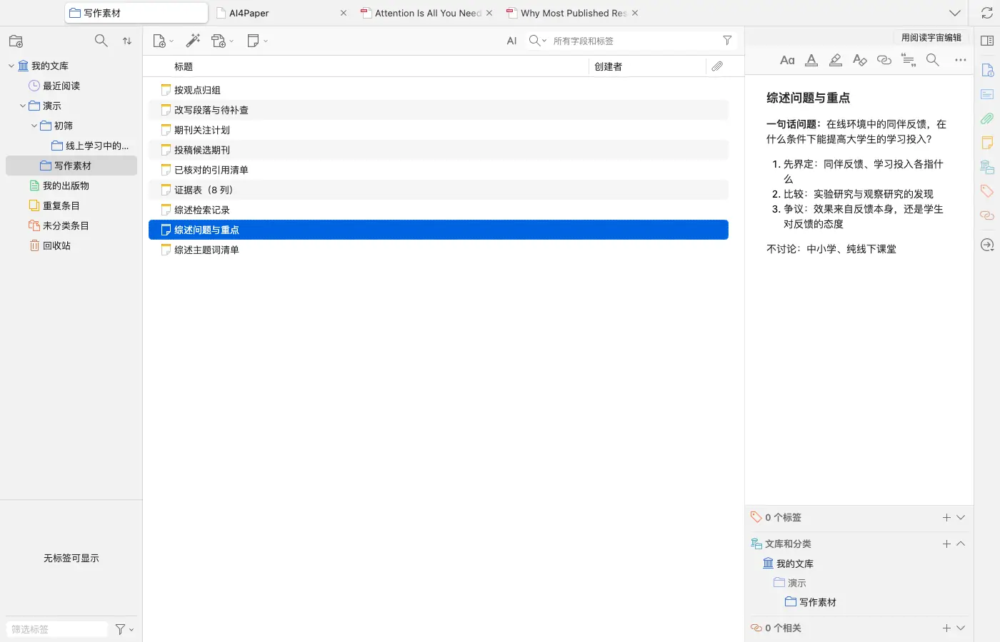
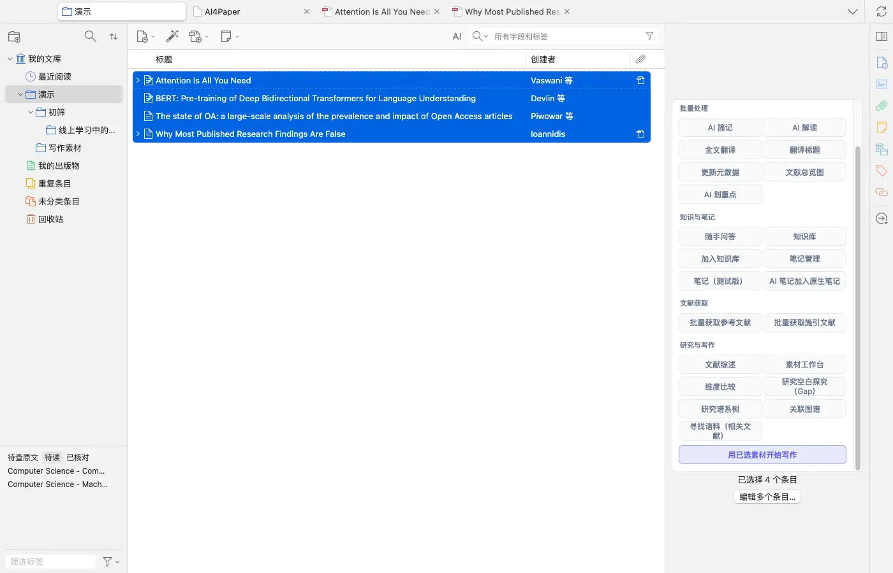
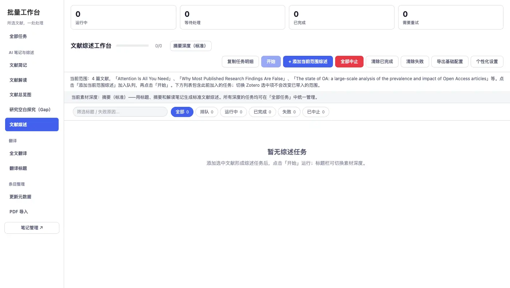
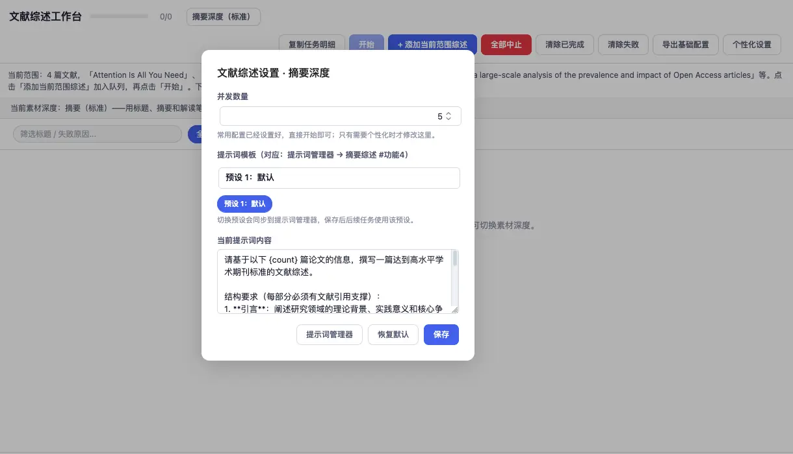
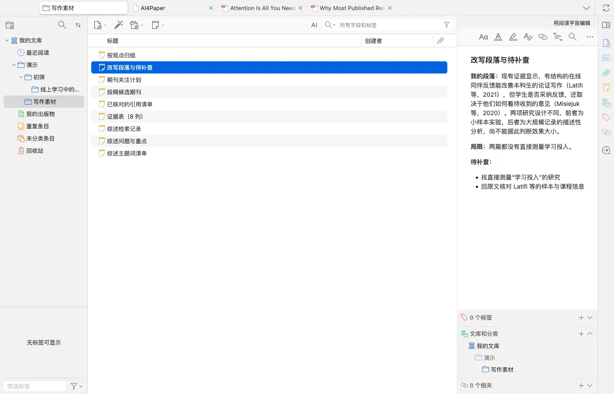

# 先整理证据，再核对综述草稿

> 适用:Zotero 7 及以上；具体以应用内提示为准 · 部分步骤已在真机核对,其余已标注「未实测」

> 资料核对日期：2026-11-11。第 1、2、5 步与第 3 步的入口、设置已在真机上核对；为控制额度，本篇没有实际生成综述，第 4 步对草稿的核对未实测。具体入口、可用功能与使用条件以当前应用内提示为准。

## 你要解决什么

生成综述可以帮助起草，不能替作者确定研究问题或完成证据判断。开始前先检查材料是否贴题，完成后逐段核对论点与引用，再用自己的分析改写。生成综述需要会员，并按文献数量和素材深度消耗较多 AI 额度，以应用内提示为准。没有足够材料时先补读，不用一段流畅文字填补证据空缺。

## 操作步骤

### 1. 先用一句话确定综述要回答什么

把对象、核心关系和范围写清，例如“在线环境中的同伴反馈，在什么条件下能提高大学生的学习投入”。再列出读者需要先理解的概念、主要争议和明确不讨论的范围。若问题还过于宽泛，先缩小范围；不要指望在生成之后才决定这篇综述究竟讨论什么。

### 2. 准备已经阅读并核对的文献与笔记

检查每篇论文的题录、原文和阅读记录，确认它与本次问题有关。笔记应包含材料、方法、发现、局限与原文位置，不能只有一段工具摘要。在文库里多选这些文献，右侧会出现「阅读辅助 · 已选 N 篇」面板，其中「研究与写作」一栏有文献综述、素材工作台、维度比较、研究空白探究等入口。

### 3. 先拟提纲，再按当前入口起草

按概念、观点或争议安排段落，并写明每一部分准备支持什么论点。然后右键所选文献选「文献分析」，在批量工作台左侧点「文献综述」：页面会写明“当前范围：N 篇文献”和当前素材深度（例如“摘要（标准）——用标题、摘要和解读笔记生成”），点「添加当前范围综述」加入队列，再点「开始」才会运行。也可以在「随手问答」里选「文献综述」模式做简短综述。先用小范围材料检查是否符合目标。

### 4. 逐段核对事实、引用与论证范围

生成前可点「个性化设置」查看素材深度和提示词要求（例如“每部分必须有文献引用支撑”），据此知道草稿会按什么结构写。拿到草稿后，打开每条关键引用，确认原文真的支持该句，数字和条件没有被省略，也没有把相关写成因果。草稿生成与核对本篇未实测；找不到可靠出处的内容先删去或标待查。

### 5. 用自己的分析改写并补足局限

检查段落是否只是在轮流介绍论文，还是说明了共同点、分歧与尚待解决的问题。保留真实不一致，不为了行文整齐强行统一结论；把局限和待补查的问题单独列出。定稿前检查学校、期刊或项目对工具使用的要求，按要求说明使用情况，并保存自己核对后的材料与版本。

## 常见问题

### 生成后可以直接交稿吗？

不建议。研究问题、核心论证、事实与引用均需作者核对，是否允许使用此类帮助还应遵守所在课程或目标期刊的要求。

### 草稿引用很多，是否说明材料充分？

引用数量不等于证据充分。应检查哪些研究直接回答问题、哪些只是背景，以及是否漏掉有代表性的不同观点。

### 遇到原文不支持的句子怎么办？

先停止使用该句，回查上下文或更换为已有证据能支持的表述。不要只换一条看起来相近的引用来保住原句。

## 相关教程

- [怎么找综述：从主题词找到研究地图](find-reviews.md)
- [做一张能比较研究的文献证据表](evidence-table.md)
- [用五个问题读论文，并逐项回查](../03-read/read-and-verify.md)
