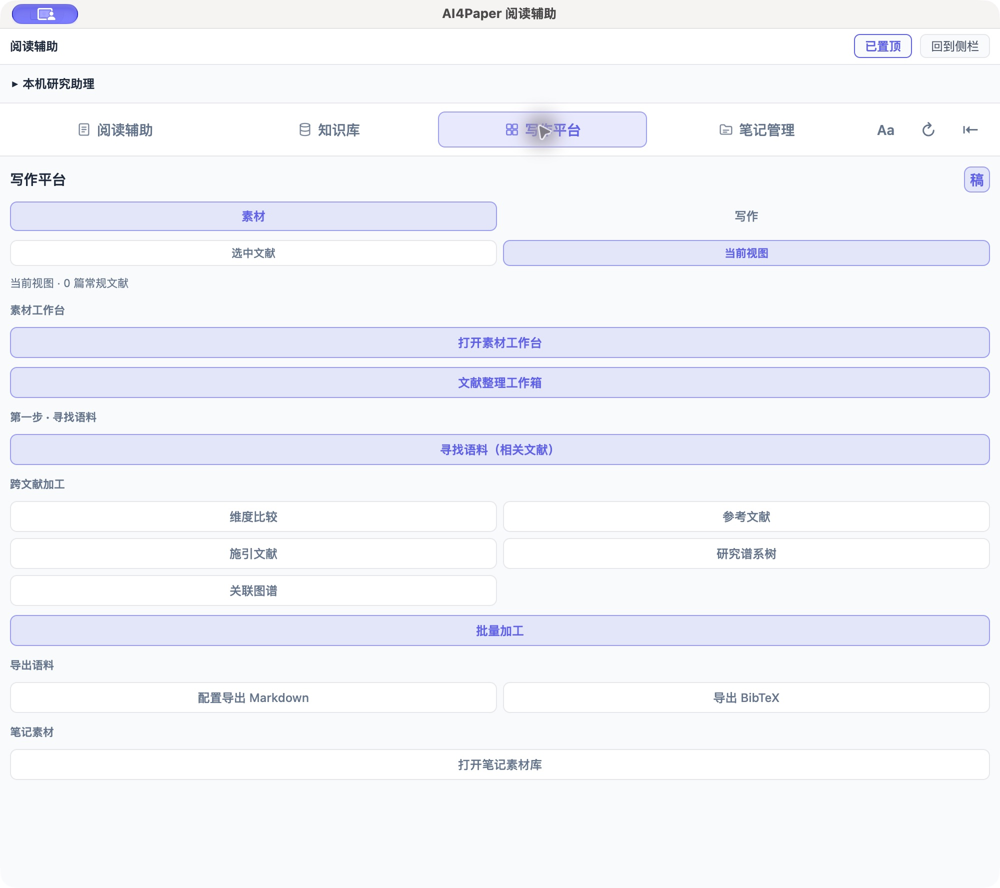

# 先整理证据，再核对综述草稿

[中文手册首页](../README.md) · [Zotero 完整手册](../../manual/zotero-plugin.md) · [Web 完整手册](../../manual/web-workspace.md)

2026-11-26 修订。当前步骤按正式 Web、AI4Paper 10.0.31 与官网核对；本轮实际执行范围见[版本与核验](../../manual/verification.md)，未执行项目不写成成功案例。

## 你要解决什么

从证据到综述稿。先完成一个小范围练习，再扩大到真实资料。

## 前提

真实材料已筛选，正文/摘要深度与引用可核。

## 操作步骤

1. 阅→写作平台，核选中文献/当前视图及篇数。
2. 在素材工作台选材料，做必要简记、比较、Gap 或谱系。
3. 进入写作/综述工作台，选标题/摘要/精读等取材深度，核主题/结构/费用后运行。
4. 逐句核数字和引用，编辑成自己的论述，保存稿件并打开导出文件。

## Web 与插件入口分别看

Web 写作区→一键综述或研究综述；先审候选材料与生成结果再插入正文。

## 结果与检查

可编辑、有来源并经人工核查的稿件。

## 常见问题

目标篇数不等于实际读到篇数；生成不保证事实或引用正确，本轮未执行消耗任务。

## 相关教程

- [两端主手册](../README.md)
- [插件全部功能与配置](../../manual/plugin-feature-reference.md)
- [故障排查](../../manual/troubleshooting.md)

<!-- 兼容旧版章节链接；最新操作见本页正文。 -->

