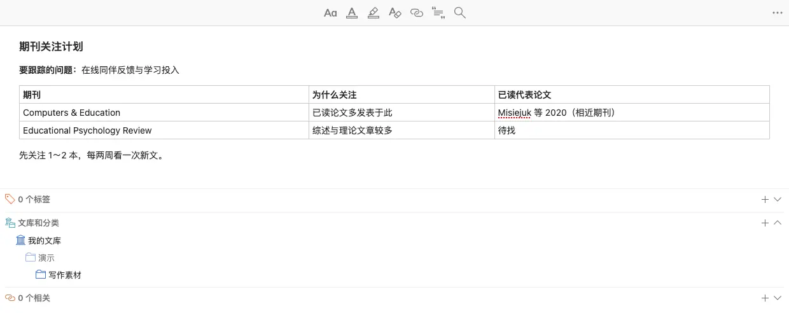
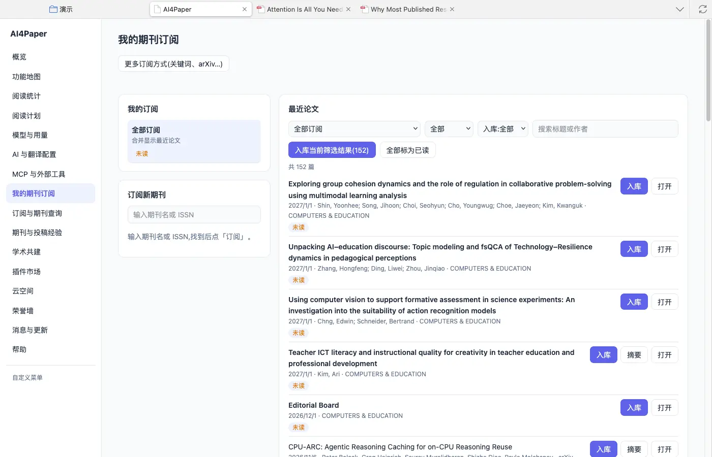
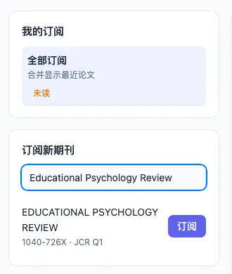
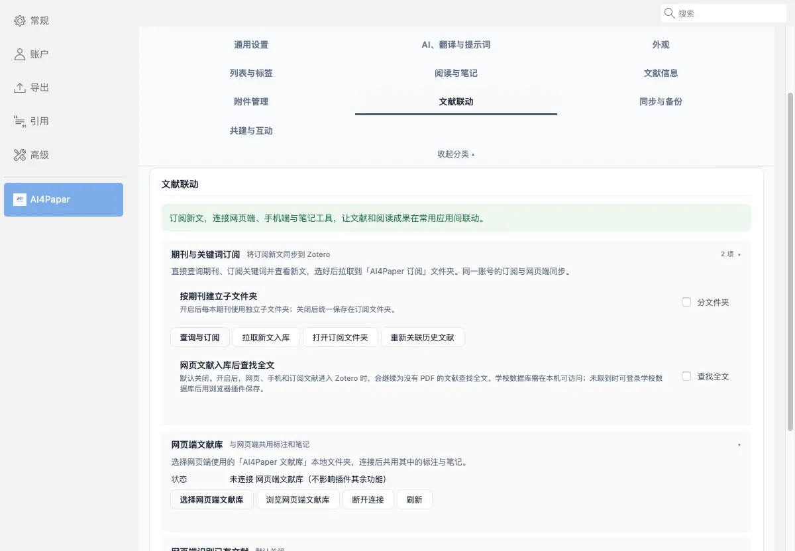

# 订阅少量相关期刊，持续补充新文献

> 适用:Zotero 7 及以上；具体以应用内提示为准 · 部分步骤已在真机核对,其余已标注「未实测」

> 资料核对日期：2026-11-11。订阅页面、新文列表和设置已在真机上核对；为避免改动账号，本篇没有真正点「订阅」或「取消订阅」，也没有拉取新文入库，这几个动作未实测。具体入口、可用功能与使用条件以当前应用内提示为准。

## 你要解决什么

订阅期刊的意义是及时发现值得读的新材料，而不是让未读提醒越积越多。先从与你问题最接近的少量期刊开始，定期筛选并核对原文。AI4Paper 应用页有「我的期刊订阅」和「订阅与期刊查询」两处入口，订阅与同一账号的网页端同步。

## 操作步骤

### 1. 先确定持续关注的研究主题

用一两句话写清当前需要跟踪什么，列出你已经读过的代表性论文。再看这些论文集中发表在哪些期刊，优先选择内容持续相关的刊物，并写下关注理由。不要只因为指标较高就大量订阅；每增加一本，都应知道它可能给自己的阅读带来什么。

### 2. 从应用页找到期刊订阅

打开应用页（Zotero「工具 → 阅读宇宙应用」），左侧选「我的期刊订阅」。左栏是「我的订阅」（可选“全部订阅”合并查看）和「订阅新期刊」，右栏是「最近论文」，可按订阅、已读状态、是否入库筛选和搜索。顶部「更多订阅方式（关键词、arXiv…）」可以按研究主题而不只按期刊订阅。

### 3. 先核对一本期刊，再按提示订阅

在「订阅新期刊」框输入期刊名或 ISSN，查到后会显示期刊全称、ISSN 和分区，旁边有「订阅」按钮。先核对全称及研究范围，避免把缩写相近的刊物当成目标；一次先试一本，订阅后回到「我的订阅」确认记录的是预期刊物。本篇只查到了期刊、没有点「订阅」，订阅后的状态请以页面显示为准。

### 4. 定期筛选动态并阅读真正相关的论文

在「最近论文」里，每条新文显示日期、作者和期刊，带「入库」「摘要」「打开」按钮。先点「摘要」看是否贴题，再决定入库。订阅动态不等于已经取得全文，更不等于完成阅读；对暂时拿不到原文的材料保留待查标记，不只靠一段摘要形成正式证据。

### 5. 按实际阅读效果调整关注范围

记录哪些期刊带来可用材料，哪些与主题逐渐无关；「我的订阅」里每本期刊旁有「取消订阅」。想把选中的新文放进 Zotero，可在设置「AI4Paper → 文献联动 → 期刊与关键词订阅」中使用「拉取新文入库」，新文会进入「AI4Paper 订阅」文件夹，还可选择按期刊建立子文件夹。订阅只覆盖选定期刊，不能代替全面检索。

## 常见问题

### 多久更新，是否会发邮件？

本篇未核实更新频率与通知方式。官网功能地图提到可通过小程序提醒，具体以当前订阅页面和相关说明为准，再决定如何安排自己的检查时间。

### 订阅后是否自动获得所有全文？

不能这样推断。看到新论文与拥有全文访问权限是不同的事情，应通过学校图书馆或出版方允许的方式取得原文。设置里有一项默认关闭的「网页文献入库后查找全文」，学校数据库需在本机可访问。

### 还需要定期检索吗？

需要。重要研究可能发表在未订阅的期刊或其他出版物中，仍应根据主题补搜，并检查已有综述之后的新证据。

## 相关教程

- [看懂期刊信息，再判断是否适合投稿](ranking-and-if.md)
- [用清楚的问题找到第一批文献](../02-find/ai-quick-search.md)
- [怎么找综述：从主题词找到研究地图](../04-write/find-reviews.md)
