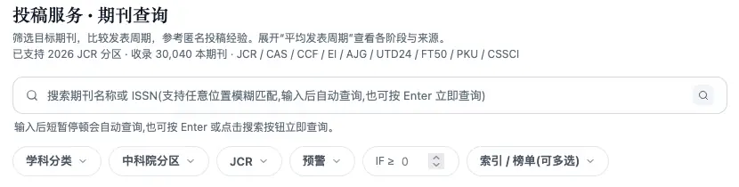
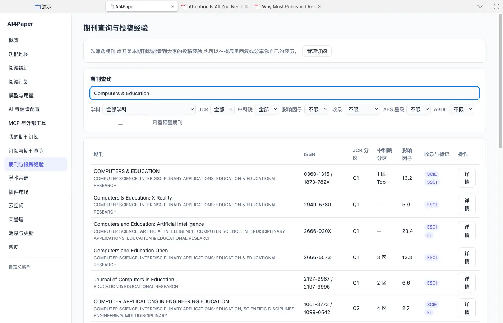
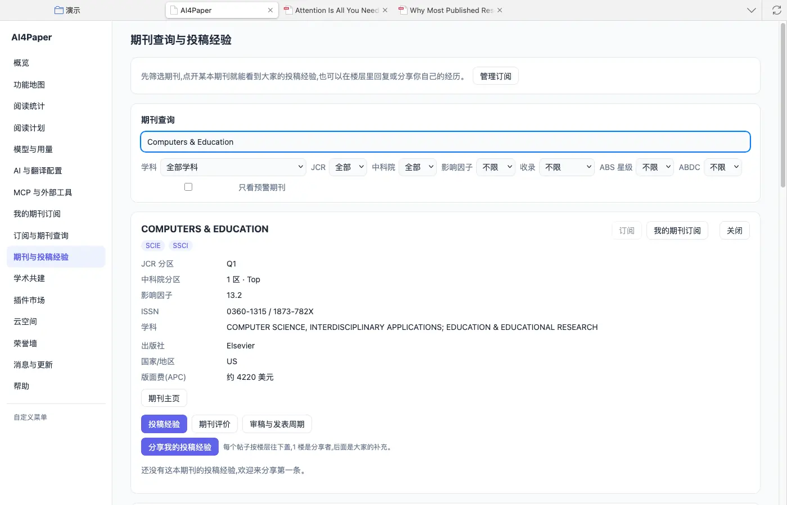
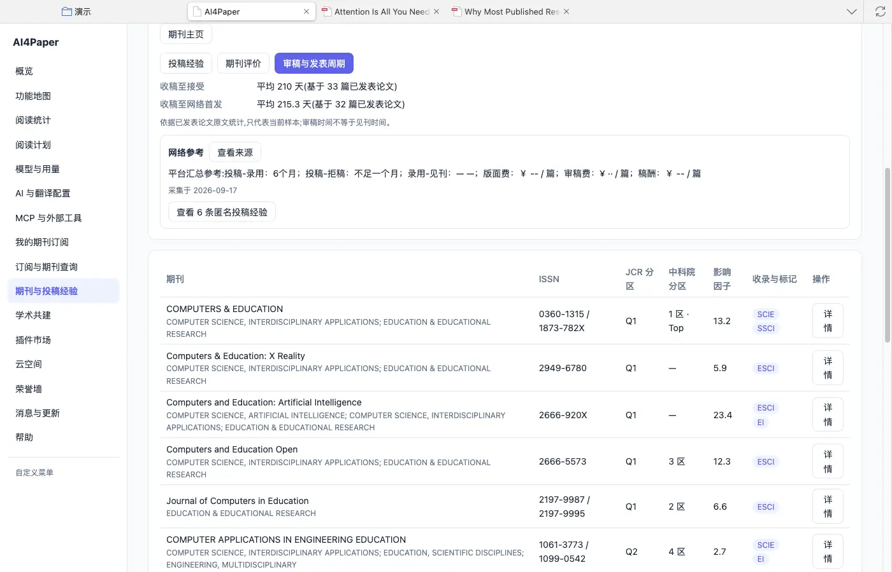
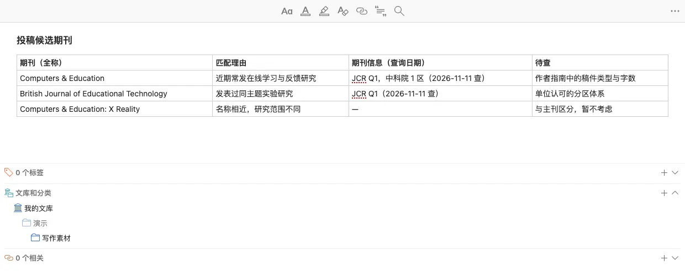

# 看懂期刊信息，再判断是否适合投稿

> 适用:Zotero 7 及以上；具体以应用内提示为准

> 资料核对日期：2026-11-11。本文操作已在真机上走通并配图；具体入口、可用功能与使用条件以当前应用内提示为准。

## 你要解决什么

选期刊先看稿件是否符合它的研究范围，再看评价要求和期刊信息。分区与影响因子是辅助比较的线索，不能直接证明某篇论文的质量，更不能保证稿件会被接收。AI4Paper 应用页里有「期刊与投稿经验」和「订阅与期刊查询」两处查期刊的地方；使用时应同时保留体系、年份和查询日期，不把一个孤立的数字当成选刊结论。

## 操作步骤

### 1. 先写清稿件主题与必须满足的要求

概括研究对象、主要方法和稿件类型，列出课程、毕业、项目或单位对发表的正式要求。要求涉及分区时，确认认定的体系与年份。应用页「订阅与期刊查询」的期刊查询区写明了当前支持的体系和年份（核对时为“已支持 2026 JCR 分区”，并列出 JCR、CAS、CCF、EI、AJG、UTD24、FT50、PKU、CSSCI 等），可以先对照单位要求看是否覆盖。

### 2. 用期刊全称核对当前信息

打开应用页左侧「期刊与投稿经验」，在「期刊查询」框输入刊名或 ISSN，还可以按学科、JCR、中科院分区、影响因子、收录、ABS、ABDC 筛选。实测输入 “Computers & Education”，结果里同时出现了 X Reality、Artificial Intelligence、Open 等多本名称相近的期刊，分区和影响因子各不相同。务必用全称和 ISSN 确认是哪一本，没有显示的信息先记待查。

### 3. 分开记录分区体系、年份和数值

点结果右侧的「详情」，会显示 JCR 分区、中科院分区、影响因子、ISSN、学科、出版社和版面费等信息。详情里的数值没有逐项标年份，记录时要另外写上查询日期和页面声明的版本（见第 1 步）。中科院分区与 JCR 分区是不同体系，不能只写一个“一区”就混用；正式评审前仍需按单位最新要求逐项核对。

### 4. 回到近期文章检查内容匹配

详情里的「期刊主页」可以打开期刊官网，阅读近期与你主题相近的文章和作者指南。「审稿与发表周期」页签给出“收稿至接受”等平均天数，并注明基于多少篇已发表论文统计、审稿时间不等于见刊时间；「投稿经验」页签是其他用户的匿名分享。这些都只能作为线索，不替代期刊当前的正式要求。

### 5. 形成包含理由与疑问的候选名单

为每本候选写一句内容匹配理由，并记录需要进一步核查的事项，如稿件类型、费用和格式，以及查询日期。名称相近、范围不同的期刊也写进来并注明“暂不考虑”，避免日后混淆。费用与投稿要求以期刊当前正式说明为准，不能凭他人旧经验承诺。

## 常见问题

### 影响因子高就应该优先投吗？

不必然。先看主题和文章类型是否匹配，再考虑正式要求与其他条件；期刊整体指标不能预测你这篇文章的接收结果。

### 查不到分区怎么办？

核对全称与 ISSN，并检查当前提供的年份和范围。缺失不能直接解释为期刊质量差，也不要自行用另一套体系替上。

### 应用显示的信息能直接用于单位评审吗？

应按单位最新正式口径复核体系和年份。保存查询依据便于核查，但不能据此替代单位自身的认定决定。

## 相关教程

- [按期刊信息缩小范围，再按内容选论文](../02-find/filter-by-ranking.md)
- [订阅少量相关期刊，持续补充新文献](journal-alerts.md)
- [做一张能比较研究的文献证据表](../04-write/evidence-table.md)
