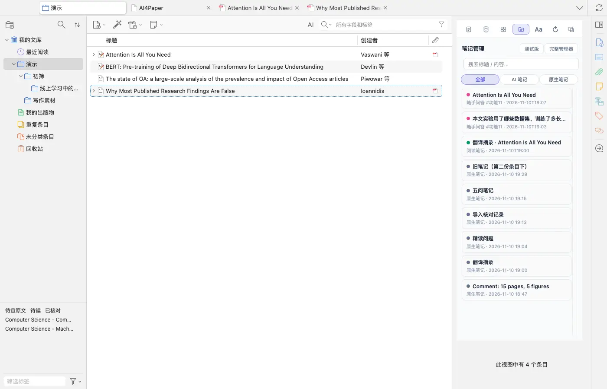
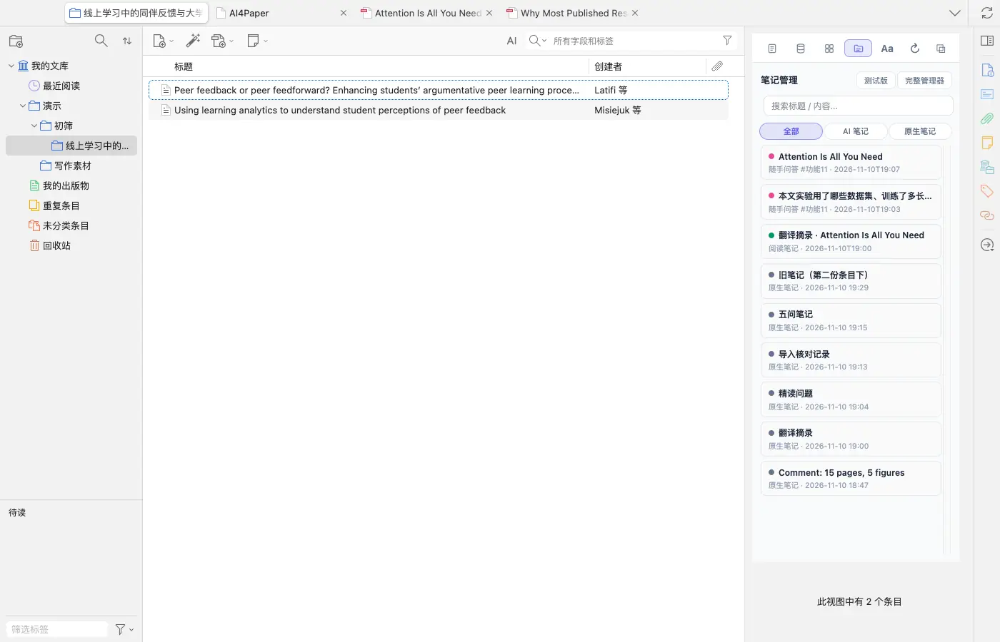
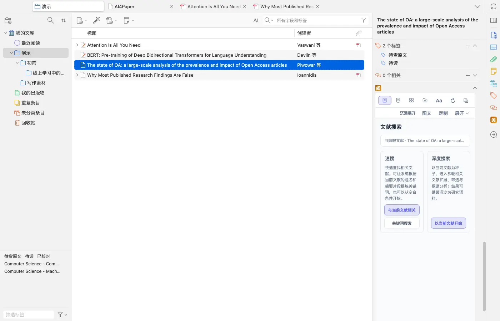
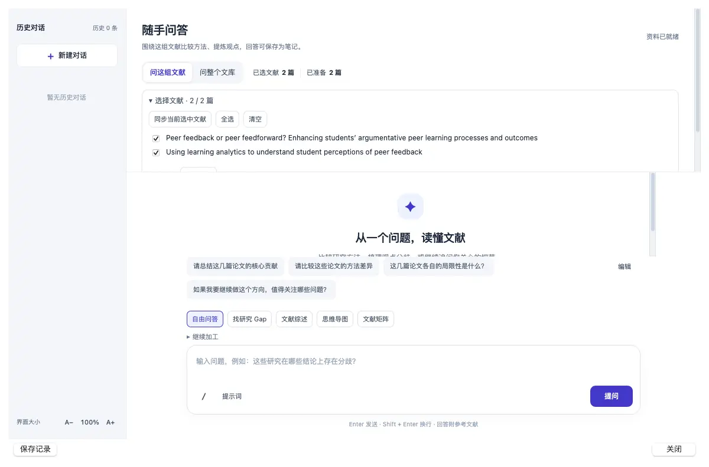
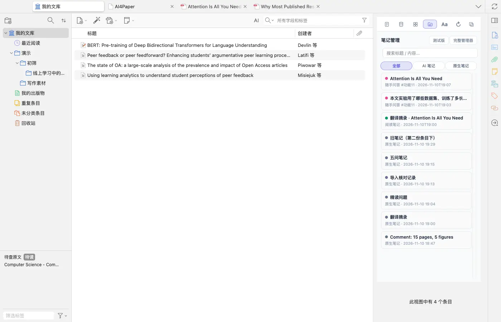

# 让分类管主题，让标签管阅读状态

> 适用:Zotero 7 及以上；具体以应用内提示为准

> 资料核对日期：2026-11-11。本文操作已在真机上走通并配图；具体入口、可用功能与使用条件以当前应用内提示为准。

## 你要解决什么

整理文库的目标是更容易找到下一篇要读的论文，而不是把所有条目排得完全整齐。先用分类区分研究任务，再用少量标签记录跨主题线索或阅读状态，会更容易坚持。AI4Paper 的不少功能以分类为范围：从哪个分类发起 AI速搜文献，导入的论文就放到它下面；右键分类做随手问答，默认就问这个分类里的文献。因此整理应围绕实际阅读与写作任务进行。

## 操作步骤

### 1. 先按当前课题建立少量主题分类

用自己看得懂的课题名称区分正在做的任务，不一开始就设计很深的层级。在 Zotero 左栏右键「我的文库」或已有分类，选「新建分类」或「新建子分类」即可。先问每个分类将支持哪一次阅读、比较或写作；没有明确用途的分类可以暂缓。

### 2. 把待筛选材料与核心材料分开

为新找到但尚未阅读的论文保留一个清楚去处，例如「初筛」分类，核对相关性后再决定是否纳入核心材料。实测从「初筛」发起 AI速搜文献，导入的论文会自动放进它下面一个以检索主题命名的子分类。不要因为导入成功就把它视为已经读过；也不要为了目录好看而删去暂时无法判断的文章。

### 3. 约定少量可持续使用的标签

例如“待读”“已核对”“待查原文”，分别表达下一步要做什么。选中一篇论文，在右侧标签区点「+」输入即可；用过的标签会出现在左下角的标签选择器里。先约定每个词的含义，再检查是否和现有叫法重复。AI4Paper 工具箱里另有「系统标签管理」「本地规则打标签」「AI 自动打标签」等批量工具，先在少量示例上试用（AI 打标签会消耗额度）。

### 4. 检索与提问前检查所选分类

检索前确认结果要加入哪一处；围绕一组论文提问前，右键该分类选「随手问答」，展开「选择文献」核对清单是不是你要的那几篇，不需要的可以取消勾选。若为了一个比较任务需要暂时汇集材料，先检查题名与版本，不把同一研究的不同报告当成多条独立证据。

### 5. 用真实查找任务检验整理效果

尝试找出下一篇待读论文：选中「我的文库」，在左下角点「待读」标签，列表就只剩带这个标签的论文；再点一次取消筛选。找不到时再调整名称或规则，而不是继续增加标签数量。大范围修改前先保留重要资料，逐批检查。

## 常见问题

### 分类与标签一定要按这套命名吗？

不用。关键是自己理解并长期保持一致。课题、状态和概念不要全挤在一种叫法里，能帮助完成实际任务就有价值。

### 已经有很多标签，是否应该全部重做？

先挑一个正在写的课题试行简化规则，确认有帮助再逐步处理。没有明确理由时不必大范围更名，更不要顺手删掉重要资料。

### 整理好是否就能直接写综述？

还需要阅读、核对和横向比较。分类与标签帮助管理材料，不会替你判断证据质量，也不会自动形成论证。

## 相关教程

- [整理已有文献，先用一小批检查导入](../02-find/import-existing.md)
- [先比较版本与附件，再处理重复文献](dedup.md)
- [把笔记写成能回原文、能继续写作的材料](note-management.md)
