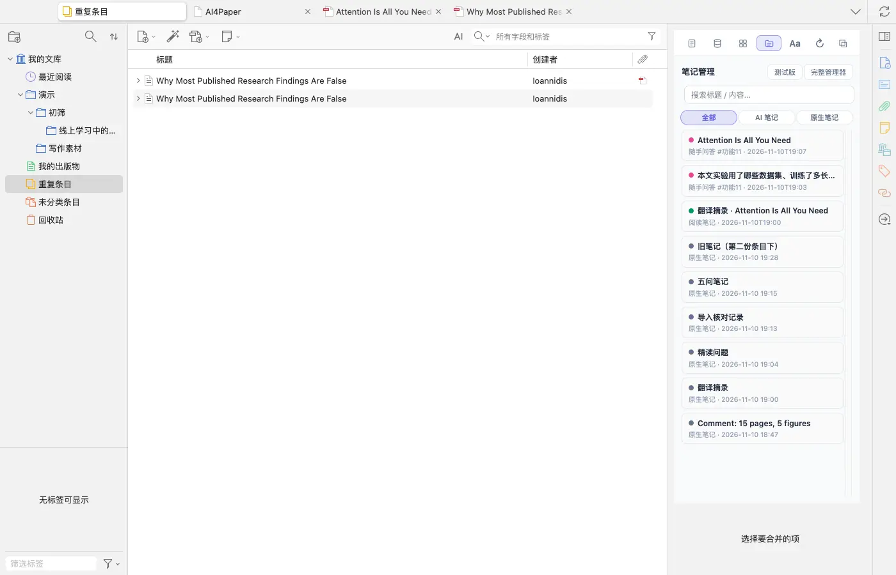
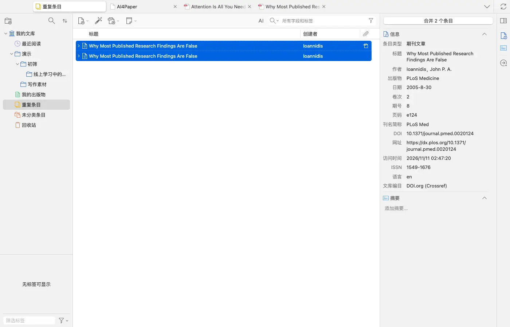
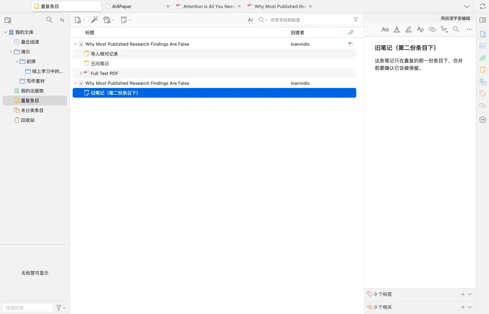
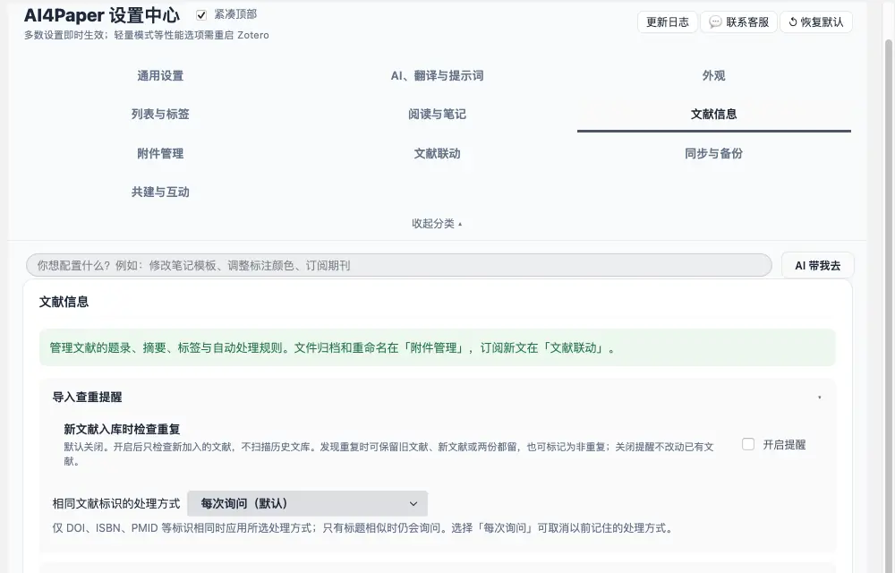
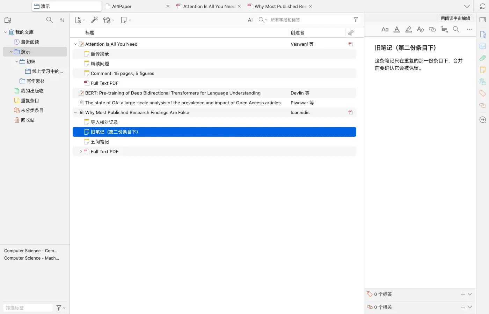

# 先比较版本与附件，再处理重复文献

> 适用:Zotero 7 及以上；具体以应用内提示为准

> 资料核对日期：2026-11-11。本文操作已在演示文库中走通并配图（包括合并一组重复条目）；具体入口、可用功能与使用条件以当前应用内提示为准。

## 你要解决什么

题名相近不等于同一份材料。预印本、正式发表版、更正说明，以及同一研究的不同报告，都可能看起来相似。处理重复之前先核对题录、版本和附件，再决定保留或整理。Zotero 自带「重复条目」与合并功能；AI4Paper 另有导入时的查重提醒，以及右键「清理」「文库体检」中的重复检查。

## 操作步骤

### 1. 先保留重要原文、笔记与标注

开始前确认重要资料有可用副本，尤其是自己添加的阅读笔记与附件。在 Zotero 左栏点「重复条目」，会列出疑似重复的文献；先选少量练习，不对整库直接批量处理。没有确认资料可恢复时，先做标记和比较，不急着执行会删改资料的动作。

### 2. 核对题名、作者、年份与出版信息

在「重复条目」里点其中一条，同组的条目会一起选中，右侧出现「合并 N 个条目」按钮和主条目的字段；字段有差异时可以选择保留哪个版本的值。逐项比较，不只看文件名：题名可能有标点差别，年份可能对应不同发表阶段，作者顺序也可能被记录错。能够取得可靠原文时以正文与正式出版信息核对。

### 3. 打开附件并确认版本关系

展开每一条，看各自挂着哪些附件和笔记——实测示例中，一条有 PDF 和两条笔记，另一条只有一条独有的旧笔记。查看 PDF 首页、正文与必要的版本说明，区分预印本、正式发表版和更正文件。若并非完全相同的材料，先保留关系说明；不能因为不想看到两个标题，就把有研究价值的版本差异抹掉。

### 4. 只在确认工具行为后处理一组

只处理已确认是同一份材料的一组。若希望以后新导入时就提醒，可在设置「AI4Paper → 文献信息 → 导入查重提醒」开启（默认关闭，只检查新加入的文献）；页面写明了可选的处理方式：每次询问、保留旧文献并合并新文献的附件与笔记、保留新文献、两份都保留，且只在 DOI、ISBN、PMID 等标识相同时自动应用。不能确认笔记和附件会怎样保留时先停止。

### 5. 重新打开文献确认结果完整

实测在「重复条目」中点「合并 2 个条目」后，保留下来的条目同时挂着原来的 PDF、两条笔记和另一条的旧笔记，被合并的那一条进入回收站。处理后检查保留条目的题录、原文、附件与重要笔记，确认目标分类仍能找到它；再记录判定依据与处理日期，确认这一组没有问题后才考虑下一组。

## 常见问题

### 标题完全一样，可以直接删一条吗？

仍应先查版本、附件和笔记。题名相同只是一条线索，不能证明两个条目包含的资料完全一样，也不能证明其中一条没有独有内容；用合并代替删除更稳妥。

### 同一论文的预印本与正式版如何处理？

先辨清关系并核对自己实际引用的版本。可按研究需要保留版本说明，不必为了消除相似标题而冒险删掉已经使用过的材料。

### 应用是否一定提供自动去重？

不会自动替你删除。Zotero 列出疑似重复并由你决定是否合并；AI4Paper 的导入查重提醒默认关闭，开启后也只在标识相同时按你选的方式处理。

## 相关教程

- [整理已有文献，先用一小批检查导入](../02-find/import-existing.md)
- [让分类管主题，让标签管阅读状态](categories-tags.md)
- [把笔记写成能回原文、能继续写作的材料](note-management.md)
