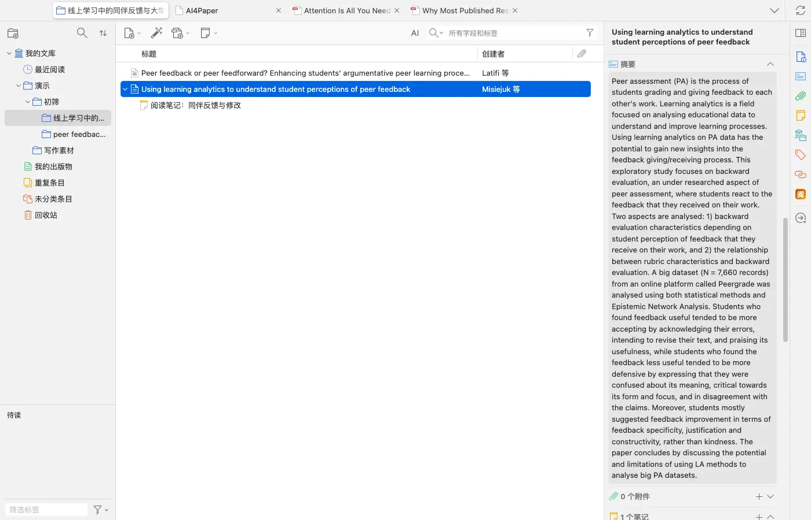
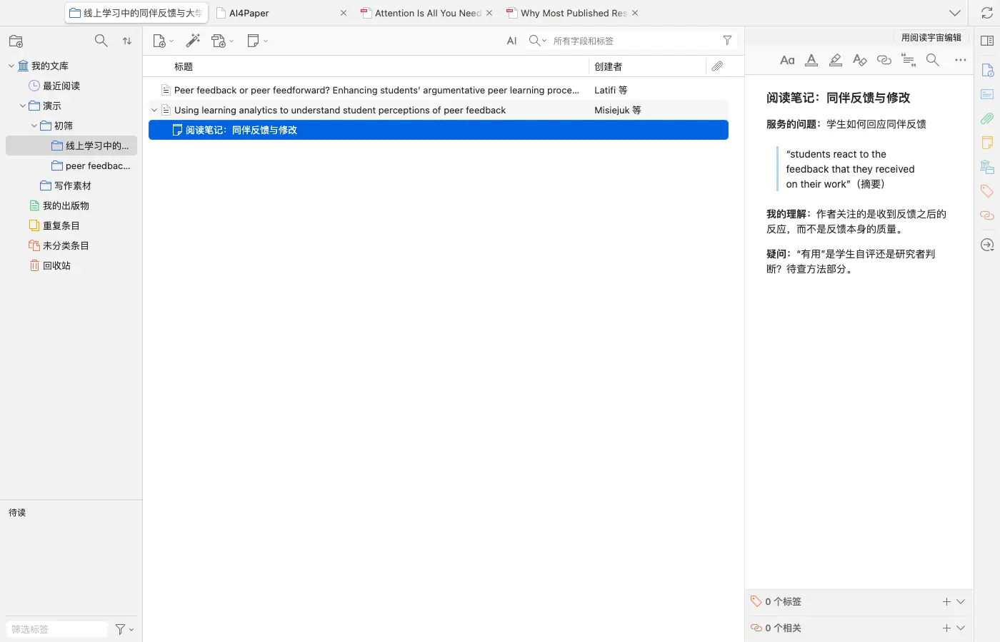
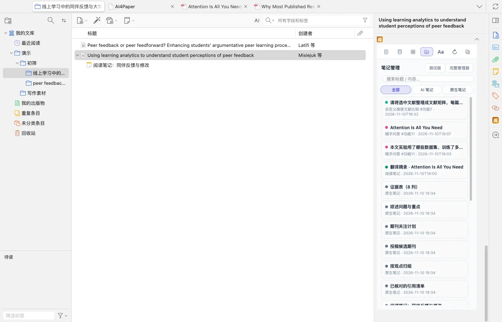
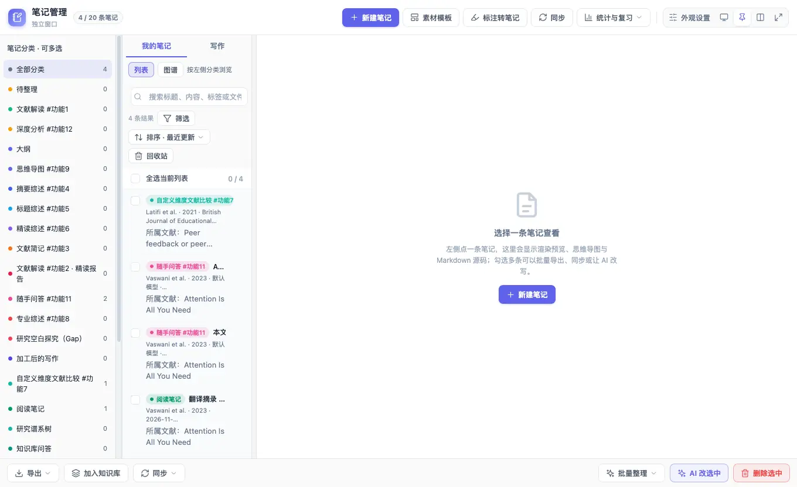
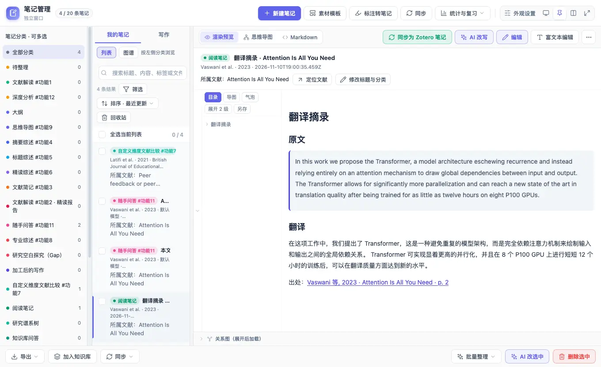

# 把笔记写成能回原文、能继续写作的材料

> 适用:Zotero 7 及以上；具体以应用内提示为准

> 资料核对日期：2026-11-11。本文操作已在真机上走通并配图；具体入口、可用功能与使用条件以当前应用内提示为准。

## 你要解决什么

好笔记不是保存更多文字，而是以后还能知道这句话来自哪里、自己为什么认为它重要。每篇先保留简要题录、原文位置、自己的理解和待确认问题，再按课题整理。AI4Paper 的「笔记管理」把 Zotero 原生笔记和 AI 笔记（随手问答、翻译摘录、文献矩阵等）放在一起查看；跨端能否看到，需要用一篇示例实际检查。

## 操作步骤

### 1. 先确定一篇笔记服务哪个问题

写下论文与你课题的关系，再决定需要记录背景、方法还是一个具体结论。先读题名和摘要，判断这篇要回答你的哪个问题。不要从第一句开始机械摘抄，也不必把每段解释都留下；先保留能帮助后续比较或写作的部分，随阅读补充。

### 2. 把原文摘录、自己的理解分开

在论文下新建一条笔记：摘录用引用格式并加引号，注明页码、章节或图表号；自己的解释另起一段，明确哪些是猜想和疑问。引用作者转述的前人研究时，标出还需要查原始出处。这样回看时能分清证据和自己的判断。

### 3. 按当前说明保存少量阅读结果

AI4Paper 里的问答、划词翻译等结果可以「保存到笔记」或「加入笔记」；实测文献矩阵的结果还会自动存进笔记管理。在右侧「阅」点笔记页，「笔记管理」会按时间列出 AI 笔记和原生笔记，可按“全部 / AI 笔记 / 原生笔记”切换、搜索标题或内容。先处理一篇示例文献，保存后重新打开确认；不把回答附来源当作已经核对。

### 4. 用课题与状态帮助查找笔记

在笔记页点「完整管理器」会打开独立的「笔记管理」窗口：左侧按笔记分类筛选（如阅读笔记、随手问答、文献解读），中间是列表、筛选和排序，顶部有新建笔记、素材模板、标注转笔记和同步。需要跨论文比较时，把相关笔记放在同一个研究问题下检查，不必为了集中阅读重复复制所有文字。

### 5. 写作前回到原文再核对一遍

点开一条笔记可以预览内容；例如「翻译摘录」笔记同时保存了原文、译文和出处，出处链接带页码，点击即可回到原文对应页。把将要使用的笔记转成论点前，打开对应原文检查范围和必要条件，并确认引用的是正确版本；仍有疑问的内容另列下一步，不混进已确认的材料。

## 常见问题

### AI 生成的笔记能否直接作为证据？

不能只凭生成结果确定证据。事实、数字、结论和出处都需自己核对；无法回查的内容只能作为待确认线索。

### 笔记很多，是否全部重写？

先处理正在写作的课题，为核心论点补上原文位置和未解问题。逐步整理比一次改变全部笔记更容易保持判断清楚。

### 换端后找不到笔记怎么办？

先检查账号和当前资料位置，再查该端的使用说明。笔记管理窗口有「同步」入口，但同步范围以页面说明为准；不要立即重复保存整批笔记，先用一篇示例确认可见范围。

## 相关教程

- [让分类管主题，让标签管阅读状态](categories-tags.md)
- [用五个问题读论文，并逐项回查](../03-read/read-and-verify.md)
- [做一张能比较研究的文献证据表](../04-write/evidence-table.md)
