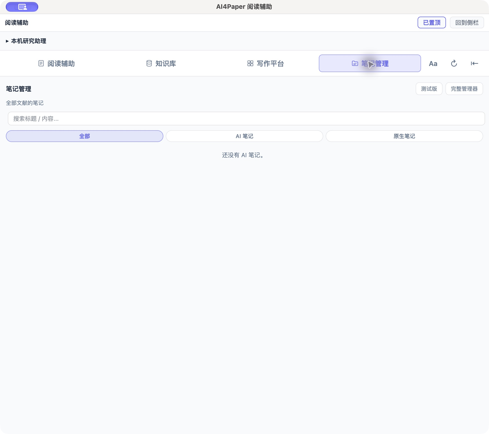

# 把笔记写成能回原文、能继续写作的材料

[中文手册首页](../README.md) · [Zotero 完整手册](../../manual/zotero-plugin.md) · [Web 完整手册](../../manual/web-workspace.md)

2026-11-26 修订。当前步骤按正式 Web、AI4Paper 10.0.31 与官网核对；本轮实际执行范围见[版本与核验](../../manual/verification.md)，未执行项目不写成成功案例。

## 你要解决什么

笔记管理与导出。先完成一个小范围练习，再扩大到真实资料。

## 前提

已有原生/AI 笔记，来源信息清楚。

## 操作步骤

1. 阅→笔记管理搜索标题/内容，切全部/AI/原生。
2. 完整管理器查看和编辑，先核原文出处，按需转原生笔记。
3. 选一条导出 Markdown/其它当前格式，在目标软件检查公式、链接和文字。
4. 第三方同步先核目标空间/方向/权限，再用公开笔记查回，勿先全量同步。

## Web 与插件入口分别看

Web 笔记页与本文笔记/素材各有位置，核当前保存空间；AI 结果不总在当前标签。

## 结果与检查

能回原文、能继续写作的笔记与可打开导出。

## 常见问题

导出不等于双向同步完成；测试版入口为可选，本轮未接第三方。

## 相关教程

- [两端主手册](../README.md)
- [插件全部功能与配置](../../manual/plugin-feature-reference.md)
- [故障排查](../../manual/troubleshooting.md)

<!-- 兼容旧版章节链接；最新操作见本页正文。 -->

