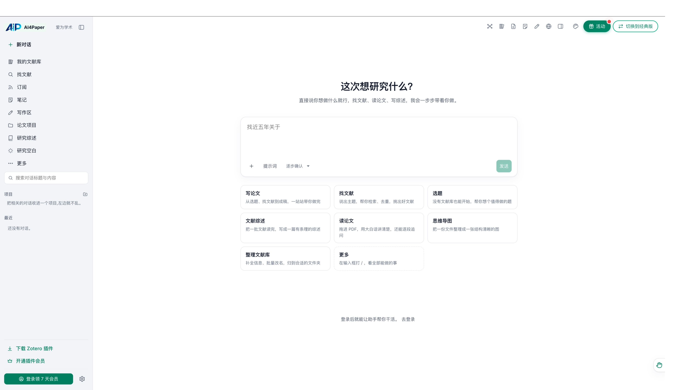

# 从第一篇文献到一份可核对的写作材料

这是阅读宇宙（AI4Paper）的中文使用手册。2026-11-26 按正式 Web、Zotero 10.0.9 与 AI4Paper 10.0.31 重写。先按你正在使用的端阅读；账号共通不等于各端本地资料自动互通。

## 你要解决什么

| 使用场景 | 直接入口 |
| --- | --- |
| 浏览器打开就用：研究助理、文库、阅读、笔记、写作 | [Web 工作台手册](../manual/web-workspace.md) |
| 在已有 Zotero 文库里安装和使用 AI4Paper | [Zotero 插件手册](../manual/zotero-plugin.md) |
| 查一个具体按钮、配置或批量工具 | [插件全部功能与配置参考](../manual/plugin-feature-reference.md)，242 条随包项目及实装补充 |
| 安装、登录、PDF、翻译、同步等异常 | [故障排查](../manual/troubleshooting.md) |
| 了解截图、精确版本和实际执行边界 | [本轮核验记录](../manual/verification.md) |

## 目录

以下旧专题地址继续有效，正文已换成当前步骤。不是只改目录或另起一套没有旧链接的教程。

### 上手

- [安装并登录，先跑通一篇文献](01-getting-started/install-and-login.md)
- [按任务认识界面，找到第一个入口](01-getting-started/ui-tour.md)
- [选网页版还是 Zotero 插件](01-getting-started/web-and-plugin.md)

### 找文献

- [用清楚的问题找到第一批文献](02-find/ai-quick-search.md)
- [按期刊信息缩小范围，再按内容选论文](02-find/filter-by-ranking.md)
- [整理已有文献，先用一小批检查导入](02-find/import-existing.md)

### 读文献

- [先读懂关键段，再选择全文翻译](03-read/translate-pdf.md)
- [让精读围绕问题，而不是堆积摘要](03-read/ai-close-reading.md)
- [用五个问题读论文，并逐项回查](03-read/read-and-verify.md)
- [围绕一组文献提问，带着来源核对](03-read/ask-your-library.md)

### 写综述与论文

- [怎么找综述：从主题词找到研究地图](04-write/find-reviews.md)
- [做一张能比较研究的文献证据表](04-write/evidence-table.md)
- [先整理证据，再核对综述草稿](04-write/one-click-review.md)
- [在 Word 或 WPS 中把引用与原文对上](04-write/cite-in-word.md)

### 选期刊

- [看懂期刊信息，再判断是否适合投稿](05-journals/ranking-and-if.md)
- [订阅少量相关期刊，持续补充新文献](05-journals/journal-alerts.md)

### 整理文库

- [让分类管主题，让标签管阅读状态](06-library/categories-tags.md)
- [先比较版本与附件，再处理重复文献](06-library/dedup.md)
- [把笔记写成能回原文、能继续写作的材料](06-library/note-management.md)

## 操作步骤

1. 选择 [Web](../manual/web-workspace.md) 或 [Zotero](../manual/zotero-plugin.md)，先确认账号与文献保存位置。
2. 用一篇[公开演示论文](https://arxiv.org/abs/1706.03762)完成导入、打开、定位和笔记，核题录与正文一致。
3. 再按任务使用检索、AI 阅读、翻译、知识库或写作。每个流程都应查回产物，不把按钮/队列当作完成。
4. 扩大到多篇前核范围、权限、费用和备份；生成内容回原文核对，整理/同步不要盲目覆盖。

## 常见问题

### 这次哪些步骤真实操作过？

实际安装正式 XPI、核版本启用、导入公开 PDF、Zotero 元数据检索、打开两端阅读器、四主面板与设置均有本轮证据。AI4Paper 产品账号尚未登录的消耗类流程、第三方同步和破坏性整理未执行。详细状态见[核验记录](../manual/verification.md)，不把官方说明冒充本轮实测结果。

### 是否每项能力在 Web 和插件中相同？

不能这样推断。手册把各端入口、数据位置与前提分开；功能地图还包含浏览器/桌面配套入口。可选模块、账号权益与文献上下文会影响显示。

### 需要拿自己的完整文库练习吗？

不用。先用公开样例和可恢复的测试资料。涉及重要资料、移动/清理、同步恢复前做好备份。不要将私人文献、账号、密钥或客户材料公开。

## 相关教程

- [Web 完整流程](../manual/web-workspace.md)
- [Zotero 完整流程](../manual/zotero-plugin.md)
- [全部功能与配置](../manual/plugin-feature-reference.md)

## 使用说明

价格、试用、会员、额度和可用版本以当前产品提示为准；本次单环境实装不等于所有平台/版本均已验收。功能是否真实可用，应以正确账号和样例操作的结果判断。

<!-- 保留旧版目录章节锚点 -->

