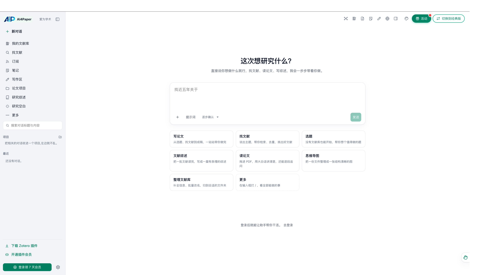

# 网页工作台:打开浏览器就能用

入口：[app.ai4paper.pro](https://app.ai4paper.pro/)。当前首次进入研究助理 `/agent`，左侧有我的文献库、找文献、订阅、笔记、写作区、论文项目、研究综述和研究空白；右上角可切经典版。

## 能做什么

导入与管理文献、阅读 PDF、翻译/AI 阅读、摘录笔记、组织素材、比较研究、起草和修订稿件、引用导出。账号/权益、资料保存位置和各端同步分别核。

## 第一次使用

1. 登录 AI4Paper 产品账号，选文献保存位置：浏览器本机、自己的文件夹或云空间。
2. 我的文献库→导入文献，先用一篇公开 PDF，核题录与正文。
3. 打开阅读器，试定位原文和记笔记，再按当前服务使用 AI。
4. 查回保存状态与输出位置，核原文后进入素材/写作。

## 完整说明

[新版 Web 完整手册](manual/web-workspace.md)覆盖入口、前提、步骤、结果、限制与排查；[本轮实际核验](manual/verification.md)区分已操作与账号未就绪项目。

[Zotero 插件手册](manual/zotero-plugin.md) · [中文手册目录](tutorials/README.md) · [桌面版](desktop-app.md)
